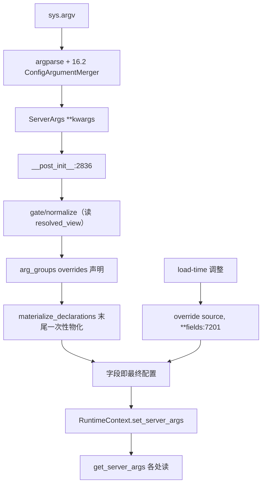

# 16.1 ServerArgs/PortArgs

## 定位

`server_args.py` 定义 SGLang 的核心配置 dataclass `ServerArgs` 与端口分组 `PortArgs`，以及把命令行/YAML 解析成 `ServerArgs` 的 `prepare_server_args`。它是全进程配置真相源，遵守 [16.3 RuntimeContext](16.3-runtime-context.md) 的 resolve-at-end 契约：`__post_init__` 结束后字段即最终配置。`ServerArgs` 体量极大（约 8000 行），涵盖模型、并行、调度、KV cache、量化、投机、分离、compiler、metrics 等全部开关。

## 职责

- 持有数百个配置字段，通过 `A`/`Arg` 元数据（[16.5 arg_groups](16.5-arg-groups.md)）派生 argparse CLI。
- `__post_init__` 执行 resolve-at-end：模型覆盖声明（`MODEL_OVERRIDES`/`@register_model_override`）→ 规范化 pass → 写入 provenance stash → `materialize_declarations()` 一次性物化。
- `_handle_model_capability_adjustments` 在解析期按模型能力调整字段。
- `override(source, **fields)` 是 resolution 后唯一安全写入入口，记录 provenance、维护白名单一致性、可绕过 strict guard。
- `PortArgs` 把所有端口（HTTP、metrics、ZMQ 拨号端口等）聚合成一个子 dataclass。
- `set_global_server_args_for_scheduler`/`get_global_server_args` 是 `RuntimeContext.set_server_args`/`get_server_args` 的旧 shim（call-site 数受 ratchet 限制）。

## 关键类与函数

| 名称 | 定义位置 | 说明 |
|---|---|---|
| `ServerArgs` | `python/sglang/srt/server_args.py:410` | 主配置 dataclass |
| `ServerArgs.__post_init__` | `python/sglang/srt/server_args.py:2836` | resolve-at-end 入口，末尾 `materialize_declarations` |
| `ServerArgs._handle_model_capability_adjustments` | `python/sglang/srt/server_args.py:3030` | 按模型能力调整字段 |
| `ServerArgs.override` | `python/sglang/srt/server_args.py:7201` | resolution 后唯一安全写入入口 |
| strict guard 触发点 | `python/sglang/srt/server_args.py:7246` | `SGLANG_STRICT_CONFIG_MUTATION=1` 时裸赋值抛错 |
| `set_global_server_args_for_scheduler` | `python/sglang/srt/server_args.py:7922` | 旧 shim，转发到 `RuntimeContext.set_server_args` |
| `get_global_server_args` | `python/sglang/srt/server_args.py:7933` | 旧 shim，转发到 `RuntimeContext.get_server_args` |
| `prepare_server_args` | `python/sglang/srt/server_args.py:7967` | CLI→`ServerArgs` 解析入口 |
| `PortArgs` | `python/sglang/srt/server_args.py:8011` | 端口分组 dataclass |

## 数据流 / 控制流

`prepare_server_args` 组装 argparse（经 `add_cli_args_from_dataclass`），把 `--config` YAML 合并（[16.2](16.2-server-args-config-parser.md)），再构造 `ServerArgs`。`__post_init__` 中段代码读 `resolved_view(server_args)`（只读视图），声明写入 stash，最后 `materialize_declarations` 按门顺序 last-writer-wins 物化。`ServerArgs(model_path="dummy")` 会 early-return（不物化、不触发 strict guard），用于轻量 fixture。

## 交叉引用

- 详见: [16.2 config parser](16.2-server-args-config-parser.md) — YAML 合并
- 详见: [16.3 RuntimeContext](16.3-runtime-context.md) — `set/get_server_args` 落点
- 详见: [16.5 arg_groups](16.5-arg-groups.md) — CLI 派生 + 覆盖声明
- 下游: [`04.1 ModelRunner`](../04-model-execution/04.1-model-runner.md) / [`03.4.2 Scheduler init`](../03-orchestration/03.4.2-scheduler-init.md) — 消费 `ServerArgs`
- 相关: [`16.4 environ`](16.4-environ.md) — `SGLANG_STRICT_CONFIG_MUTATION`
- 相关 skill: `.claude/skills/sglang-runtime-context`、`.claude/skills/large-class-style`

## 进一步阅读

- 源码: `python/sglang/srt/server_args.py`
- 类: `python/sglang/srt/server_args.py:410`
- override: `python/sglang/srt/server_args.py:7201`
