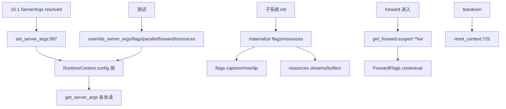

# 16.3 RuntimeContext

## 定位

`runtime_context.py` 的 `RuntimeContext` 是 SGLang 进程静态运行时状态的唯一容器（`get_context()` 单例）。它把配置、运行标志、资源、per-forward 标志、并行拓扑分层管在同一对象上，给调用方"一个 import + 一套命名"取代散落的 free function。本页是 `.claude/skills/sglang-runtime-context` 的代码侧落地说明。

## 职责

- **config 层**：`get_server_args()` 返回全进程**已 resolved** 的 `ServerArgs`；发布走 `set_server_args`/`override_server_args`；旧 `get_global_server_args` 是其 shim。
- **runtime flags 层**：`get_flags()` 持有非配置纯函数的状态：`CaptureFlags`（cuda-graph 生命周期）、`MoeFlags`（ACTIVE 后端，可换）、`DpFlags`（DP-attention）。
- **resources 层**：`get_resources()` + `get_stream(name)`/`get_buffer(name, factory)` 持有图池、EPLB、EP dispatcher、命名 side stream、workspace buffer。
- **per-forward 层**：`get_forward()` contextvar-backed，`scoped(**kw)` 事务性写并退出恢复；TBO 在单线程交错。
- **parallel 层**：`get_parallel()` 透传 `parallel_state`/`dp_attention` 的拓扑 getter，测试用 `override()`。
- `reset_context()` 用于测试 teardown。

## 关键类与函数

| 名称 | 定义位置 | 说明 |
|---|---|---|
| `ParallelContext` | `python/sglang/srt/runtime_context.py:102` | tp/pp/moe/attn/cp/dp 拓扑透传，`override` 测试 |
| `_FlagGroupBase` | `python/sglang/srt/runtime_context.py:266` | flags 组基类，`override(**kw)` 事务 |
| `CaptureFlags` | `python/sglang/srt/runtime_context.py:304` | cuda-graph 生命周期标志 |
| `MoeFlags` | `python/sglang/srt/runtime_context.py:318` | ACTIVE MoE 后端 |
| `DpFlags` | `python/sglang/srt/runtime_context.py:341` | DP-attention 运行标志 |
| `Flags` | `python/sglang/srt/runtime_context.py:361` | flags 总装 |
| `Resources` | `python/sglang/srt/runtime_context.py:376` | 资源槽 + 命名 stream/buffer |
| `ForwardFlags` | `python/sglang/srt/runtime_context.py:409` | per-forward contextvar，`scoped` |
| `RuntimeContext` | `python/sglang/srt/runtime_context.py:536` | 单例容器 |
| `RuntimeContext.set_server_args` | `python/sglang/srt/runtime_context.py:587` | 发布 `ServerArgs` |
| `RuntimeContext.override_server_args` | `python/sglang/srt/runtime_context.py:603` | 测试用配置覆盖（scoped） |
| `_ServerArgsOverride` | `python/sglang/srt/runtime_context.py:623` | override_server_args 的句柄 |
| `get_context` | `python/sglang/srt/runtime_context.py:689` | 返回单例 |
| `get_parallel`/`get_server_args`/`get_flags`/`get_resources`/`get_forward` | `python/sglang/srt/runtime_context.py:693`/`:697`/`:701`/`:705`/`:709` | 各层访问器 |
| `get_stream`/`get_buffer` | `python/sglang/srt/runtime_context.py:713`/`:721` | 命名 stream/buffer |
| `reset_context` | `python/sglang/srt/runtime_context.py:725` | 测试 teardown |

## 数据流 / 控制流

resolve-at-end 契约：`ServerArgs.__post_init__` 末尾物化后，字段即最终配置；任何进程任何时刻可直接读字段。resolution 后唯一写入入口是 `ServerArgs.override(source, **fields)`（[16.1](16.1-server-args-port-args.md)），裸赋值在 `SGLANG_STRICT_CONFIG_MUTATION=1`（测试默认开）下抛错。运行标志在各子系统 init 时物化（如 `initialize_moe_config` 写 `flags.moe`），per-forward 标志用 contextvar 配合 `scoped`。资源 lease 必须在 init/warmup 时建立（cuda graph capture 外）。

## 交叉引用

- 上游: [16.1 ServerArgs](16.1-server-args-port-args.md) — config 层对象
- 上游: [16.4 environ](16.4-environ.md) — `SGLANG_STRICT_CONFIG_MUTATION`
- 下游: [`04.5 runner_components`](../04-model-execution/04.5-runner-components.md) / [`03.4.2 Scheduler init`](../03-orchestration/03.4.2-scheduler-init.md) — 物化 flags/resources
- 下游: [`08 并行`](../08-distributed/index.md) — `get_parallel` 透传拓扑
- 相关 skill: `.claude/skills/sglang-runtime-context`

## 进一步阅读

- 源码: `python/sglang/srt/runtime_context.py`
- 容器: `python/sglang/srt/runtime_context.py:536`
- 守卫测试: `test/registered/unit/test_runtime_context.py`
