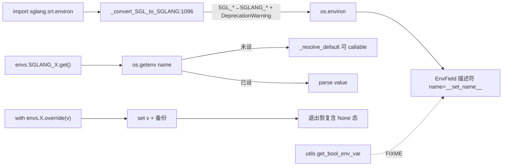

# 16.4 environ

## 定位

`python/sglang/srt/environ.py` 是 SGLang 所有自管环境变量的中央注册表。`Envs` 类用 `EnvField` 描述符集中定义 `SGLANG_*`（及对齐的上游前缀如 `MOONCAKE_*`/`ASCEND_*`），强制走 `.get()`/`.set()`/`.override()` API，杜绝裸 `os.environ` 读写。`SGL_*` 在 import 时自动迁移为 `SGLANG_*` 并发 `DeprecationWarning`。本模块刻意只依赖 stdlib，加载极早。

## 职责

- `EnvField` 及类型子类（`EnvBool`/`EnvInt`/`EnvFloat`/`EnvStr`/`EnvTuple`）提供解析、默认、set-to-None 区分、`override()` context manager。
- `Envs` 类按 section 注释组织全部条目，含 `SGLANG_STRICT_CONFIG_MUTATION`、`SGLANG_ENABLE_JIT_DEEPGEMM`、`SGLANG_FORCE_FUSED_OP_BACKEND`、`SGLANG_PLATFORM`、`SGLANG_PLUGINS` 等。
- `__bool__`/`__len__` 故意抛错，强制 `.get()`。
- `_convert_SGL_to_SGLANG` import 时把 `SGL_*` 改写为 `SGLANG_*`；`_print_deprecated_env`/`_warn_deprecated_env_to_cli_flag` 处理重命名与 env→CLI 迁移。
- `temp_set_env`（在 `utils/common.py`）仅供非 sglang 键，显式拒绝 `SGLANG_*`/`SGL_*`。

## 关键类与函数

| 名称 | 定义位置 | 说明 |
|---|---|---|
| `EnvField` | `python/sglang/srt/environ.py:28` | 描述符基类，`get`/`set`/`clear`/`is_set`/`override` |
| `EnvField.__bool__` | `python/sglang/srt/environ.py:94` | 故意抛错，强制 `.get()` |
| `EnvField.override` | `python/sglang/srt/environ.py:77` | 测试用 context manager，恢复含 None 态 |
| `_default_hip` | `python/sglang/srt/environ.py:11` | 惰性 ROCm 探测，给平台相关默认值 |
| `Envs` | `python/sglang/srt/environ.py:200` | 全部条目宿主 |
| `SGLANG_STRICT_CONFIG_MUTATION` | `python/sglang/srt/environ.py:204` | 裸 config 赋值守卫 |
| `SGLANG_ENABLE_JIT_DEEPGEMM` | `python/sglang/srt/environ.py:654` | JIT DeepGEMM 开关 |
| `SGLANG_FORCE_FUSED_OP_BACKEND` | `python/sglang/srt/environ.py:711` | fused op 后端强制 |
| `SGLANG_PLATFORM` | `python/sglang/srt/environ.py:1050` | 平台选择 |
| `SGLANG_PLUGINS` | `python/sglang/srt/environ.py:1051` | 通用插件白名单 |
| `envs = Envs()` | `python/sglang/srt/environ.py:1072` | 进程单例 |
| `_print_deprecated_env` | `python/sglang/srt/environ.py:1076` | 旧名→新名/移除告警 |
| `_warn_deprecated_env_to_cli_flag` | `python/sglang/srt/environ.py:1087` | env→CLI 迁移告警 |
| `_convert_SGL_to_SGLANG` | `python/sglang/srt/environ.py:1096` | import 时 `SGL_*`→`SGLANG_*` |

## 数据流 / 控制流

`__set_name__` 把字段名绑成环境变量名；`get()` 读 `os.getenv`，未设走 `_resolve_default`（支持 callable 做平台惰性默认），解析失败回退默认并 warn。`override(v)` 在进入时 `set`、退出按备份恢复（区分"未设"与"显式 None"）。`SGL_*` 在 import 阶段被批量改写。`.claude/skills/env-var-conventions` 规定：新 `SGLANG_*` 必须进 `Envs`；前缀动词分 `ENABLE_/DISABLE_/USE_/FORCE_/LOG_/TEST_/DEBUG_/OPT_`；`DISABLE_FOO=EnvBool(True)` 双重否定被禁。

## 交叉引用

- 上游: [16.1 ServerArgs](16.1-server-args-port-args.md) — `SGLANG_STRICT_CONFIG_MUTATION` 触发点
- 上游: [16.3 RuntimeContext](16.3-runtime-context.md) — `get_server_args` 守卫
- 下游: [`15.7 deep_gemm`](../15-kernels-hardware/15.7-deep-gemm-wrapper.md) — `SGLANG_ENABLE_JIT_DEEPGEMM`
- 下游: [`15.3 kernels`](../15-kernels-hardware/15.3-kernels-namespace.md) — `SGLANG_FORCE_FUSED_OP_BACKEND`
- 下游: [`15.5 platforms`](../15-kernels-hardware/15.5-platforms.md) / [16.7 plugins](16.7-plugins.md) — `SGLANG_PLATFORM`/`SGLANG_PLUGINS`
- 相关: [16.9 global_config legacy](16.9-global-config-legacy.md) — FIXME 指向本模块
- 相关 skill: `.claude/skills/env-var-conventions`

## 进一步阅读

- 源码: `python/sglang/srt/environ.py`
- 规范 skill: `.claude/skills/env-var-conventions/SKILL.md`
- 旧 helper FIXME: `python/sglang/srt/utils/common.py:1226`
