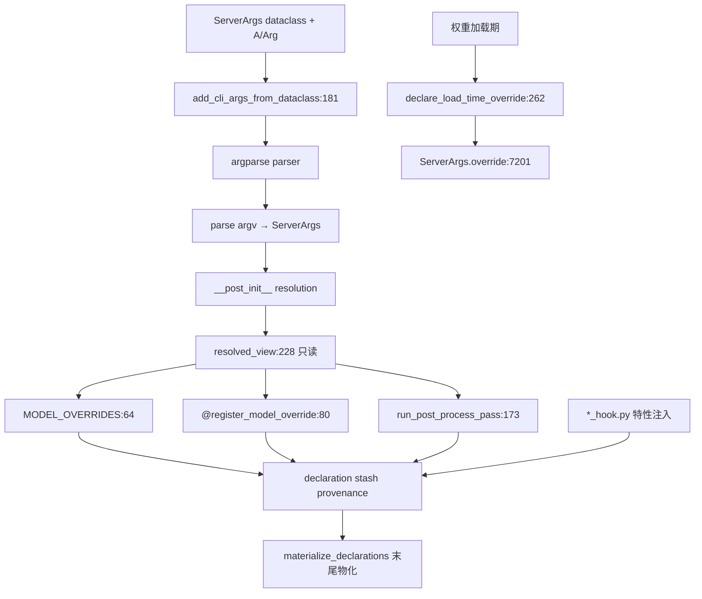

# 16.5 arg_groups

## 定位

`python/sglang/srt/arg_groups/` 把 `ServerArgs` dataclass 的 CLI 派生、模型覆盖声明、特性 hook 集中管理。`arg_utils.py` 用 `Annotated` 元数据自动从 dataclass 字段生成 argparse 参数；`overrides.py` 用声明式注册表替代历史上的命令式 `server_args.x = ...`；若干 `*_hook.py` 在 resolution 流水线注入特性相关字段。

## 职责

- `arg_utils.py`：`A`（`Annotated` 别名）、`Arg`（CLI 元数据 frozen dataclass）、`resolvable_fields`（resolve 白名单）、`add_cli_args_from_dataclass`（自动派生 argparse）。
- `overrides.py`：`MODEL_OVERRIDES`（常量 per-arch）+ `@register_model_override`（派生）+ `run_post_process_pass`（规范化 pass）+ `resolved_view`（resolution 内只读视图）+ `declare_load_time_override`（权重加载期声明）。
- `argparse_actions.py`：自定义 argparse action。
- `overrides.py` 之外的 hook：`speculative_hook.py`、`pd_disaggregation_hook.py`、`deepseek_v4_hook.py`、`hisparse_hook.py`，在 resolution 阶段为对应特性注入/调整字段。
- 所有声明最终经 `materialize_declarations` 在 `ServerArgs.__post_init__` 末尾物化（[16.1](16.1-server-args-port-args.md)）。

## 关键类与函数

| 名称 | 定义位置 | 说明 |
|---|---|---|
| `A` | `python/sglang/srt/arg_groups/arg_utils.py:58` | `Annotated` 别名 |
| `Arg` | `python/sglang/srt/arg_groups/arg_utils.py:62` | CLI 元数据（help/choices/aliases/cli_name/type_parser/nargs） |
| `resolvable_fields` | `python/sglang/srt/arg_groups/arg_utils.py:86` | resolve 白名单（`Arg(resolvable=True)`） |
| `add_cli_args_from_dataclass` | `python/sglang/srt/arg_groups/arg_utils.py:181` | 自动派生 argparse 参数 |
| `MODEL_OVERRIDES` | `python/sglang/srt/arg_groups/overrides.py:64` | 常量 per-arch 覆盖字典 |
| `register_model_override` | `python/sglang/srt/arg_groups/overrides.py:80` | 派生覆盖装饰器 |
| `register_model_override_predicate` | `python/sglang/srt/arg_groups/overrides.py:97` | 谓词触发覆盖 |
| `run_post_process_pass` | `python/sglang/srt/arg_groups/overrides.py:173` | 规范化 pass（读 view 返回声明） |
| `resolved_view` | `python/sglang/srt/arg_groups/overrides.py:228` | resolution 内只读视图 |
| `declare_load_time_override` | `python/sglang/srt/arg_groups/overrides.py:262` | 权重加载期声明（校验白名单→`override`） |
| `_disable_overlap_schedule_for_cpu` | `python/sglang/srt/arg_groups/speculative_hook.py:14` | speculative hook 示例 |

## 子模块树

- `arg_groups/`
  - `arg_utils.py` — `A`/`Arg`/`add_cli_args_from_dataclass`/`resolvable_fields`
  - `argparse_actions.py` — 自定义 argparse action
  - `overrides.py` — 声明式模型覆盖注册表与 pass
  - `speculative_hook.py` — 投机解码 resolution hook
  - `pd_disaggregation_hook.py` — PD 分离 hook
  - `deepseek_v4_hook.py` — DeepSeek V4 hook
  - `hisparse_hook.py` — HiSparse hook

## 数据流 / 控制流

`add_cli_args_from_dataclass` 从 dataclass 字段的 `Annotated` 元数据（裸 `str` 等价 `Arg(help=...)`）构建 argparse。resolution 内 hook 读 `resolved_view`、写声明 stash（不直接写字段）。声明对非白名单字段会在其 slot 失败。`declare_load_time_override` 用于只能在权重加载期确知的值，校验白名单后路由到 `override`。`.claude/skills/sglang-runtime-context` 给出"load-time vs resolution-time"约束：读可扩展注册表的逻辑不能进 resolution。

## 交叉引用

- 上游: [16.1 ServerArgs](16.1-server-args-port-args.md) — 被 hook 的 dataclass
- 上游: [16.3 RuntimeContext](16.3-runtime-context.md) — resolve-at-end 契约
- 相关: [16.6 模型配置](16.6-model-configs.md) — override 按 `hf_config.architectures` 键
- 相关: [`10 投机解码`](../10-speculative/index.md) / [`09 分离`](../09-disaggregation/index.md) — 特性 hook 来源
- 相关 skill: `.claude/skills/sglang-runtime-context`

## 进一步阅读

- 源码: `python/sglang/srt/arg_groups/`
- 自动 CLI: `python/sglang/srt/arg_groups/arg_utils.py:181`
- 覆盖注册: `python/sglang/srt/arg_groups/overrides.py:64`
