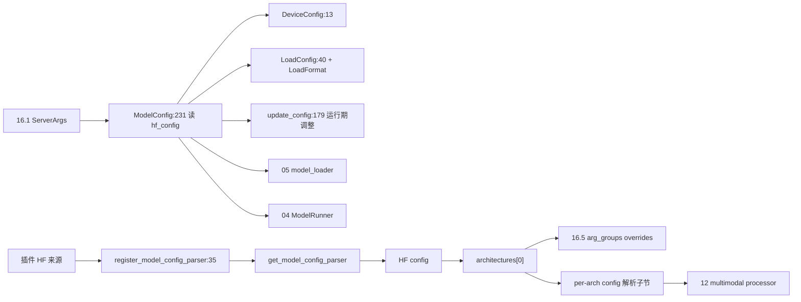

# 16.6 模型配置

## 定位

`python/sglang/srt/configs/` 承载 SGLang 的模型/设备/加载配置与每架构专属 config。`ModelConfig`/`DeviceConfig`/`LoadConfig` 是三块基础结构，约 50 个 per-arch config 文件为多模态/MoE/混合架构模型解析 HF config 子节，`model_config_parser_registry.py` 提供命名解析器注册表以支持插件扩展 HF config 来源。

## 职责

- `model_config.py`：`ModelConfig`（上下文长度、dtype、架构识别、attention arch、hugging face config 解析与校验）、`AttentionArch`/`ModelImpl` 枚举、大量架构探测 helper（`is_deepseek_dsa`/`is_deepseek_v4`/`is_minimax_sparse`/`is_hybrid_swa_model`/`get_hybrid_layer_ids` 等）。
- `device_config.py`：`DeviceConfig` 设备选择与能力。
- `load_config.py`：`LoadFormat` 枚举（含 `PRIVATE` 私有加载入口）、`LoadConfig`。
- `update_config.py`：运行期改 `ModelConfig` 的 helper（`update_config`、`adjust_tp_num_heads_if_necessary`、`update_intermediate_size`、`resolve_head_dim`）。
- 约 50 个 per-arch config：`deepseek_v4.py`/`deepseek_ocr.py`/`deepseekvl2.py`、`qwen3_*`、`kimi_*`、`step3*`、`lfm2*`、`falcaon_h1`/`granitemoehybrid`/`cohere2_moe`/`dbrx`、`minimax_vl`/`minicpmv4_6`、`janus_pro`/`dots_*`/`nemotron_h`/`nano_nemotron_vl`、`hybrid_arch.py`/`mamba_utils.py`/`linear_attn_model_registry.py` 等。
- `model_config_parser_registry.py`：`ModelConfigParserBase` ABC + `register_model_config_parser`/`get_model_config_parser`，镜像 `LoadFormat.PRIVATE` 的注册表式逃避。
- `utils.py`：`register_image_processor`/`register_processor`。

## 关键类与函数

| 名称 | 定义位置 | 说明 |
|---|---|---|
| `AttentionArch` | `python/sglang/srt/configs/model_config.py:76` | MHA/MLA/DSA 等 |
| `ModelImpl` | `python/sglang/srt/configs/model_config.py:81` | 模型实现选择 |
| `ModelConfig` | `python/sglang/srt/configs/model_config.py:231` | 模型配置主体 |
| `_get_and_verify_dtype` | `python/sglang/srt/configs/model_config.py:1592` | dtype 校验 |
| `is_hybrid_swa_model` | `python/sglang/srt/configs/model_config.py:1895` | 混合 SWA 探测 |
| `get_hybrid_layer_ids` | `python/sglang/srt/configs/model_config.py:1934` | 混合层 ID |
| `DeviceConfig` | `python/sglang/srt/configs/device_config.py:13` | 设备配置 |
| `LoadFormat` | `python/sglang/srt/configs/load_config.py:17` | 加载格式枚举，`PRIVATE` 在 `:35` |
| `LoadConfig` | `python/sglang/srt/configs/load_config.py:40` | 加载配置 |
| `update_config` | `python/sglang/srt/configs/update_config.py:179` | 改 `ModelConfig` 字段 |
| `ModelConfigParserBase` | `python/sglang/srt/configs/model_config_parser_registry.py:20` | 解析器 ABC |
| `register_model_config_parser` | `python/sglang/srt/configs/model_config_parser_registry.py:35` | 注册装饰器 |
| `get_model_config_parser` | `python/sglang/srt/configs/model_config_parser_registry.py:55` | 按名取解析器 |

## 子模块树

- `configs/`
  - 基础: `model_config.py`/`device_config.py`/`load_config.py`/`update_config.py`/`utils.py`
  - 注册: `model_config_parser_registry.py`/`linear_attn_model_registry.py`
  - per-arch: 约 50 文件（见 `__init__.py` 导入清单）
  - 辅助: `hybrid_arch.py`/`mamba_utils.py`/`modelopt_config.py`

`__init__.py` 把约 50 个 per-arch config 类集中导出，供 [05 模型加载](../05-model-loading/index.md) 与 [12 多模态](../12-multimodal/index.md) 消费。

## 数据流 / 控制流

`ModelConfig` 由 `ServerArgs` 驱动，读 HF config 并按架构识别 attention arch / dtype / 上下文长度；per-arch config 文件解析模型专属子节（如视觉编码器、MoE 路由）。`update_config` 在 TP/加载调整后修正 `ModelConfig` 字段。插件可经 `register_model_config_parser` 注入自定义 HF config 来源（如私有存储）。

## 交叉引用

- 上游: [16.1 ServerArgs](16.1-server-args-port-args.md) — 驱动 `ModelConfig`
- 上游: [16.5 arg_groups](16.5-arg-groups.md) — `MODEL_OVERRIDES` 按 arch 键
- 下游: [`05 模型加载`](../05-model-loading/index.md) — `ModelConfig` + `LoadConfig`
- 下游: [`12 多模态`](../12-multimodal/index.md) — per-arch processor
- 下游: [`04.1 ModelRunner`](../04-model-execution/04.1-model-runner.md) — 消费 `ModelConfig`

## 进一步阅读

- 源码: `python/sglang/srt/configs/`
- 主体: `python/sglang/srt/configs/model_config.py:231`
- 解析器注册: `python/sglang/srt/configs/model_config_parser_registry.py:20`
