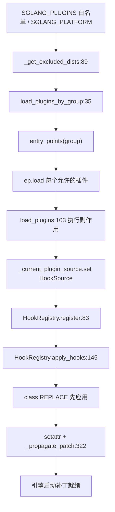

# 16.7 plugins 框架

## 定位

`python/sglang/srt/plugins/` 是 SGLang 统一插件框架，支持两类 setuptools `entry_points`：`sglang.srt.platforms`（硬件平台，见 [15.5 platforms](15.5-platforms.md)）与 `sgl.srt.plugins`（通用插件，注入 hook/替换类）。通用插件经 `HookRegistry` 在引擎启动前 monkey-patch 任意函数/方法/类。`SGLANG_PLUGINS` 提供白名单，`SGLANG_PLATFORM` 选择平台时自动屏蔽未选平台的通用插件。

## 职责

- `__init__.py`：`load_plugins_by_group` 发现+加载插件（支持 `SGLANG_PLUGINS` 白名单与 `excluded_dists`）；`_get_excluded_dists` 在 `SGLANG_PLATFORM` 设置时算出未选平台 dist；`load_plugins` 幂等地执行所有通用插件并 `apply_hooks`。
- `hook_registry.py`：`HookType`（BEFORE/AFTER/AROUND/REPLACE）、`HookRegistry.register`/`apply_hooks`/`reset`、`HookSource` 标注来源、`plugin_hook` 装饰器、`_propagate_patch` 把补丁同步到 `from X import Y` 的 stale 绑定。
- class REPLACE 先于方法级 hook 应用，保证后续方法 hook 对替换类解析。
- 平台插件走 `activate()` 返回 qualname，通用插件用副作用注册 hook。

## 关键类与函数

| 名称 | 定义位置 | 说明 |
|---|---|---|
| `PLATFORM_PLUGINS_GROUP` | `python/sglang/srt/plugins/__init__.py:28` | `sglang.srt.platforms` |
| `GENERAL_PLUGINS_GROUP` | `python/sglang/srt/plugins/__init__.py:29` | `sglang.srt.plugins` |
| `load_plugins_by_group` | `python/sglang/srt/plugins/__init__.py:35` | 发现+加载，支持白名单/排除 |
| `_get_excluded_dists` | `python/sglang/srt/plugins/__init__.py:89` | `SGLANG_PLATFORM` 下未选平台 dist |
| `load_plugins` | `python/sglang/srt/plugins/__init__.py:103` | 幂等执行通用插件 + `apply_hooks` |
| `HookSource` | `python/sglang/srt/plugins/hook_registry.py:38` | plugin_name/dist_name |
| `HookType` | `python/sglang/srt/plugins/hook_registry.py:60` | BEFORE/AFTER/AROUND/REPLACE |
| `HookRegistry` | `python/sglang/srt/plugins/hook_registry.py:69` | 全局 hook 注册表 |
| `HookRegistry.register` | `python/sglang/srt/plugins/hook_registry.py:83` | 注册 hook |
| `HookRegistry.apply_hooks` | `python/sglang/srt/plugins/hook_registry.py:145` | 实际 monkey-patch |
| `_propagate_patch` | `python/sglang/srt/plugins/hook_registry.py:322` | 同步 stale `from X import Y` 绑定 |
| `_wrap_fn` | `python/sglang/srt/plugins/hook_registry.py:352` | 按 hook 类型造 wrapper |
| `plugin_hook` | `python/sglang/srt/plugins/hook_registry.py:399` | 装饰器注册 |

## 数据流 / 控制流

`load_plugins` 进程幂等（`_plugins_loaded` 守卫）。每个通用插件在 `_current_plugin_source` contextvar 内执行，`HookRegistry.register` 自动读取来源。`apply_hooks` 按 `_target_sort_key` 把 class REPLACE 排在前面（tier 0），再处理方法级 hook；`_wrap_fn` 按 `REPLACE/BEFORE/AFTER/AROUND` 造 wrapper，REPLACE 先排序使其他 hook wrap 替换后函数。`_propagate_patch` 遍历 `sys.modules` 修复 `from X import Y` 的 stale 引用。`SGLANG_PLATFORM` 设置时未选平台 dist 的通用插件被排除，避免拖入其硬件依赖。

## 交叉引用

- 上游: [`15.5 platforms`](../15-kernels-hardware/15.5-platforms.md) — `sglang.srt.platforms` 组与 `current_platform`
- 上游: [16.4 environ](16.4-environ.md) — `SGLANG_PLUGINS`/`SGLANG_PLATFORM`
- 下游: 各子系统类均可被 hook（如 `Scheduler`/`ModelRunner`/注意力后端）
- 相关: [`00.4 进程模型`](../00-overview/00.4-process-model.md) — 各进程 `load_plugins` 调用时机

## 进一步阅读

- 源码: `python/sglang/srt/plugins/`
- 框架入口: `python/sglang/srt/plugins/__init__.py:103`
- hook 注册: `python/sglang/srt/plugins/hook_registry.py:69`
