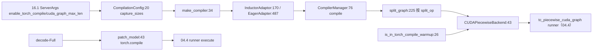

# 16.8 compilation

## 定位

`python/sglang/srt/compilation/` 管 SGLang 的 `torch.compile` 集成与 piecewise/breakable cuda graph。它把 `CompilationConfig`、inductor pass、piecewise 后端、torch.compile decoration、FX 工具集中，配合 [`04.4 Runners`](../04-model-execution/04.4-runners.md) 的 `tc_piecewise_cuda_graph` runner 与 decode-Full torch.compile 路径，在 prefill/extend 阶段把模型 forward 切图编译。

## 职责

- `compilation_config.py`：`CompilationConfig`（capture_sizes/compiler/enable_debug_mode/split_ops）+ `register_split_op`。
- `compiler_interface.py`：`CompilerInterface` ABC、`InductorAdaptor`（torch.compile/inductor 桥）、`EagerAdapter`、`AlwaysHitShapeEnv`、`set_inductor_config`。
- `backend.py`：`make_compiler`/`make_backend`、`CompilerManager`、`split_graph`、`PiecewiseCompileInterpreter`、`SGLangBackend`、`SplitItem`。
- `cuda_piecewise_backend.py`：`CUDAPiecewiseBackend`/`ConcreteSizeEntry`；`npu_piecewise_backend.py`/`xpu_piecewise_backend.py` 子类化。
- `inductor_pass.py`：`PassContext`、`InductorPass`/`SGLangInductorPass`/`CallableInductorPass`/`PrinterInductorPass`；`pass_manager.py` `PostGradPassManager`；`fix_functionalization.py` `FixFunctionalizationPass`。
- `compile.py`：`IntermediateTensors`、`install_torch_compiled`（`torch.compile` 包装）、dynamic dim 标记。
- `torch_compile_decoration.py`：`patch_model`/`set_torch_compile_config`；`compile_phase.py` torch.compile warmup 状态。

## 关键类与函数

| 名称 | 定义位置 | 说明 |
|---|---|---|
| `CompilationConfig` | `python/sglang/srt/compilation/compilation_config.py:20` | capture_sizes/compiler/split_ops |
| `register_split_op` | `python/sglang/srt/compilation/compilation_config.py:10` | 注册切图算子到 `SPLIT_OPS` |
| `CompilerInterface` | `python/sglang/srt/compilation/compiler_interface.py:22` | 编译器 ABC |
| `InductorAdaptor` | `python/sglang/srt/compilation/compiler_interface.py:170` | torch.compile/inductor 桥 |
| `EagerAdapter` | `python/sglang/srt/compilation/compiler_interface.py:487` | eager 回退 |
| `set_inductor_config` | `python/sglang/srt/compilation/compiler_interface.py:479` | inductor 配置 |
| `make_compiler`/`make_backend` | `python/sglang/srt/compilation/backend.py:34`/`:43` | 工厂 |
| `CompilerManager` | `python/sglang/srt/compilation/backend.py:76` | 编译管理 |
| `split_graph` | `python/sglang/srt/compilation/backend.py:225` | 按 split_op 切图 |
| `SGLangBackend` | `python/sglang/srt/compilation/backend.py:366` | 自定义 backend |
| `CUDAPiecewiseBackend` | `python/sglang/srt/compilation/cuda_piecewise_backend.py:43` | piecewise 后端主体 |
| `NPUPiecewiseBackend`/`XPUPiecewiseBackend` | `python/sglang/srt/compilation/npu_piecewise_backend.py:16`/`xpu_piecewise_backend.py:19` | 平台子类 |
| `InductorPass`/`SGLangInductorPass` | `python/sglang/srt/compilation/inductor_pass.py:50`/`:116` | 自定义图 pass |
| `PostGradPassManager` | `python/sglang/srt/compilation/pass_manager.py:20` | grad 后 pass 管理 |
| `IntermediateTensors` | `python/sglang/srt/compilation/compile.py:20` | PP 中间张量（手写 `__init__` 防丢失源文件信息） |
| `install_torch_compiled` | `python/sglang/srt/compilation/compile.py:150` | `torch.compile` 包装入口 |
| `patch_model` | `python/sglang/srt/compilation/torch_compile_decoration.py:43` | decode-Full torch.compile 改造 |
| `is_in_torch_compile_warmup` | `python/sglang/srt/compilation/compile_phase.py:26` | warmup 阶段标志 |

## 子模块树

- `compilation/`
  - `compilation_config.py`/`compilation_counter.py` — 配置与计数
  - `compiler_interface.py` — 编译器 ABC 与 inductor/eager 适配
  - `backend.py` — 编译管理/切图/解释器/自定义 backend
  - `cuda_piecewise_backend.py`/`npu_piecewise_backend.py`/`xpu_piecewise_backend.py` — piecewise 后端
  - `inductor_pass.py`/`pass_manager.py`/`fix_functionalization.py` — 自定义 pass
  - `compile.py` — `IntermediateTensors` + `install_torch_compiled`
  - `torch_compile_decoration.py`/`compile_phase.py` — decoration 与阶段状态
  - `fx_utils.py`/`weak_ref_tensor.py` — FX 工具

## 数据流 / 控制流

`CompilationConfig.capture_sizes` 来自 `ServerArgs` cuda graph 配置。`make_compiler` 按 `compiler` 字段选 `InductorAdaptor` 或 `EagerAdapter`，`CompilerManager.compile` 调 `split_graph` 按 `split_ops` 把 FX 图分段，piecewise 后端对每段编译并捕获。`is_in_torch_compile_warmup` 区分 warmup 与实际捕获。decode-Full 路径另走 `patch_model` 直接 `torch.compile` 包装 model forward。

## 交叉引用

- 上游: [16.1 ServerArgs](16.1-server-args-port-args.md) — `enable_torch_compile`/cuda graph 字段
- 下游: [`04.4 Runners`](../04-model-execution/04.4-runners.md) — `tc_piecewise_cuda_graph` / breakable runner
- 下游: [`04.6 池与图配置`](../04-model-execution/04.6-pool-graph-config.md) — 图捕获配置
- 相关: [`15.5 platforms`](../15-kernels-hardware/15.5-platforms.md) — `get_compile_backend`/`get_piecewise_backend_cls`
- 相关: [16.4 environ](16.4-environ.md) — `SGLANG_ENABLE_TORCH_COMPILE`

## 进一步阅读

- 源码: `python/sglang/srt/compilation/`
- 配置: `python/sglang/srt/compilation/compilation_config.py:20`
- 入口: `python/sglang/srt/compilation/backend.py:76`
