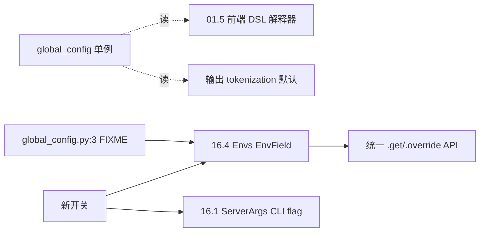

# 16.9 global_config legacy

## 定位

`python/sglang/global_config.py` 是 SGLang 早期前端的"全局常量"容器 `GlobalConfig`，历史上承载 DSL 解释器/输出 tokenization 的若干默认值。它已被 [`16.4 environ`](16.4-environ.md) 体系取代：文件顶部 FIXME 明确写着"deprecate this file and move all usage to `sglang.srt.environ` or `sglang.__init__.py`"。本页记录其现状与迁移方向。

## 职责

- `GlobalConfig` 持有：`verbosity`、`default_backend`、`skip_special_tokens_in_output`、`spaces_between_special_tokens_in_out`、`enable_precache_with_tracing`、`enable_parallel_encoding`。
- 进程级单例 `global_config = GlobalConfig()`，供前端 DSL 解释器与输出 detokenizer 读取。
- 现属过渡期：新开关不写这里，应进 `Envs`（环境变量）或 `ServerArgs`（CLI flag）。

## 关键类与函数

| 名称 | 定义位置 | 说明 |
|---|---|---|
| FIXME 注释 | `python/sglang/global_config.py:3` | 指向 `sglang.srt.environ` 或 `sglang.__init__.py` |
| `GlobalConfig` | `python/sglang/global_config.py:6` | 全局常量容器 |
| `GlobalConfig.__init__` | `python/sglang/global_config.py:11` | 默认值集合 |
| `global_config` | `python/sglang/global_config.py:29` | 进程单例 |

## 子模块树

- `python/sglang/global_config.py` — 单文件，无子模块

## 数据流 / 控制流

现存读侧（DSL 解释器预缓存/并行编码、输出 tokenization）仍读 `global_config`，属待清理技术债。新功能开关按 `.claude/skills/env-var-conventions` 决策：用户面进 `ServerArgs` CLI、专家/A-B 进 `Envs`。`SGL_*`→`SGLANG_*` 自动迁移与 `DISABLE_*` 双重否定禁令同样适用。

## 交叉引用

- 上游: [`01.2 GlobalConfig`](../01-frontend/01.2-global-config.md) — 01 子系统的前端视角
- 下游: [16.4 environ](16.4-environ.md) — 迁移目标
- 相关: [`01.5 DSL 解释器`](../01-frontend/01.5.3-dsl-interpreter.md) — `enable_precache_with_tracing`/`enable_parallel_encoding` 消费方
- 相关 skill: `.claude/skills/env-var-conventions`

## 进一步阅读

- 源码: `python/sglang/global_config.py`
- FIXME: `python/sglang/global_config.py:3`
- 迁移目标: `python/sglang/srt/environ.py`
