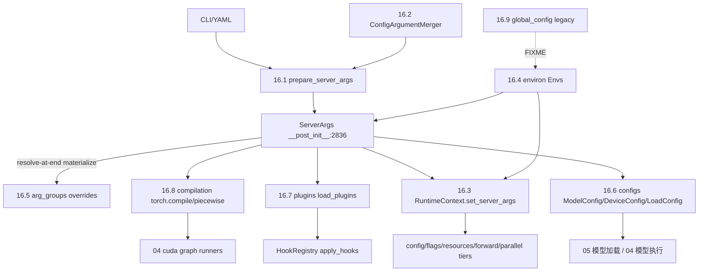

# 16 配置与运行时上下文

## 定位

子系统 16 是 SGLang 全进程配置与运行时状态的中央。`ServerArgs` dataclass 是唯一的配置真相源，`RuntimeContext` 把配置、运行标志、资源、per-forward 标志、并行拓扑分层管在同一单例上。`environ.py`（`Envs`/`EnvField`）集中所有 `SGLANG_*` 环境变量，`arg_groups/` 把 CLI 参数与模型覆盖声明化，`configs/` 承载模型/设备/加载配置与每架构 config，`plugins/` 提供统一插件框架，`compilation/` 管 `torch.compile` 与 piecewise cuda graph。

## 职责

- `server_args.py` 定义 `ServerArgs`/`PortArgs` 与 `prepare_server_args`，含 resolve-at-end 契约与 `override(source, **fields)` 安全入口。
- `server_args_config_parser.py` 把 YAML `--config` 文件与 CLI 参数合并（CLI > Config > Defaults）。
- `runtime_context.py` `RuntimeContext` 单例分层：config / flags / resources / per-forward / parallel，`get_*` 访问器 + 测试 `override()`。
- `environ.py` `Envs` 类持有全部 `EnvField`，`SGL_*` 自动迁移为 `SGLANG_*`。
- `arg_groups/` 自动从 dataclass 派生 argparse 参数、声明式模型覆盖、特性 hook（speculative/pd_disaggregation/deepseek_v4/hisparse）。
- `configs/` 模型/设备/加载配置、约 50 每-架构 config、parser 注册表。
- `plugins/` 两个 entry_point 组 + `HookRegistry`（BEFORE/AFTER/AROUND/REPLACE）。
- `compilation/` `CompilationConfig`、inductor pass、piecewise cuda graph 后端。
- `global_config.py` 旧前端全局常量（FIXME 指向 `srt.environ`）。

## 子系统边界图

## 子系统内导航

| 编号 | 页面 | 一句话定位 |
|---|---|---|
| 16.1 | [ServerArgs/PortArgs](16.1-server-args-port-args.md) | 配置 dataclass 与 `prepare_server_args` |
| 16.2 | [config parser](16.2-server-args-config-parser.md) | YAML `--config` 与 CLI 合并 |
| 16.3 | [RuntimeContext](16.3-runtime-context.md) | 分层单例与 resolve-at-end 契约 |
| 16.4 | [environ](16.4-environ.md) | `Envs`/`EnvField` 与 `SGLANG_*` 约定 |
| 16.5 | [arg_groups](16.5-arg-groups.md) | CLI 派生、模型覆盖声明、特性 hook |
| 16.6 | [模型配置](16.6-model-configs.md) | `ModelConfig`/`DeviceConfig`/`LoadConfig` + 每-架构 config |
| 16.7 | [plugins 框架](16.7-plugins.md) | entry_points 发现 + `HookRegistry` |
| 16.8 | [compilation](16.8-compilation.md) | `torch.compile` 与 piecewise cuda graph |
| 16.9 | [global_config legacy](16.9-global-config-legacy.md) | 旧前端全局常量 |

## 交叉引用

- 上游: [`00 总览`](../00-overview/index.md) — 进程模型
- 下游: [`04 模型执行`](../04-model-execution/index.md) / [`03 编排`](../03-orchestration/index.md) — 消费 `ServerArgs`/`RuntimeContext`
- 相关: [`15.5 platforms`](../15-kernels-hardware/15.5-platforms.md) — `current_platform` 受 `SGLANG_PLATFORM` 驱动
- 相关 skill: `.claude/skills/sglang-runtime-context`、`.claude/skills/env-var-conventions`

## 进一步阅读

- 源码: `python/sglang/srt/server_args.py`、`python/sglang/srt/runtime_context.py`、`python/sglang/srt/environ.py`
- 守卫测试: `test/registered/unit/test_runtime_context.py` 等
