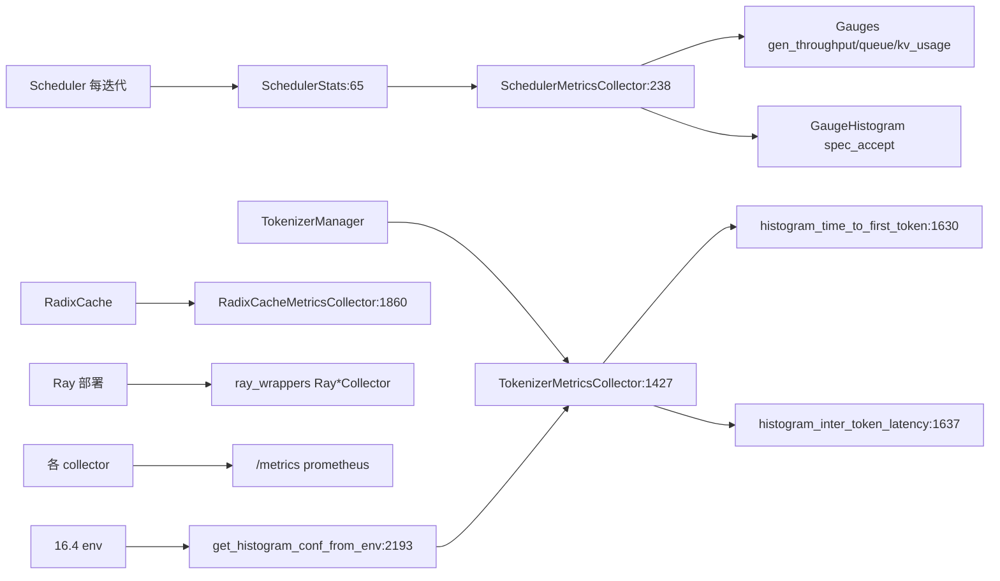

# 17.1 Prometheus metrics

## 定位

`observability/metrics_collector.py` 是 SGLang Prometheus 指标体系的核心，2200+ 行。它把 Scheduler/Tokenizer/Storage/ExpertDispatch/RadixCache/Encoder 各进程的运行状态聚合成 `SchedulerStats`，再通过多个 `*MetricsCollector` 暴露 Counter/Gauge/Histogram，经 `/metrics` 端点供 Prometheus 抓取。`ray_wrappers.py` 提供 Ray 下的等价封装。

## 职责

- `QueueCount`/`SchedulerStats`：队列/运行数、吞吐、cache hit、token 池用量、投机解码、retract 等原始统计。
- `SchedulerMetricsCollector`：调度器主指标（gen_throughput、running/queue、kv cache 用量、spec accept、retract 等）。
- `TokenizerMetricsCollector`：TTFT/inter-token latency Histogram、prompt tokens。
- `StorageMetricsCollector`/`RadixCacheMetricsCollector`/`ExpertDispatchCollector`/`EncoderMetricsCollector`：子系统细分指标。
- `resolve_collector_class`/`_StatLoggerDIMixin`：按部署形态（单进程/Ray）解析 collector 类，DI 基类。
- `GaugeHistogram`（`utils/gauge_histogram.py`）支持"既看瞬时又看分布"的混合指标。
- `get_histogram_conf_from_env` 允许环境变量自定义 bucket。

## 关键类与函数

| 名称 | 定义位置 | 说明 |
|---|---|---|
| `QueueCount` | `python/sglang/srt/observability/metrics_collector.py:45` | 队列计数 + per-priority 拆分 |
| `SchedulerStats` | `python/sglang/srt/observability/metrics_collector.py:65` | 调度统计快照 dataclass |
| `compute_routing_key_stats` | `python/sglang/srt/observability/metrics_collector.py:163` | routing key 统计 |
| `DPCooperationInfo` | `python/sglang/srt/observability/metrics_collector.py:172` | DP 协作信息 |
| `resolve_collector_class` | `python/sglang/srt/observability/metrics_collector.py:201` | 按形态选 collector 类 |
| `_StatLoggerDIMixin` | `python/sglang/srt/observability/metrics_collector.py:215` | DI 基类 |
| `SchedulerMetricsCollectorContext` | `python/sglang/srt/observability/metrics_collector.py:230` | 上下文 |
| `SchedulerMetricsCollector` | `python/sglang/srt/observability/metrics_collector.py:238` | 调度器主 collector |
| `TokenizerMetricsCollector` | `python/sglang/srt/observability/metrics_collector.py:1427` | TTFT/inter-token Histogram |
| `histogram_time_to_first_token` | `python/sglang/srt/observability/metrics_collector.py:1630` | `sglang:time_to_first_token_seconds` |
| `histogram_inter_token_latency` | `python/sglang/srt/observability/metrics_collector.py:1637` | `sglang:inter_token_latency_seconds` |
| `observe_time_to_first_token` | `python/sglang/srt/observability/metrics_collector.py:1704` | TTFT observe |
| `observe_inter_token_latency` | `python/sglang/srt/observability/metrics_collector.py:1720` | inter-token observe |
| `StorageMetrics`/`StorageMetricsCollector` | `python/sglang/srt/observability/metrics_collector.py:1740`/`:1747` | 存储指标 |
| `ExpertDispatchCollector` | `python/sglang/srt/observability/metrics_collector.py:1845` | 专家派发 |
| `RadixCacheMetricsCollector` | `python/sglang/srt/observability/metrics_collector.py:1860` | Radix 缓存 |
| `EncoderMetricsCollector` | `python/sglang/srt/observability/metrics_collector.py:1961` | 编码器 |
| `get_histogram_conf_from_env` | `python/sglang/srt/observability/metrics_collector.py:2193` | env 自定义 bucket |
| `GaugeHistogram` | `python/sglang/srt/utils/gauge_histogram.py:41` | gauge+histogram 混合 |
| `RaySchedulerMetricsCollector` 等 | `python/sglang/srt/observability/ray_wrappers.py:274` | Ray 封装 |

`SchedulerStats.token_usage` 是各池用量的瓶颈（`max(full, swa, mamba)`），文件内 FIXME（`:78`）标注其命名误导需 API 弃期才能改。`ForwardMode`/`DisaggregationMode`/`ServerArgs` 作为 import 驱动标签与配置。

## 数据流 / 控制流

`Scheduler` 在事件循环里更新 `SchedulerStats`，`SchedulerMetricsCollector` 把它翻译成 Counter/Gauge/GaugeHistogram；`TokenizerManager` 在请求完成时 observe TTFT/inter-token latency。Ray 部署用 `ray_wrappers.py` 的 `Ray*Wrapper` 经 Ray actor 桥接同一指标命名。`SGLANG_*` env 可覆盖 bucket 边界。

## 交叉引用

- 上游: [`03.4 调度循环`](../03-orchestration/03.4.3-scheduler-event-loop.md) — 采集点
- 上游: [`02.2.7 warmup/health`](../02-server-api/02.2.7-warmup-health.md) — `/metrics` 端点
- 相关: [17.3 forward-pass metrics](17.3-forward-pass-metrics.md) — ZMQ 实时通道
- 相关: [17.4 request metrics](17.4-request-metrics-time-stats.md) — TTFT/TPOT 来源
- 相关: [`16.4 environ`](../16-config-runtime/16.4-environ.md) — 指标开关与 bucket

## 进一步阅读

- 源码: `python/sglang/srt/observability/metrics_collector.py`
- 主体: `python/sglang/srt/observability/metrics_collector.py:238`
- GaugeHistogram: `python/sglang/srt/utils/gauge_histogram.py:41`
