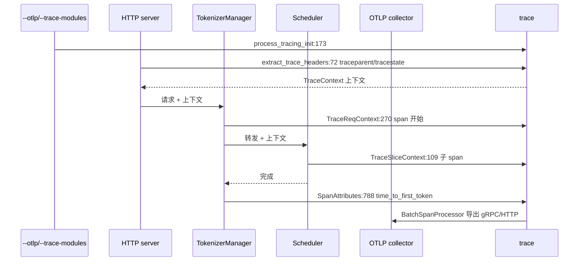

# 17.2 OpenTelemetry tracing

## 定位

`observability/trace.py`（800+ 行）是 SGLang 请求级分布式追踪的入口。它用 OpenTelemetry SDK 把单请求的调度、forward、分离传输等多阶段 span 经 OTLP gRPC/HTTP 导出，并在入口处从 W3C `traceparent`/`tracestate` 头恢复上下文。`--trace-modules` 限制哪些模块发 span，避免噪声。

## 职责

- import 时尝试导入 `opentelemetry`（`:41-58`），失败则降级为 no-op。
- `TRACE_HEADERS = ["traceparent", "tracestate"]`（`:39`）定义跨服务传播头；`extract_trace_headers` 从 HTTP 头恢复上下文。
- `global_trace_modules`（`:37`）由 `--trace-modules` 注入，过滤 span 发射模块。
- `process_tracing_init` 初始化 `TracerProvider` + `BatchSpanProcessor` + OTLP exporter（gRPC/HTTP）；`get_otlp_span_exporter` 按协议选 exporter。
- `TraceCustomIdGenerator` 自定义 span id；`TraceReqContext`/`TraceSliceContext`/`TraceNullContext` 提请求/片段上下文；`SpanAttributes` 定义 GenAI 语义属性（含 `gen_ai.latency.time_to_first_token`）。
- `mooncake_trace.py` 为 Mooncake KV 传输阶段加专用 span。

## 关键类与函数

| 名称 | 定义位置 | 说明 |
|---|---|---|
| `global_trace_modules` | `python/sglang/srt/observability/trace.py:37` | `--trace-modules` 过滤 |
| `TRACE_HEADERS` | `python/sglang/srt/observability/trace.py:39` | W3C 传播头 |
| OTLP import 块 | `python/sglang/srt/observability/trace.py:41` | gRPC/HTTP exporter import（try/except） |
| `extract_trace_headers` | `python/sglang/srt/observability/trace.py:72` | 从 HTTP 头取 traceparent/tracestate |
| `get_global_trace_level`/`set_global_trace_level` | `python/sglang/srt/observability/trace.py:76`/`:85` | trace 等级 |
| `TraceCustomIdGenerator` | `python/sglang/srt/observability/trace.py:126` | 自定义 span id 生成 |
| `process_tracing_init` | `python/sglang/srt/observability/trace.py:173` | TracerProvider + exporter 初始化 |
| `get_global_tracing_enabled` | `python/sglang/srt/observability/trace.py:226` | 是否启用 |
| `get_otlp_span_exporter` | `python/sglang/srt/observability/trace.py:230` | 按 endpoint/协议选 exporter |
| `trace_set_thread_info` | `python/sglang/srt/observability/trace.py:247` | 线程信息 |
| `TraceReqContext` | `python/sglang/srt/observability/trace.py:270` | 请求 span 上下文 |
| `TraceNullContext` | `python/sglang/srt/observability/trace.py:778` | no-op 上下文 |
| `SpanAttributes` | `python/sglang/srt/observability/trace.py:788` | GenAI 语义属性（`time_to_first_token` 在 `:803`） |
| `mooncake_trace_func` | `python/sglang/srt/observability/mooncake_trace.py:55` | Mooncake 阶段 span |

## 数据流 / 控制流

入口进程 `process_tracing_init` 建 `TracerProvider` 与 exporter，`--trace-modules` 限定发射范围。HTTP server 从请求头 `traceparent`/`tracestate` 恢复 W3C 上下文，沿 io_struct 消息传到 Scheduler；各阶段用 `TraceReqContext`/`TraceSliceContext` 开 span，结束写 `SpanAttributes`（如 `gen_ai.latency.time_to_first_token`）。`BatchSpanProcessor` 异步批量导出到 OTLP。未装 `opentelemetry` 时全链路静默降级。

## 交叉引用

- 上游: [`02 服务入口`](../02-server-api/index.md) — HTTP 头抽取点
- 下游: [17.4 request metrics](17.4-request-metrics-time-stats.md) — `TraceReqContext` 与阶段时延共用
- 相关: [17.1 Prometheus metrics](17.1-prometheus-metrics.md) — `SpanAttributes` 与指标互补
- 相关: [`09 分离`](../09-disaggregation/index.md) — `mooncake_trace` 阶段 span
- 相关: [`16.4 environ`](../16-config-runtime/16.4-environ.md) — `--trace-modules`/OTLP 端点

## 进一步阅读

- 源码: `python/sglang/srt/observability/trace.py`
- 初始化: `python/sglang/srt/observability/trace.py:173`
- 语义属性: `python/sglang/srt/observability/trace.py:788`
