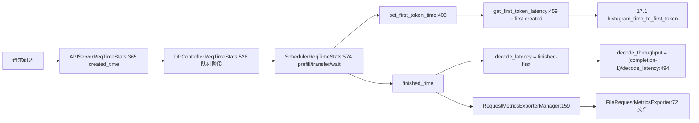

# 17.4 request metrics/time stats

## 定位

`observability/req_time_stats.py` 与 `request_metrics_exporter.py` 负责单请求生命周期时延的采集、阶段切片与导出。`ReqTimeStatsBase` 抽象把请求分成 API server / DP controller / Scheduler / Encoder 多阶段，记录 TTFT、inter-token、decode throughput 等指标；`RequestMetricsExporter` 把每请求记录按需导出（如文件），用于离线回归分析。

## 职责

- `req_time_stats.py`：按进程角色分 `APIServerReqTimeStats`/`DPControllerReqTimeStats`/`SchedulerReqTimeStats`/`EncoderReqTimeStats`，统一 `ReqTimeStatsBase`。
- `RequestStageConfig`/`RequestStage`：阶段定义与实例化。
- 时间校准：`calibrate_time_diff`/`convert_time_to_realtime`/`convert_time_cross_thread` 处理跨线程/跨进程时钟差。
- TTFT = `first_token_time - created_time`；inter-token/decode throughput 由 `finished_time - first_token_time` 与 `completion_tokens` 推导。
- 与 [17.1](17.1-prometheus-metrics.md) `TokenizerMetricsCollector` 的 TTFT/inter-token Histogram 共享语义。
- `request_metrics_exporter.py`：`RequestMetricsExporter` ABC + `FileRequestMetricsExporter` + `RequestMetricsExporterManager` + `create_request_metrics_exporters` 工厂。

## 关键类与函数

| 名称 | 定义位置 | 说明 |
|---|---|---|
| `calibrate_time_diff` | `python/sglang/srt/observability/req_time_stats.py:55` | 校准 `time.time` 与 `perf_counter` 差 |
| `convert_time_to_realtime` | `python/sglang/srt/observability/req_time_stats.py:66` | perf_counter→wall clock |
| `convert_time_cross_thread` | `python/sglang/srt/observability/req_time_stats.py:76` | 跨线程时钟转换 |
| `RequestStageConfig`/`RequestStage` | `python/sglang/srt/observability/req_time_stats.py:84`/`:101` | 阶段定义 |
| `ReqTimeStatsBase` | `python/sglang/srt/observability/req_time_stats.py:225` | 基类 |
| `APIServerReqTimeStats` | `python/sglang/srt/observability/req_time_stats.py:365` | API server 阶段（`first_token_time:369`，`get_first_token_latency:459`） |
| `DPControllerReqTimeStats` | `python/sglang/srt/observability/req_time_stats.py:528` | DP controller 阶段 |
| `SchedulerReqTimeStats` | `python/sglang/srt/observability/req_time_stats.py:574` | Scheduler 阶段（prefill/decode/transfer 队列） |
| `EncoderReqTimeStats` | `python/sglang/srt/observability/req_time_stats.py:1178` | Encoder 阶段 |
| `set_schedule_time_batch`/`set_time_batch` | `python/sglang/srt/observability/req_time_stats.py:1210`/`:1229` | 按 batch 设置时间 |
| `RequestMetricsExporter` | `python/sglang/srt/observability/request_metrics_exporter.py:21` | 导出器 ABC |
| `FileRequestMetricsExporter` | `python/sglang/srt/observability/request_metrics_exporter.py:72` | 文件导出 |
| `RequestMetricsExporterManager` | `python/sglang/srt/observability/request_metrics_exporter.py:159` | 管理多个导出器 |
| `create_request_metrics_exporters` | `python/sglang/srt/observability/request_metrics_exporter.py:207` | 工厂 |

## 数据流 / 控制流

每个阶段 stats 在对应进程被填充并沿 io_struct 消息传递。`SchedulerReqTimeStats` 区分 unified/prefill/decode 三种队列流程（`:578` 起 docstring）。TTFT 与 inter-token 同时进 [17.1](17.1-prometheus-metrics.md) 的 Prometheus Histogram 与 `RequestMetricsExporter` 的逐请求记录。`calibrate_time_diff` 减少系统调用，`convert_time_cross_thread` 保证跨线程时间一致。

## 交叉引用

- 上游: [`03.3 TokenizerManager`](../03-orchestration/03.3.1-tokenizer-manager.md) / [`03.4 Scheduler`](../03-orchestration/03.4.1-scheduler-structure.md) — 阶段填充点
- 相关: [17.1 Prometheus metrics](17.1-prometheus-metrics.md) — TTFT/inter-token Histogram
- 相关: [17.2 OTel tracing](17.2-opentelemetry-tracing.md) — `TraceReqContext` 同样按阶段切片
- 相关: [`09 分离`](../09-disaggregation/index.md) — prefill/transfer 队列阶段

## 进一步阅读

- 源码: `python/sglang/srt/observability/req_time_stats.py`、`request_metrics_exporter.py`
- API 阶段: `python/sglang/srt/observability/req_time_stats.py:365`
- 导出器: `python/sglang/srt/observability/request_metrics_exporter.py:21`
