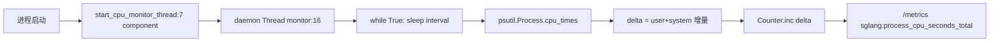

# 17.5 CPU monitor

## 定位

`observability/cpu_monitor.py` 是一个极小的守护线程工具：在每个 SGLang 进程启动一个后台线程，周期性采样进程 CPU 时间（user+system）增量，累加到 Prometheus `sglang:process_cpu_seconds_total` Counter，标签区分组件名。它让 `/metrics` 能暴露进程级 CPU 消耗，便于容量规划与异常检测。

## 职责

- `start_cpu_monitor_thread(component, interval=5.0)` 启动 daemon 线程，按 `interval` 秒采样。
- `psutil.Process().cpu_times()` 取 user/system 时间，按增量 `inc(delta)` 到 Counter。
- Counter 名 `sglang:process_cpu_seconds_total`，标签 `component` 区分 scheduler/tokenizer/detokenizer 等。

## 关键类与函数

| 名称 | 定义位置 | 说明 |
|---|---|---|
| `start_cpu_monitor_thread` | `python/sglang/srt/observability/cpu_monitor.py:7` | 启动 CPU 监控守护线程 |
| `sglang:process_cpu_seconds_total` | `python/sglang/srt/observability/cpu_monitor.py:10` | Prometheus Counter |
| monitor 闭包 | `python/sglang/srt/observability/cpu_monitor.py:16` | 周期采样 + 增量上报 |

## 子模块树

- `python/sglang/srt/observability/cpu_monitor.py` — 单文件，仅依赖 `psutil`/`prometheus_client`/`threading`

## 数据流 / 控制流

调用方在进程初始化时（如 Scheduler/TokenizerManager）传入 `component` 名启动线程。线程每 `interval` 秒读 `cpu_times`，算本次与上次差值，`labels(component=...).inc(delta)`。daemon 属性保证进程退出时线程自动结束。该数据与 [17.1](17.1-prometheus-metrics.md) 的 GPU 指标互补，覆盖非加速器资源。

## 交叉引用

- 上游: [`03 编排`](../03-orchestration/index.md) — 各进程启动点
- 相关: [17.1 Prometheus metrics](17.1-prometheus-metrics.md) — 同进 `/metrics`
- 相关: [`00.4 进程模型`](../00-overview/00.4-process-model.md) — 组件划分

## 进一步阅读

- 源码: `python/sglang/srt/observability/cpu_monitor.py`
- 入口: `python/sglang/srt/observability/cpu_monitor.py:7`
