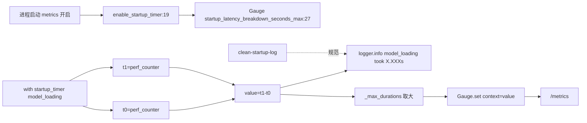

# 17.6 启动日志/timer

## 定位

`observability/startup_func_log_and_timer.py` 记录 SGLang 进程启动阶段（模型加载、内存分配、cuda graph 捕获等）的耗时分解，便于定位冷启动慢的环节。它把每段耗时同时写成日志行与 Prometheus Gauge `sglang:startup_latency_breakdown_seconds_max`，仅记每个 context 历史最大值。配套的 `.claude/skills/clean-startup-log` 规范"启动日志应当干净无噪声"。

## 职责

- `enable_startup_timer`：metrics 启用时初始化 Gauge（`multiprocess_mode="mostrecent"`）。
- `set_startup_metric(context, value)`：写日志 + 更新 `_max_durations` 最大值 + set Gauge。
- `startup_timer(name)` context manager：包围一段代码，退出时 `set_startup_metric`，支持 `log_only`（仅日志不写 Gauge）。
- `time_startup_latency`：函数装饰器形式。
- `reset_startup_timers`/`get_max_duration`：测试与查询辅助。

## 关键类与函数

| 名称 | 定义位置 | 说明 |
|---|---|---|
| `enable_startup_timer` | `python/sglang/srt/observability/startup_func_log_and_timer.py:19` | 初始化 Gauge |
| `sglang:startup_latency_breakdown_seconds_max` | `python/sglang/srt/observability/startup_func_log_and_timer.py:27` | 启动分段耗时 Gauge |
| `set_startup_metric` | `python/sglang/srt/observability/startup_func_log_and_timer.py:35` | 写日志 + 更新最大值 + set Gauge |
| `reset_startup_timers` | `python/sglang/srt/observability/startup_func_log_and_timer.py:48` | 重置最大值表 |
| `get_max_duration` | `python/sglang/srt/observability/startup_func_log_and_timer.py:54` | 查某 context 最大值 |
| `startup_timer` | `python/sglang/srt/observability/startup_func_log_and_timer.py:60` | context manager |
| `time_startup_latency` | `python/sglang/srt/observability/startup_func_log_and_timer.py:95` | 装饰器 |

## 子模块树

- `python/sglang/srt/observability/startup_func_log_and_timer.py` — 单文件

## 数据流 / 控制流

启动代码用 `with startup_timer("model_loading"):` 包围关键段；退出时 `set_startup_metric` 既打日志（`should_log` 默认 True）又更新 Gauge（仅 metrics 开启时）。同一 context 多次调用只记最大，避免 warmup 重复污染。`.claude/skills/clean-startup-log` 提供对照参考日志，要求启动输出无第三方 WARNING/deprecation/裸 print。

## 交叉引用

- 上游: [`03.4.2 Scheduler init`](../03-orchestration/03.4.2-scheduler-init.md) — 启动分段点
- 相关: [17.1 Prometheus metrics](17.1-prometheus-metrics.md) — Gauge 注册体系
- 相关: [`04.1 ModelRunner.initialize`](../04-model-execution/04.1-model-runner.md) — 主要被测段
- 相关 skill: `.claude/skills/clean-startup-log`

## 进一步阅读

- 源码: `python/sglang/srt/observability/startup_func_log_and_timer.py`
- context manager: `python/sglang/srt/observability/startup_func_log_and_timer.py:60`
- skill: `.claude/skills/clean-startup-log/SKILL.md`
