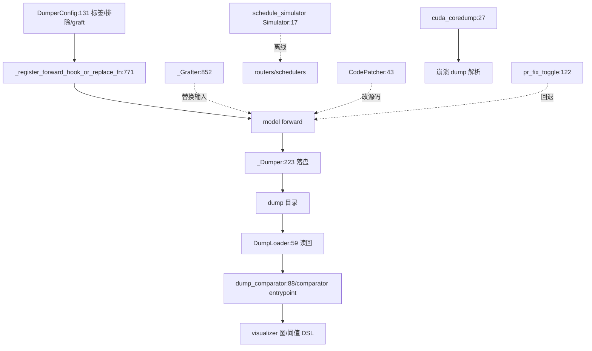

# 17.7 debug 工具集

## 定位

`debug_utils/` 是 SGLang 的深度诊断工具箱，面向"数值对不上/CUDA 崩溃/调度策略回归/源码临时改"等场景。核心是 `dumper.py`（按标签/排除/graft 全量 dump 中间张量，支持 SGLang 与 Megatron 框架插件、ZMQ RPC 广播、HTTP 触发）与 `comparator/`（逐 token/全量 tensor 对比、可视化、bundle 匹配）。配套 `schedule_simulator/`（离线复现调度）、`source_patcher/`（运行时改函数源码）、`cuda_coredump.py`、`log_parser.py`、`model_truncator.py`、`pr_fix_toggle.py` 等。

## 职责

- `dumper.py`：`DumperConfig`/`_Dumper`/`_NonIntrusiveDumper` 经 forward hook/replace_fn 落盘中间值；`_Grafter` 把 baseline 值 graft 进 target 路径做 A/B；`_SGLangPlugin`/`_MegatronPlugin` 框架适配；`_ZmqRpcBroadcast` 多 rank 协调；`_DumperHttpManager` HTTP 触发。
- `dump_loader.py`：`DumpLoader` 读回 dump 目录，polars DataFrame 过滤。
- `dump_comparator.py`/`text_comparator.py`：两目录 tensor 逐对比较 + 文本输出。
- `comparator/`：`entrypoint.py` 总入口、`bundle_matcher.py`/`aligner/`/`visualizer/`/`per_token_visualizer.py`/`threshold_dsl.py`/`preset.py` 高级对比与图。
- `cuda_coredump.py`：启用 CUDA coredump、解析 dump 目录、`report()`。
- `log_parser.py`：`parse(lines)` 解析运行日志。
- `model_truncator.py`：截断模型权重/层数做小模型复现。
- `schedule_simulator/`：`Simulator`/`GPUState`/`routers/`/`schedulers/`/`data_source/` 离线调度模拟。
- `source_patcher/`：`CodePatcher`/`apply_patches_from_config` 运行时改函数源码（preamble 注入）。
- `tensor_dump_forward_hook.py`：`TensorDumper` + `register_forward_hook_for_model`。
- `pr_fix_toggle.py`：`maybe_revert_pr_fix` 按 env 回退某 PR 的修复以二分回归。

## 关键类与函数

| 名称 | 定义位置 | 说明 |
|---|---|---|
| `DumperConfig`/`_Dumper` | `python/sglang/srt/debug_utils/dumper.py:131`/`:223` | dump 配置与主 dumper |
| `_NonIntrusiveDumper` | `python/sglang/srt/debug_utils/dumper.py:650` | 非侵入式 dumper |
| `_Grafter`/`GraftTransformInput` | `python/sglang/srt/debug_utils/dumper.py:852`/`:830` | baseline→target graft |
| `_SGLangPlugin`/`_MegatronPlugin` | `python/sglang/srt/debug_utils/dumper.py:1701`/`:1806` | 框架插件 |
| `_ZmqRpcBroadcast`/`_DumperHttpManager` | `python/sglang/srt/debug_utils/dumper.py:1519`/`:1348` | 多 rank 协调/HTTP 触发 |
| `DumpLoader` | `python/sglang/srt/debug_utils/dump_loader.py:59` | dump 读回 |
| `check_tensor_pair` | `python/sglang/srt/debug_utils/dump_comparator.py:88` | tensor 对比 |
| `comparator/entrypoint.py` | `python/sglang/srt/debug_utils/comparator/entrypoint.py` | 对比总入口 |
| `Simulator` | `python/sglang/srt/debug_utils/schedule_simulator/simulator.py:17` | 调度模拟器 |
| `CodePatcher`/`apply_patches_from_config` | `python/sglang/srt/debug_utils/source_patcher/code_patcher.py:43`/`:21` | 源码 patcher |
| `TensorDumper`/`register_forward_hook_for_model` | `python/sglang/srt/debug_utils/tensor_dump_forward_hook.py:26`/`:141` | forward hook dump |
| `is_enabled`/`report` | `python/sglang/srt/debug_utils/cuda_coredump.py:27`/`:82` | CUDA coredump 控制 |
| `parse` | `python/sglang/srt/debug_utils/log_parser.py:19` | 日志解析 |
| `main`（model_truncator） | `python/sglang/srt/debug_utils/model_truncator.py:14` | 模型截断入口 |
| `maybe_revert_pr_fix` | `python/sglang/srt/debug_utils/pr_fix_toggle.py:122` | PR fix 回退 |

## 子模块树

- `debug_utils/`
  - `dumper.py` — 主 dumper（框架插件/graft/RPC/HTTP）
  - `dump_loader.py`/`dump_comparator.py`/`text_comparator.py` — 读回与对比
  - `comparator/` — entrypoint/aligner/visualizer/bundle_matcher/per_token_visualizer/threshold_dsl/preset/dims_spec
  - `cuda_coredump.py`/`log_parser.py`/`model_truncator.py`/`pr_fix_toggle.py`/`tensor_dump_forward_hook.py`
  - `schedule_simulator/` — simulator/gpu_state/routers/schedulers/data_source/metrics
  - `source_patcher/` — code_patcher/source_editor/types

## 数据流 / 控制流

dumper 用 `DumperConfig` 描述落盘范围，`_register_forward_hook_or_replace_fn` 把 hook/替换挂到目标函数；`_Grafter` 把 baseline dump 的值 graft 进 target 的对应位置做受控 A/B。多 rank 经 `_ZmqRpcBroadcast` 协调，HTTP 端点触发 dump。dump 目录由 `DumpLoader` 读回 polars DataFrame，`dump_comparator`/`comparator/` 做逐 tensor/逐 token 对比、可视化与阈值判定。`schedule_simulator` 用离线 trace 复现调度策略回归；`source_patcher` 在不改文件的前提下临时改函数源码做 A/B；`pr_fix_toggle` 按 env 回退某 PR 修复以二分定位回归。

## 交叉引用

- 上游: [`04.1 ModelRunner`](../04-model-execution/04.1-model-runner.md) — forward hook 挂载点
- 相关: [`08 分布式`](../08-distributed/index.md) — 多 rank RPC 协调
- 相关: [`03.10 schedule_policy`](../03-orchestration/03.10-schedule-policy.md) — simulator 复现对象
- 相关: [17.8 profiling](17.8-profiling.md) — 性能侧诊断互补
- 相关 skill: `.claude/skills/debug-cuda-crash`、`debug-distributed-hang`、`llm-torch-profiler-analysis`、`mechanical-refactor-verify`

## 进一步阅读

- 源码: `python/sglang/srt/debug_utils/`
- dumper: `python/sglang/srt/debug_utils/dumper.py:131`
- comparator 入口: `python/sglang/srt/debug_utils/comparator/entrypoint.py`
