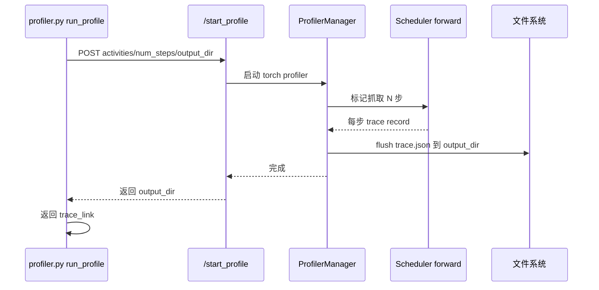

# 17.8 profiling

## 定位

`python/sglang/profiler.py` 是 SGLang torch profiler 的客户端，配合 HTTP server 的 `/start_profile`/`/stop_profile` 端点与 Scheduler 侧 `profiler_manager`，对运行中的服务器抓取 Chrome 兼容的 trace。`.claude/skills/generate-profile` 把"起服务→验精度→抓 trace→返回路径"编成自动化流程。基准脚本 `benchmark/one_batch.py` 也内置 `start_profile`/`stop_profile`。

## 职责

- `profiler.py::run_profile`：POST `/start_profile`（带 `num_steps`/`activities`/`output_dir`/`profile_by_stage`/`merge_profiles`/`start_step`），等服务器抓完返回 trace 目录。
- HTTP server `http_server.py`：`/start_profile`（`:1083`）与 `/stop_profile`（`:1094`）路由；gRPC server 同样提供。
- `managers/scheduler_components/profiler_manager.py`：Scheduler 进程内的抓取管理器，守"已在抓/未在抓"状态。
- `utils/profile_utils.py`/`utils/profile_merger.py`：trace 工具与多 rank trace 合并。
- `benchmark/one_batch.py`：`start_profile:102`/`stop_profile:147` 离线单批 profile。
- encode_server 也提供同名端点（`:4187`/`:4219`）。

## 关键类与函数

| 名称 | 定义位置 | 说明 |
|---|---|---|
| `run_profile` | `python/sglang/profiler.py:21` | 客户端入口，POST `/start_profile` |
| `/start_profile` 路由 | `python/sglang/srt/entrypoints/http_server.py:1083` | HTTP 端点 |
| `/stop_profile` 路由 | `python/sglang/srt/entrypoints/http_server.py:1094` | HTTP 端点 |
| gRPC 端点 | `python/sglang/srt/entrypoints/grpc_server.py:152` | `/start_profile`/`/stop_profile` 注册 |
| `ProfilerManager` | `python/sglang/srt/managers/scheduler_components/profiler_manager.py` | Scheduler 侧抓取管理 |
| 已在抓守卫 | `python/sglang/srt/managers/scheduler_components/profiler_manager.py:116` | `Profiling is already in progress` |
| `benchmark/one_batch.py::start_profile` | `python/sglang/benchmark/one_batch.py:102` | 离线单批 profile |
| `benchmark/one_batch.py::stop_profile` | `python/sglang/benchmark/one_batch.py:147` | 停止 |
| encode_server `/start_profile` | `python/sglang/srt/disaggregation/encode_server.py:4187` | 分离编码侧端点 |

## 子模块树

- `python/sglang/profiler.py` — 客户端 `run_profile` + CLI
- `python/sglang/srt/entrypoints/http_server.py` — 端点路由
- `python/sglang/srt/entrypoints/grpc_server.py` — gRPC 端点
- `python/sglang/srt/managers/scheduler_components/profiler_manager.py` — 抓取管理
- `python/sglang/srt/utils/profile_utils.py`/`profile_merger.py` — trace 工具/合并
- `python/sglang/benchmark/one_batch.py` — 离线 profile
- `python/sglang/srt/disaggregation/encode_server.py` — 分离侧端点

## 数据流 / 控制流

`run_profile` 先 dump `/server_info`，再 POST `/start_profile` 带参数；端点把请求转给 `ProfilerManager`，后者在 Scheduler forward 循环里激活 `torch.profiler.profile`，抓 `num_steps` 步后 flush 到 `output_dir`（默认 `SGLANG_TORCH_PROFILER_DIR=/tmp`）。`profile_by_stage` 按 PP 阶段分文件，`merge_profiles` 经 `profile_merger.py` 合并多 rank trace。`/stop_profile` 用于提前停止。gRPC server 在 core serving 之外挂 sidecar 提供这些端点。

## 交叉引用

- 上游: [`02 服务入口`](../02-server-api/index.md) — 端点注册
- 下游: [`03.4.3 调度事件循环`](../03-orchestration/03.4.3-scheduler-event-loop.md) — 抓取发生处
- 相关: [17.7 debug 工具集](17.7-debug-toolkit.md) — dumper 为数值侧，profiler 为时延侧
- 相关: [19.6 基准测试](../19-build-ci-dev/19.6-benchmarks.md) — `benchmark/one_batch.py`
- 相关 skill: `.claude/skills/generate-profile`、`.claude/skills/llm-torch-profiler-analysis`

## 进一步阅读

- 源码: `python/sglang/profiler.py`
- 端点: `python/sglang/srt/entrypoints/http_server.py:1083`
- skill: `.claude/skills/generate-profile/SKILL.md`
