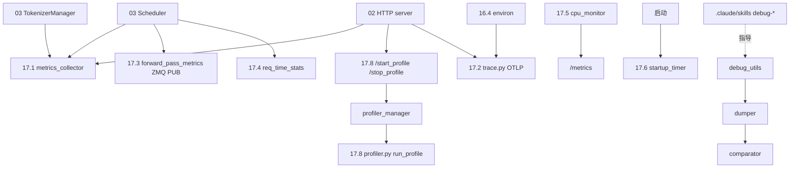

# 17 可观测性与运维

## 定位

子系统 17 是 SGLang 运行时的"观测面与诊断工具箱"。Prometheus 指标、OpenTelemetry 追踪、forward-pass 实时指标、请求时延统计、CPU 监控、启动计时统一在 `observability/` 下；`debug_utils/` 提供张量 dumper/comparator、cuda coredump、log parser、模型截断、调度模拟器、源码 patcher、forward hook 等深度诊断工具；`profiler.py` 与 `/start_profile`/`/stop_profile` 端点驱动 torch profiler 抓取。本子系统横跨 Scheduler/Tokenizer/HTTP/DP 多进程，是排障与回归归因的入口。

## 职责

- `metrics_collector.py`：`SchedulerMetricsCollector`/`TokenizerMetricsCollector`/`StorageMetricsCollector`/`ExpertDispatchCollector`/`RadixCacheMetricsCollector`/`EncoderMetricsCollector`，`SchedulerStats`/`QueueCount`，Gauge/Histogram/Counter。
- `trace.py`：OpenTelemetry OTLP gRPC/HTTP 导出、W3C traceparent/tracestate、`--trace-modules` 过滤、`SpanAttributes`。
- `forward_pass_metrics.py`：每迭代 `ForwardPassMetrics` 经 ZMQ PUB 发出，`FPM_VERSION=1`，msgspec.Struct；`SchedulerMetricsMixin` 发射。
- `req_time_stats.py` + `request_metrics_exporter.py`：TTFT/inter-token/request stage 时延，按阶段（API/DP/Scheduler/Encoder）切片，文件导出。
- `cpu_monitor.py`：每进程 CPU seconds Counter。
- `startup_func_log_and_timer.py`：启动分段计时 Gauge。
- `debug_utils/`：dumper/dump_loader/dump_comparator/text_comparator/cuda_coredump/log_parser/model_truncator/schedule_simulator/source_patcher/tensor_dump_forward_hook/pr_fix_toggle + `comparator/`。
- `profiler.py` + 端点：torch profiler 抓取与 trace 合并。

## 子系统边界图

## 子系统内导航

| 编号 | 页面 | 一句话定位 |
|---|---|---|
| 17.1 | [Prometheus metrics](17.1-prometheus-metrics.md) | 多 collector 指标体系与 GaugeHistogram |
| 17.2 | [OpenTelemetry tracing](17.2-opentelemetry-tracing.md) | OTLP 导出与 W3C 上下文传播 |
| 17.3 | [forward-pass metrics](17.3-forward-pass-metrics.md) | ZMQ PUB 实时调度指标 |
| 17.4 | [request metrics/time stats](17.4-request-metrics-time-stats.md) | TTFT/inter-token 与请求阶段时延 |
| 17.5 | [CPU monitor](17.5-cpu-monitor.md) | 进程 CPU seconds Counter |
| 17.6 | [启动日志/timer](17.6-startup-logging-timer.md) | 启动分段计时 |
| 17.7 | [debug 工具集](17.7-debug-toolkit.md) | dumper/comparator/simulator/patcher |
| 17.8 | [profiling](17.8-profiling.md) | torch profiler 与端点 |

## 交叉引用

- 上游: [`03 编排`](../03-orchestration/index.md) / [`02 服务入口`](../02-server-api/index.md) — 指标采集点
- 依赖: [`16.4 environ`](../16-config-runtime/16.4-environ.md) — 指标/tracing 开关
- 相关: [`09 分离`](../09-disaggregation/index.md) — `DisaggregationMode` 标签
- 相关 skill: `.claude/skills/debug-cuda-crash`、`debug-distributed-hang`、`llm-torch-profiler-analysis`、`mechanical-refactor-verify`、`generate-profile`、`clean-startup-log`

## 进一步阅读

- 源码: `python/sglang/srt/observability/`、`python/sglang/srt/debug_utils/`
- 客户端: `python/sglang/profiler.py`
