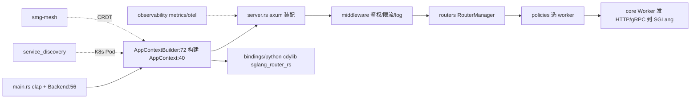

# 18.1 网关总览

## 定位

`sgl-model-gateway/` 是用 Rust 写的 SGLang 控制与数据面网关。crate 名 `smg`（`Cargo.toml` lib name），发布为 `sgl-model-gateway` 包，二进制 `sgl-model-gateway`/`smg`/`amg` 共用 `src/main.rs`。它把一组 SGLang worker 组织成统一端点，承担路由、负载均衡、PD 分离、worker 生命周期、可靠性、服务发现、mesh HA、鉴权与可观测。Python 绑定经 maturin/pyo3 产出 `sglang_router` 包，gRPC Rust 桥在 `rust/sglang-grpc/`。

## 职责

- `src/lib.rs` 聚合全部模块：`core`/`routers`/`policies`/`observability`/`wasm`/`service_discovery`/`server`/`middleware`/`config`，re-export `smg_auth as auth`、`openai_protocol as protocols`、`reasoning_parser`、`llm_tokenizer as tokenizer`、`tool_parser`。
- `src/main.rs` CLI（clap）+ `Backend` 枚举选择运行模式。
- `app_context.rs` `AppContext` 持有全部运行时句柄（client/worker_registry/policy_registry/router_manager/tokenizer_registry/storage/wasm_manager/mcp_manager/workflow_engines 等）。
- `server.rs` axum server 装配路由、中间件、mesh、observability。
- 依赖关键 crate：axum/tower（HTTP）、tonic/prost（gRPC）、kube/k8s-openapi（服务发现）、wasmtime（wasm）、rmcp（MCP）、opentelemetry（trace）、metrics-exporter-prometheus、smg-mesh/smg-auth/smg-mcp/smg-wasm/smg-grpc-client、crdts/redis（mesh）。
- release profile `opt-level="z"` + fat LTO + strip，面向小二进制。

## 关键类与函数

| 名称 | 定义位置 | 说明 |
|---|---|---|
| `smg` lib | `sgl-model-gateway/Cargo.toml:21` | crate 名 `smg`，`rlib` |
| `sgl-model-gateway`/`smg`/`amg` bin | `sgl-model-gateway/Cargo.toml:25`/`:29`/`:33` | 三二进制共用 `src/main.rs` |
| `Backend` enum | `sgl-model-gateway/src/main.rs:56` | 运行模式选择 |
| `AppContext` | `sgl-model-gateway/src/app_context.rs:40` | 全局运行时句柄容器 |
| `AppContextBuilder` | `sgl-model-gateway/src/app_context.rs:72` | builder |
| lib re-exports | `sgl-model-gateway/src/lib.rs:1` | `auth`/`protocols`/`tokenizer`/`reasoning_parser`/`tool_parser` |
| server 装配 | `sgl-model-gateway/src/server.rs:1` | axum router + mesh + observability |
| features | `sgl-model-gateway/Cargo.toml:10` | `grpc-client`/`grpc-server`/`vendored-openssl` |

## 子模块树

- `sgl-model-gateway/`
  - `src/` — `lib.rs`/`main.rs`/`app_context.rs`/`server.rs`/`middleware.rs`/`service_discovery.rs`/`version.rs` + `config/`/`core/`/`routers/`/`policies/`/`observability/`/`wasm/`
  - `bindings/python` — maturin/pyo3 `sgl-model-gateway-python`
  - `benches/` `e2e_test/` `examples/` `tests/` `scripts/` `build.rs` `rust-toolchain.toml`
- `rust/sglang-grpc/` — 进程内 gRPC server（见 [18.12](18.12-in-process-rust-grpc.md)）

## 数据流 / 控制流

`main.rs` 解析 CLI 选 `Backend`，`AppContextBuilder` 按配置构造 `AppContext`（含 registry/policy/router_manager/storage/wasm/mcp），`server.rs` 用 axum 挂载路由与中间件并启动 mesh/observability。运行期请求经中间件到 `RouterManager`，按 `LoadBalancingPolicy` 选 worker 转发。Python 绑定把同一 `smg` crate 编成 `cdylib` 供 Python 嵌入调用。

## 交叉引用

- 详见: [18.2 Worker 编排](18.2-worker-orchestration.md) / [18.3 Routers](18.3-routers.md) / [18.11 Python bindings](18.11-python-bindings.md)
- 上游: [`02 服务入口`](../02-server-api/index.md) — 协议复用
- 下游: [`03 编排`](../03-orchestration/index.md) — worker = SGLang 进程
- 相关: [`19.3 CI`](../19-build-ci-dev/19.3-ci-workflows.md) — `pr-test-rust`

## 进一步阅读

- 源码: `sgl-model-gateway/src/lib.rs`、`app_context.rs`、`server.rs`
- 依赖: `sgl-model-gateway/Cargo.toml`
- 说明: `sgl-model-gateway/README.md`
