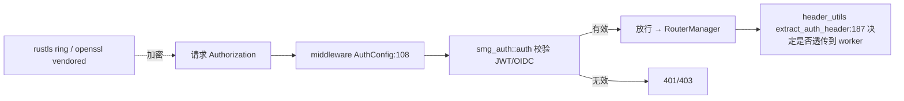

# 18.10 Auth

## 定位

网关的鉴权由外部 crate `smg-auth` 提供，在 `src/lib.rs` 以 `pub use smg_auth as auth;` re-export。它支持 JWT（`jsonwebtoken`）与 OIDC，TLS 经 `rustls`/`openssl`。`src/middleware.rs::AuthConfig` 在 axum 中间件层接入鉴权，`smg-auth` 处理 token 校验/签发细节。

## 职责

- `smg-auth` crate：JWT 签发/校验（`jsonwebtoken`，`use_pem`）、OIDC 发现、密钥管理。
- `lib.rs:2` re-export `auth`，使 `smg_auth` 符号以 `crate::auth::*` 暴露。
- `middleware.rs::AuthConfig`：鉴权配置，中间件层校验 Authorization 头。
- TLS：`rustls`（ring）默认 + `openssl`（vendored 可选 feature `vendored-openssl`）。
- 头透传：`routers/header_utils.rs::extract_auth_header`（[18.3](18.3-routers.md)）取与转发鉴权头。

## 关键类与函数

| 名称 | 定义位置 | 说明 |
|---|---|---|
| `pub use smg_auth as auth` | `src/lib.rs:2` | re-export 鉴权 crate |
| `smg-auth` 依赖 | `sgl-model-gateway/Cargo.toml:86` | `smg-auth = "=1.0.0"` |
| `jsonwebtoken` 依赖 | `sgl-model-gateway/Cargo.toml:105` | JWT，`use_pem` |
| `rustls`/`openssl` 依赖 | `sgl-model-gateway/Cargo.toml:92`/`:94` | TLS |
| `AuthConfig` | `src/middleware.rs:108` | 鉴权中间件配置 |
| `extract_auth_header` | `src/routers/header_utils.rs:187` | 取 Authorization 头 |
| `vendored-openssl` feature | `sgl-model-gateway/Cargo.toml:15` | 静态 openssl |

## 子模块树

- 外部 `smg-auth` crate → `src/lib.rs` re-export 为 `auth`
- `src/middleware.rs`（`AuthConfig` 段）
- `src/routers/header_utils.rs`（`extract_auth_header`）

## 数据流 / 控制流

请求带 Authorization 头进中间件，`AuthConfig` 配置的 `smg_auth` 校验 JWT/OIDC；通过则放行，`extract_auth_header` 决定鉴权头是否转发给后端 worker，失败返 401/403。TLS 由 `rustls`（默认 ring provider）或 `openssl`（vendored feature）提供。

## 交叉引用

- 上游: [18.1 网关总览](18.1-gateway-overview.md) — `lib.rs` re-export
- 下游: [18.3 Routers](18.3-routers.md) — `header_utils` 透传
- 相关: [`02.2.x 兼容端点`](../02-server-api/02.2.1-native-api.md) — 上游鉴权头来源
- 相关: [`16.7 plugins`](../16-config-runtime/16.7-plugins.md) — Python 侧中间件对照

## 进一步阅读

- re-export: `sgl-model-gateway/src/lib.rs:2`
- 中间件: `sgl-model-gateway/src/middleware.rs:108`
- 依赖: `sgl-model-gateway/Cargo.toml:86`（`smg-auth`）、`:105`（`jsonwebtoken`）
