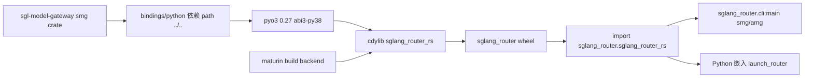

# 18.11 Python bindings

## 定位

`sgl-model-gateway/bindings/python/` 用 maturin + pyo3 把 Rust `smg` crate 编成 Python 扩展 `sglang_router`，让 Python 侧（如 SGLang launch_router、`sglang_router` CLI）直接嵌入运行 Rust 网关，无需独立进程。crate 名 `sgl-model-gateway-python`，扩展模块名 `sglang_router_rs`。

## 职责

- `Cargo.toml`：`cdylib` lib `sglang_router_rs`，依赖 `pyo3 0.27`（`extension-module`/`abi3-py38`）+ `sgl-model-gateway`（path 依赖，default features）+ `tokio`。
- `pyproject.toml`：maturin build backend，project 名 `sglang-router`，依赖 `setproctitle`/`aiohttp`/`orjson`/`uvicorn`/`fastapi`；`[tool.maturin] python-source=src module-name=sglang_router.sglang_router_rs`；scripts `smg`/`amg`/`sglang-router` → `sglang_router.cli:main`。
- `src/`：pyo3 暴露 Rust 函数/类给 Python（Router 入口、launch、配置）。
- `tests/`：Python 测试。
- features：`default = ["pyo3/extension-module"]`、`vendored-openssl` 透传。

## 关键类与函数

| 名称 | 定义位置 | 说明 |
|---|---|---|
| crate `sgl-model-gateway-python` | `bindings/python/Cargo.toml:2` | Python 绑定 crate |
| lib name `sglang_router_rs` | `bindings/python/Cargo.toml:7` | cdylib 名 |
| `pyo3` 依赖 | `bindings/python/Cargo.toml:11` | `extension-module`/`abi3-py38` |
| maturin backend | `bindings/python/pyproject.toml:2` | `maturin>=1.0,<2.0` |
| project `sglang-router` | `bindings/python/pyproject.toml:6` | PyPI 包名 |
| `module-name` | `bindings/python/pyproject.toml:53` | `sglang_router.sglang_router_rs` |
| scripts `smg`/`amg`/`sglang-router` | `bindings/python/pyproject.toml:46` | CLI 入口 |

## 子模块树

- `bindings/python/`
  - `Cargo.toml`/`pyproject.toml`/`setup.py`/`MANIFEST.in`/`pytest.ini`/`.coveragerc`
  - `src/` — pyo3 绑定源 + Python 包 `sglang_router`
  - `tests/`
- workspace：`sgl-model-gateway/Cargo.toml:2` `members = ["bindings/python"]`

## 构建流

maturin 调 cargo 把 `bindings/python` 编成 cdylib，产出 `sglang_router` wheel（含 Rust 扩展 `sglang_router_rs`）。Python 侧 `import sglang_router` 后可调 Rust 暴露的入口（Router 构造/launch），或经 `sglang_router.cli:main` 跑 CLI（`smg`/`amg`）。`abi3-py38` 保证一个 wheel 跨 Python 3.8+。`vendored-openssl` feature 透传给 `sgl-model-gateway` 做静态 openssl。

## 交叉引用

- 上游: [18.1 网关总览](18.1-gateway-overview.md) — 被绑定的 `smg` crate
- 下游: [`01.4 launch_server`](../01-frontend/01.4-launch-server.md) — Python 侧 launch_router 入口
- 相关: [`01.3 CLI`](../01-frontend/01.3-cli.md) — `smg`/`amg` scripts
- 相关: [`19.3 CI`](../19-build-ci-dev/19.3-ci-workflows.md) — `pr-test-rust` 构建绑定

## 进一步阅读

- 源码: `sgl-model-gateway/bindings/python/`
- 构建: `sgl-model-gateway/bindings/python/pyproject.toml:2`
- workspace: `sgl-model-gateway/Cargo.toml:2`
