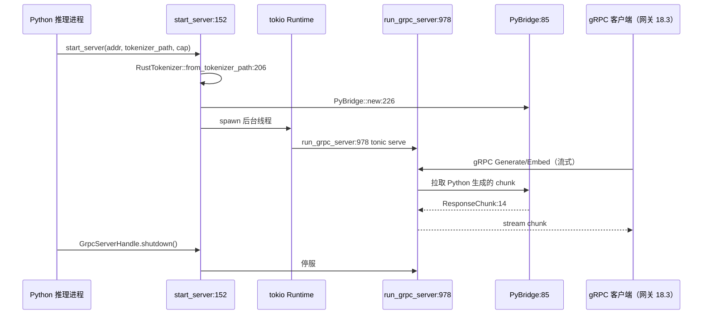

# 18.12 进程内 Rust gRPC

## 定位

`rust/sglang-grpc/` 是一个独立 Rust crate，给 Python 推理进程提供进程内 gRPC server：Python 侧调 `start_server` 在后台线程跑 tonic gRPC server，`PyBridge` 桥接 Python 生成逻辑与 Rust 流式响应，`RustTokenizer` 经 `llm-tokenizer` 提供 Rust tokenize。它对接 [`02.5 gRPC`](../02-server-api/02.5-grpc.md) 中的 grpc bridge RuntimeHandle，让 SGLang 以 gRPC 暴露推理。

## 职责

- `lib.rs`：pyo3 模块入口，暴露 `start_server` 与 `GrpcServerHandle`；`GrpcServerHandle` 持有运行时句柄可停服。
- `bridge.rs`：`PyBridge` + `ResponseChunk`/`ResponseData`/`TerminalError`/`ChunkSendStatus`，桥接 Python 异步生成与 Rust 流。
- `server.rs`：`SglangServiceImpl`（gRPC service 实现）+ `run_grpc_server`（tonic server 启动）+ 流式/中止/状态处理。
- `tokenizers.rs`：`RustTokenizer::from_tokenizer_path` 加载 tokenizer。
- `build.rs`/`Cargo.toml`：tonic/prost 编译 proto，pyo3 ABI3。

## 关键类与函数

| 名称 | 定义位置 | 说明 |
|---|---|---|
| `GrpcServerHandle` | `rust/sglang-grpc/src/lib.rs:22` | 服务句柄（停服/状态） |
| `start_server` | `rust/sglang-grpc/src/lib.rs:152` | pyo3 入口，启动 gRPC server |
| `RustTokenizer::from_tokenizer_path` | `rust/sglang-grpc/src/lib.rs:206` | Python 侧加载 tokenizer |
| `PyBridge::new` | `rust/sglang-grpc/src/lib.rs:226` | 构造 bridge |
| `run_grpc_server` | `rust/sglang-grpc/src/server.rs:978` | tonic server 主循环 |
| `SglangServiceImpl` | `rust/sglang-grpc/src/server.rs:21` | gRPC service 实现（持 `PyBridge`） |
| `PyBridge` | `rust/sglang-grpc/src/bridge.rs:85` | Python↔Rust 桥 |
| `ResponseChunk`/`ResponseData`/`TerminalError`/`ChunkSendStatus` | `rust/sglang-grpc/src/bridge.rs:14`/`:27`/`:49`/`:71` | 桥数据类型 |
| `RustTokenizer` | `rust/sglang-grpc/src/tokenizers.rs:47` | Rust tokenize |

## 子模块树

- `rust/sglang-grpc/`
  - `src/lib.rs` — pyo3 入口 + `GrpcServerHandle`/`start_server`
  - `src/bridge.rs`/`bridge/` — `PyBridge` + 数据类型
  - `src/server.rs`/`server/` — `SglangServiceImpl`/`run_grpc_server`
  - `src/tokenizers.rs` — `RustTokenizer`
  - `src/utils/` — 辅助
  - `build.rs`/`Cargo.toml`/`rust-toolchain.toml`

## 数据流 / 控制流

Python 进程调 `start_server`，传地址/tokenizer 路径/响应 channel 容量。`start_server` 构造 `RustTokenizer` 与 `PyBridge`，在独立 tokio runtime 线程跑 `run_grpc_server`。gRPC 客户端（如 [18.3](18.3-routers.md) `GrpcRouter`/网关）发起流式 Generate，`SglangServiceImpl` 经 `PyBridge` 向 Python 拉生成 chunk 并回流，`ChunkSendStatus` 管背压，`TerminalError` 终结流。`GrpcServerHandle` 让 Python 控制停服。这与 [`02.5 grpc`](../02-server-api/02.5-grpc.md) 的 RuntimeHandle 配套，使推理进程可不装独立 HTTP server 仅以 gRPC 暴露。

## 交叉引用

- 上游: [`02.5 gRPC`](../02-server-api/02.5-grpc.md) — grpc bridge RuntimeHandle
- 上游: [18.3 Routers](18.3-routers.md) — 网关 `GrpcClient`/`GrpcRouter` 是典型客户端
- 相关: [18.9 网关可观测](18.9-gateway-observability.md) — `inject_trace_context_grpc` 注入 W3C
- 相关: [`00.4 进程模型`](../00-overview/00.4-process-model.md) — 推理进程 gRPC 形态

## 进一步阅读

- 源码: `rust/sglang-grpc/`
- 入口: `rust/sglang-grpc/src/lib.rs:152`
- 桥: `rust/sglang-grpc/src/bridge.rs:85`
- server: `rust/sglang-grpc/src/server.rs:978`
