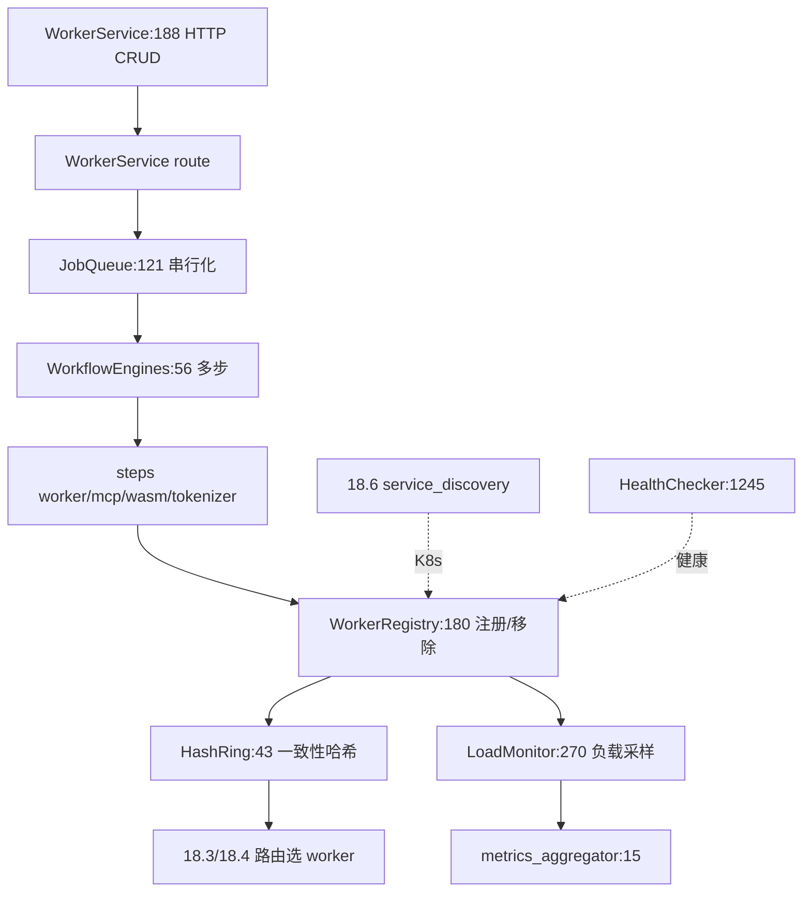

# 18.2 Worker 编排

## 定位

`src/core/` 是网关的 worker 控制面：抽象 `Worker` trait、维护 worker 注册表与一致性哈希、管理负载监控、对外提供 worker CRUD `WorkerService`、用 `JobQueue` 串行化副作用任务、用 `steps/` 多步工作流引擎编排注册/激活/更新/移除/MCP/wasm/tokenizer 流程。

## 职责

- `worker.rs`：`Worker` trait 与 `BasicWorker`/`DPAwareWorker` 实现；`WorkerType`/`ConnectionMode`/`RuntimeType`/`HealthConfig`/`WorkerMetadata`/`WorkerLoadGuard`/`AttachedBody`/`HealthChecker`。
- `worker_registry.rs`：`WorkerRegistry` + `HashRing` + `WorkerId` + `WorkerRegistryStats`，按 routing_key 索引、一致性哈希定位。
- `worker_manager.rs`：`WorkerManager`（worker 操作总入口）+ `LoadMonitor`（负载采样守护）。
- `worker_service.rs`：HTTP CRUD `WorkerService`（create/delete/update/list/get worker）。
- `worker_builder.rs`：`BasicWorkerBuilder`/`DPAwareWorkerBuilder`。
- `job_queue.rs`：`Job`/`JobQueue`/`JobQueueConfig` 串行化 worker 变更任务。
- `circuit_breaker.rs`/`retry.rs`/`token_bucket.rs`：可靠性基元（见 [18.5](18.5-reliability-primitives.md)）。
- `metrics_aggregator.rs`：`MetricPack` 聚合多 worker metrics。
- `model_card.rs`/`model_type.rs`/`error.rs`：模型卡片、端点类型、错误。
- `steps/`：`WorkflowEngines` + `workflow_data` + worker/shared/external/local 步骤 + mcp_registration + wasm_module_registration/removal + tokenizer_registration。

## 关键类与函数

| 名称 | 定义位置 | 说明 |
|---|---|---|
| `Worker`/`BasicWorker`/`DPAwareWorker` | `src/core/worker.rs:707`/`:650`/`:987` | worker 抽象与实现 |
| `WorkerType`/`ConnectionMode`/`RuntimeType` | `src/core/worker.rs:515`/`:425`/`:475` | worker 分类 |
| `HealthConfig`/`WorkerMetadata`/`WorkerLoadGuard` | `src/core/worker.rs:553`/`:583`/`:1147` | 健康配置/元数据/加载守卫 |
| `HealthChecker` | `src/core/worker.rs:1245` | 健康检查器 |
| `HashRing`/`WorkerId`/`WorkerRegistry` | `src/core/worker_registry.rs:43`/`:148`/`:180` | 一致性哈希注册表 |
| `WorkerRegistryStats` | `src/core/worker_registry.rs:703` | 注册表统计 |
| `WorkerManager`/`LoadMonitor` | `src/core/worker_manager.rs:84`/`:270` | worker 操作与负载监控 |
| `WorkerService` | `src/core/worker_service.rs:188` | HTTP CRUD 服务 |
| `BasicWorkerBuilder`/`DPAwareWorkerBuilder` | `src/core/worker_builder.rs:15`/`:191` | builder |
| `Job`/`JobQueueConfig`/`JobQueue` | `src/core/job_queue.rs:34`/`:104`/`:121` | 串行任务队列 |
| `MetricPack`/`aggregate_metrics` | `src/core/metrics_aggregator.rs:6`/`:15` | metrics 聚合 |
| `ModelCard`/`ProviderType` | `src/core/model_card.rs:112`/`:28` | 模型卡片 |
| `Endpoint` | `src/core/model_type.rs:259` | 端点类型 |
| `WorkflowEngines` | `src/core/steps/workflow_engines.rs:56` | 多步工作流引擎 |
| `create_mcp_registration_workflow` | `src/core/steps/mcp_registration.rs:261` | MCP 注册工作流工厂 |

## 子模块树

- `core/`
  - `mod.rs` — re-export
  - `worker.rs`/`worker_registry.rs`/`worker_manager.rs`/`worker_service.rs`/`worker_builder.rs`
  - `job_queue.rs`/`circuit_breaker.rs`/`retry.rs`/`token_bucket.rs`/`metrics_aggregator.rs`
  - `model_card.rs`/`model_type.rs`/`error.rs`
  - `steps/` — `mod.rs`/`workflow_engines.rs`/`workflow_data.rs` + `worker/`(shared/external/local) + `mcp_registration.rs`/`wasm_module_registration.rs`/`wasm_module_removal.rs`/`tokenizer_registration.rs`

## 数据流 / 控制流

`WorkerService` 暴露 HTTP CRUD，请求转 `JobQueue` 串行化后由 `WorkflowEngines` 执行多步工作流（注册/激活/更新 policy/移除）。`WorkerRegistry` 维护 `HashRing` 与 routing_key 索引；`LoadMonitor` 后台采样负载供策略与 metrics。`service_discovery` 从 K8s 推送 Pod 变更进注册表。`HealthChecker` 周期探测把不健康 worker 标记，触发 [18.5](18.5-reliability-primitives.md) 熔断。

## 交叉引用

- 详见: [18.5 可靠性基元](18.5-reliability-primitives.md) / [18.6 服务发现](18.6-service-discovery.md)
- 下游: [18.3 Routers](18.3-routers.md) — 路由层读 registry 选 worker
- 上游: [`03 编排`](../03-orchestration/index.md) — worker=SGLang 进程
- 相关: [`09 分离`](../09-disaggregation/index.md) — `DPAwareWorker`/`DPAwareWorkerBuilder`

## 进一步阅读

- 源码: `sgl-model-gateway/src/core/`
- worker trait: `sgl-model-gateway/src/core/worker.rs:707`
- 注册表: `sgl-model-gateway/src/core/worker_registry.rs:180`
