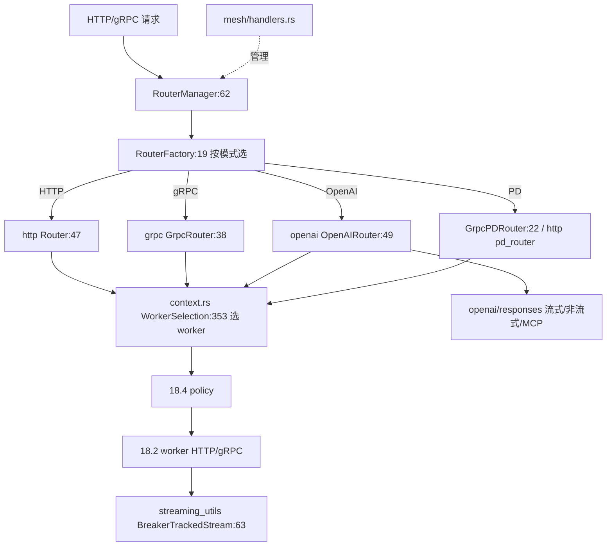

# 18.3 Routers

## 定位

`src/routers/` 把请求分发抽象成 `RouterTrait`，由 `RouterManager` 统一管理、`RouterFactory` 构造。具体路由族覆盖 HTTP、gRPC、OpenAI、PD 分离、Mesh，并配以 conversations/parse/tokenize/header_utils/streaming_utils/mcp_utils/persistence_utils 等共享处理工具。`RouterManager` 自身也实现 `RouterTrait`，可聚合多个子路由。

## 职责

- `router_manager.rs`：`RouterManager` + `RouterId` + `router_ids` 命名空间，聚合管理多路由。
- `factory.rs`：`RouterFactory` 按配置选具体路由实现。
- `http/`：`router.rs::Router`（HTTP 反代 + 路由）+ `pd_router`/`pd_types`（PD 分离路由）。
- `grpc/`：`router.rs::GrpcRouter` + `pd_router.rs::GrpcPDRouter` + `pipeline.rs`（请求管线）+ `client.rs`（gRPC 客户端）+ `context.rs`（RequestContext/WorkerSelection/ClientSelection）+ `proto_wrapper.rs`（proto 包装）+ `regular/`/`harmony/`/`common/`/`utils.rs`。
- `openai/`：`router.rs::OpenAIRouter` + `provider.rs`（SGLangProvider）+ `context.rs` + `responses/`（responses API 流式/非流式/MCP/tool）。
- `mesh/`：`handlers.rs` mesh 管理 HTTP 端点（cluster status/node info/health/rate limit/app config）。
- `conversations/`/`parse/`/`tokenize/`：会话/函数调用与推理解析/tokenize 工具。
- `header_utils.rs`/`streaming_utils.rs`/`mcp_utils.rs`/`persistence_utils.rs`/`error.rs`：共享工具。

## 关键类与函数

| 名称 | 定义位置 | 说明 |
|---|---|---|
| `RouterManager`/`RouterId` | `src/routers/router_manager.rs:62`/`:39` | 路由聚合管理 |
| `RouterFactory` | `src/routers/factory.rs:19` | 路由工厂 |
| `Router`（HTTP） | `src/routers/http/router.rs:47` | HTTP 反代 + 路由 |
| `pd_router`/`pd_types` | `src/routers/http/pd_router.rs`/`pd_types.rs` | HTTP PD 分离 |
| `GrpcRouter` | `src/routers/grpc/router.rs:38` | gRPC 路由 |
| `GrpcPDRouter` | `src/routers/grpc/pd_router.rs:22` | gRPC PD 分离路由 |
| `GrpcClient`/`ModelInfo` | `src/routers/grpc/client.rs:23`/`:162` | gRPC 客户端 |
| `RequestContext`/`WorkerSelection` | `src/routers/grpc/context.rs:200`/`:353` | gRPC 请求上下文 |
| `ProtoRequest` 等 | `src/routers/grpc/proto_wrapper.rs:16` | proto 包装枚举族 |
| `OpenAIRouter` | `src/routers/openai/router.rs:49` | OpenAI 兼容路由 |
| `SGLangProvider`/`ProviderError` | `src/routers/openai/provider.rs:80`/`:46` | SGLang provider |
| `responses/` | `src/routers/openai/responses/` | responses API 流式/非流式/MCP/tool |
| mesh handlers | `src/routers/mesh/handlers.rs:25` | `ClusterStatusResponse`/`NodeInfo`/`MeshHealthResponse` 等 |
| `ApiProvider`/header utils | `src/routers/header_utils.rs:122` | 头处理与 provider 类型 |
| `BreakerTrackedStream` | `src/routers/streaming_utils.rs:63` | 流式 + 熔断跟踪 |
| `parse_function_call`/`parse_reasoning` | `src/routers/parse/mod.rs:9` | 函数调用/推理解析 |
| tokenize handlers | `src/routers/tokenize/mod.rs:10` | tokenize 工具 |

## 子模块树

- `routers/`
  - `mod.rs`/`router_manager.rs`/`factory.rs`/`error.rs`
  - `http/` — `router.rs`/`pd_router.rs`/`pd_types.rs`
  - `grpc/` — `router.rs`/`pd_router.rs`/`pipeline.rs`/`client.rs`/`context.rs`/`proto_wrapper.rs`/`regular/`/`harmony/`/`common/`/`utils.rs`
  - `openai/` — `router.rs`/`provider.rs`/`context.rs`/`responses/`
  - `mesh/` — `handlers.rs`/`mod.rs`
  - `conversations/`/`parse/`/`tokenize/`
  - `header_utils.rs`/`streaming_utils.rs`/`mcp_utils.rs`/`persistence_utils.rs`

## 数据流 / 控制流

`RouterManager` 实现聚合：按请求模型/路由模式经 `RouterFactory` 选具体 router。各 router 在 `RequestContext`/`WorkerSelection` 里用 `LoadBalancingPolicy`（[18.4](18.4-routing-policies.md)）从 `WorkerRegistry` 选 worker，经 `GrpcClient` 或 HTTP 反代转发；流式响应经 `BreakerTrackedStream` 与熔断联动。OpenAI 路由额外处理 responses API（含 MCP 工具循环、流式累加）。mesh handlers 暴露集群管理端点。

## 交叉引用

- 上游: [18.2 Worker 编排](18.2-worker-orchestration.md) — registry/worker
- 下游: [18.4 路由策略](18.4-routing-policies.md) — policy 注入
- 相关: [18.7 MCP/WASM](18.7-mcp-wasm.md) — `mcp_utils.rs`/responses MCP
- 相关: [`02.5 gRPC`](../02-server-api/02.5-grpc.md) / [`09 分离`](../09-disaggregation/index.md)
- 相关: [`02.3.5 responses`](../02-server-api/02.3.5-openai-responses-harmony-tool.md) — OpenAI responses 协议

## 进一步阅读

- 源码: `sgl-model-gateway/src/routers/`
- 管理: `sgl-model-gateway/src/routers/router_manager.rs:62`
- HTTP 路由: `sgl-model-gateway/src/routers/http/router.rs:47`
