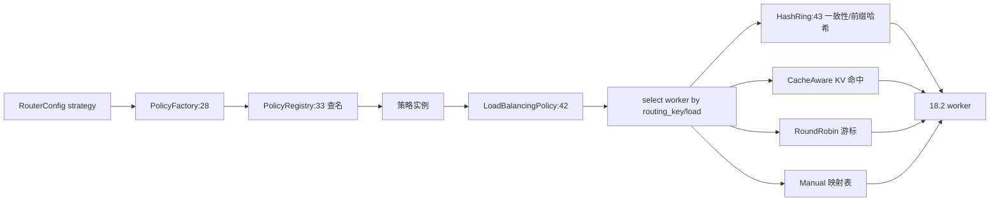

# 18.4 路由策略

## 定位

`src/policies/` 定义路由层"选哪个 worker"的策略族，统一于 `LoadBalancingPolicy` trait。9 种内置策略覆盖随机/轮询/缓存感知/两选一/桶/前缀哈希/一致性哈希/手工/前缀树，由 `PolicyFactory` 构造、`PolicyRegistry` 注册。`HashRing`（[18.2](18.2-worker-orchestration.md)）支撑一致性哈希与前缀哈希策略。

## 职责

- `LoadBalancingPolicy` trait（`mod.rs:42`）：策略统一接口，`Send + Sync + Debug`。
- `random.rs`：`RandomPolicy` 随机选。
- `round_robin.rs`：`RoundRobinPolicy` 轮询。
- `cache_aware.rs`：`CacheAwarePolicy` 按 KV cache 命中/余量选。
- `power_of_two.rs`：`PowerOfTwoPolicy` 两选一（轻负载候选）。
- `bucket.rs`：`BucketPolicy` 桶式分组。
- `prefix_hash.rs`：`PrefixHashPolicy`/`PrefixHashConfig` 按 prompt 前缀哈希定位（亲和 cache）。
- `consistent_hashing.rs`：`ConsistentHashingPolicy` 一致性哈希。
- `manual.rs`：`ManualPolicy`/`ManualConfig` 手工映射。
- `tree.rs`：前缀树匹配（`PrefixMatchResult`）。
- `factory.rs`/`registry.rs`/`utils.rs`：构造、注册、公共工具。

## 关键类与函数

| 名称 | 定义位置 | 说明 |
|---|---|---|
| `LoadBalancingPolicy` trait | `src/policies/mod.rs:42` | 策略统一接口 |
| `PolicyFactory` | `src/policies/factory.rs`/`mod.rs:28` | 策略工厂 |
| `PolicyRegistry` | `src/policies/registry.rs`/`mod.rs:33` | 策略注册表 |
| `RandomPolicy` | `src/policies/random.rs:15` | 随机 |
| `RoundRobinPolicy` | `src/policies/round_robin.rs` | 轮询 |
| `CacheAwarePolicy` | `src/policies/cache_aware.rs` | cache 感知 |
| `PowerOfTwoPolicy` | `src/policies/power_of_two.rs` | power-of-two-choices |
| `BucketPolicy` | `src/policies/bucket.rs` | 桶分组 |
| `PrefixHashConfig`/`PrefixHashPolicy` | `src/policies/prefix_hash.rs:39`/`:90` | 前缀哈希 |
| `ConsistentHashingPolicy` | `src/policies/consistent_hashing.rs` | 一致性哈希 |
| `ManualConfig`/`ManualPolicy` | `src/policies/manual.rs`/`mod.rs:29` | 手工映射 |
| `PrefixMatchResult` | `src/policies/tree.rs`/`mod.rs:35` | 前缀树匹配结果 |
| utils | `src/policies/utils.rs` | 公共工具 |

## 子模块树

- `policies/`
  - `mod.rs` — trait + re-export
  - `factory.rs`/`registry.rs`/`utils.rs`
  - `random.rs`/`round_robin.rs`/`cache_aware.rs`/`power_of_two.rs`/`bucket.rs`/`prefix_hash.rs`/`consistent_hashing.rs`/`manual.rs`/`tree.rs`

## 数据流 / 控制流

`PolicyFactory` 按 `RouterConfig` 的 strategy 字符串从 `PolicyRegistry` 查名构造策略实例。请求分发时 router 调策略 `select`，按 routing_key/load/cache 命中决定目标 worker。`cache_aware`/`prefix_hash` 提升 KV cache 命中率；`consistent_hashing`/`prefix_hash` 经 `HashRing` 稳定映射；`manual` 支持运维手工路由（如故障转移）。`tree` 提供前缀匹配能力供 prefix 类策略复用。

基准：`benches/consistent_hash_bench.rs`/`manual_policy_benchmark.rs` 对策略做 micro-bench。

## 交叉引用

- 上游: [18.3 Routers](18.3-routers.md) — router 调策略
- 上游: [18.2 Worker 编排](18.2-worker-orchestration.md) — `HashRing`/`WorkerRegistry`
- 相关: [`07 KV Cache`](../07-kv-cache/index.md) — `CacheAwarePolicy` 目标
- 相关: [`09 分离`](../09-disaggregation/index.md) — PD 路由用不同策略

## 进一步阅读

- 源码: `sgl-model-gateway/src/policies/`
- trait: `sgl-model-gateway/src/policies/mod.rs:42`
- bench: `sgl-model-gateway/benches/consistent_hash_bench.rs`
