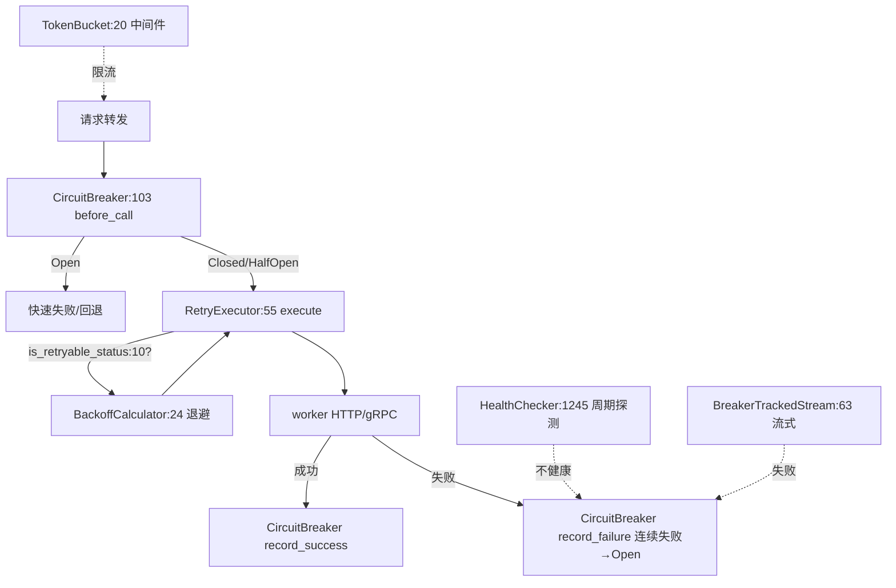

# 18.5 可靠性基元

## 定位

`src/core/` 下三个独立模块 `circuit_breaker.rs`/`retry.rs`/`token_bucket.rs` 加 `worker.rs` 的 `HealthChecker`/`HealthConfig`，构成网关的可靠性基元。它们在路由转发路径上联动：熔断器按失败计数开/半开/关，重试器对可重试状态码指数退避，令牌桶限流，健康检查周期探测并把不健康 worker 喂给熔断。

## 职责

- `circuit_breaker.rs`：`CircuitBreaker`（`CircuitState` Closed/Open/HalfOpen）+ `CircuitBreakerConfig` + `CircuitBreakerStats`；按连续失败/成功计数切换状态，半开试探。
- `retry.rs`：`RetryExecutor` + `BackoffCalculator` + `is_retryable_status` + `RetryError`；对 5xx/网络错误指数退避重试。
- `token_bucket.rs`：`TokenBucket` 令牌桶限流（也作 middleware 限流器）。
- `worker.rs::HealthConfig`/`HealthChecker`：周期健康探测配置与执行。
- `streaming_utils.rs::BreakerTrackedStream`：流式响应与熔断器联动（见 [18.3](18.3-routers.md)）。

## 关键类与函数

| 名称 | 定义位置 | 说明 |
|---|---|---|
| `CircuitBreakerConfig` | `src/core/circuit_breaker.rs:12` | 熔断配置（阈值/超时/半开试探数） |
| `CircuitState` | `src/core/circuit_breaker.rs:41` | Closed/Open/HalfOpen |
| `CircuitBreaker` | `src/core/circuit_breaker.rs:103` | 熔断器主体 |
| `CircuitBreakerStats` | `src/core/circuit_breaker.rs:414` | 状态统计 |
| `is_retryable_status` | `src/core/retry.rs:10` | 判断可重试 HTTP 状态 |
| `BackoffCalculator` | `src/core/retry.rs:24` | 指数退避计算 |
| `RetryError`/`RetryExecutor` | `src/core/retry.rs:48`/`:55` | 重试错误与执行器 |
| `TokenBucket` | `src/core/token_bucket.rs:20` | 令牌桶限流 |
| `HealthConfig` | `src/core/worker.rs:553` | 健康检查配置 |
| `HealthChecker` | `src/core/worker.rs:1245` | 健康检查器 |
| `BreakerTrackedStream` | `src/routers/streaming_utils.rs:63` | 流式 + 熔断跟踪 |

## 子模块树

- `core/circuit_breaker.rs` — 熔断
- `core/retry.rs` — 重试
- `core/token_bucket.rs` — 限流
- `core/worker.rs`（`HealthConfig`/`HealthChecker` 部分）
- `middleware.rs`（`TokenBucket` 作为 limiter 的接入）

## 数据流 / 控制流

请求进熔断器：`Open` 直接快速失败；`Closed`/`HalfOpen` 进 `RetryExecutor`，对可重试状态码经 `BackoffCalculator` 退避后重试。结果回写熔断器：成功清零连续失败，失败累加并可能转 `Open`。`HealthChecker` 周期探测，不健康 worker 喂给熔断促使其开路。`TokenBucket` 在中间件层限流保护后端。流式响应经 `BreakerTrackedStream` 把中途失败报给熔断。metrics（[18.9](18.9-gateway-observability.md)）暴露 `smg_worker_cb_state`/`smg_worker_retries_total`/`smg_worker_retry_backoff_seconds` 等。

## 交叉引用

- 上游: [18.2 Worker 编排](18.2-worker-orchestration.md) — `HealthChecker`/`HealthConfig`
- 上游: [18.3 Routers](18.3-routers.md) — `BreakerTrackedStream`
- 相关: [18.9 网关可观测](18.9-gateway-observability.md) — cb/retry metrics
- 相关: [`16.7 plugins`](../16-config-runtime/16.7-plugins.md) — 中间件概念类比（不同语言）

## 进一步阅读

- 源码: `sgl-model-gateway/src/core/circuit_breaker.rs`、`retry.rs`、`token_bucket.rs`
- 熔断: `sgl-model-gateway/src/core/circuit_breaker.rs:103`
- 重试: `sgl-model-gateway/src/core/retry.rs:55`
