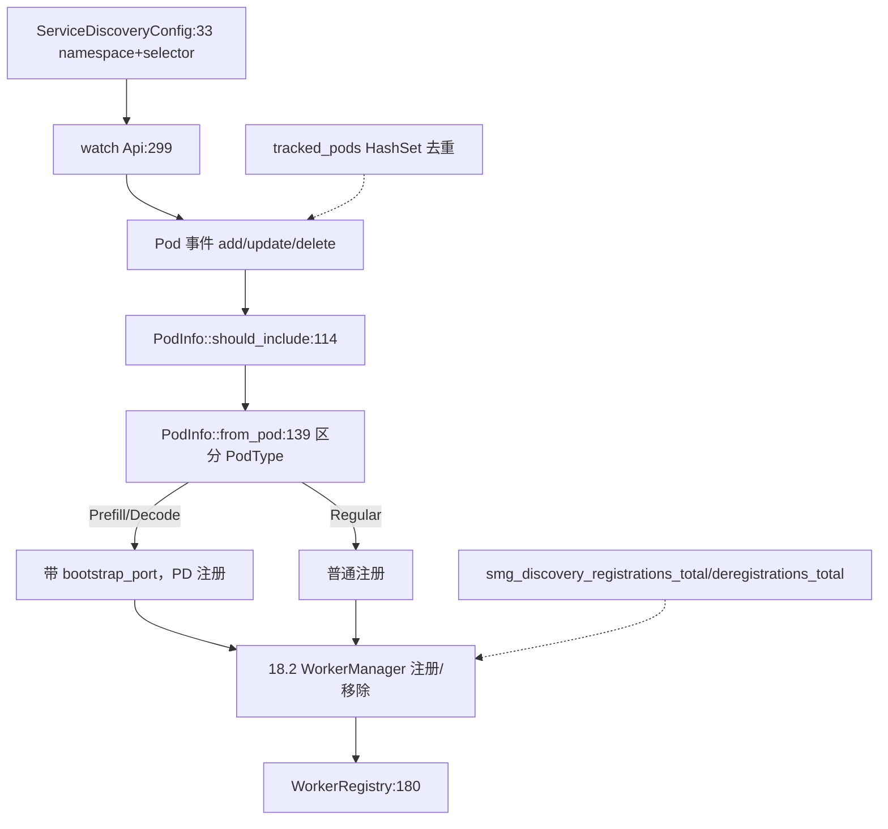

# 18.6 服务发现

## 定位

`src/service_discovery.rs` 让网关从 Kubernetes 集群自动发现 SGLang worker Pod，把它们注册进 `WorkerRegistry`（[18.2](18.2-worker-orchestration.md)）。它用 `kube`/`k8s-openapi` watch `Pod` 资源，按 label selector 与 Pod 状态过滤，区分 prefill/decode/regular 类型，周期或事件驱动同步。

## 职责

- `ServiceDiscoveryConfig`：namespace/label selector/端口/bootstrap 端口等发现配置。
- `PodInfo`：从 `Pod` 提取的 worker 信息（URL、类型、bootstrap 端口），`from_pod`/`should_include`/`matches_selector`。
- `PodType`：Regular/Prefill/Decode，决定 worker 注册路径与 bootstrap 端口。
- watch 循环：监听 Pod 增删改，调用 `WorkerManager` 注册/移除/标记节点。
- 启动一个后台 tokio task 维护 `tracked_pods`。

## 关键类与函数

| 名称 | 定义位置 | 说明 |
|---|---|---|
| `use k8s_openapi::api::core::v1::Pod` | `src/service_discovery.rs:8` | K8s Pod 类型 |
| `ServiceDiscoveryConfig` | `src/service_discovery.rs:33` | 发现配置 |
| `PodType` | `src/service_discovery.rs:84` | Regular/Prefill/Decode |
| `PodInfo` | `src/service_discovery.rs:91` | worker 信息，`pod_type`/`bootstrap_port` |
| `PodInfo::matches_selector` | `src/service_discovery.rs:103` | label selector 匹配 |
| `PodInfo::should_include` | `src/service_discovery.rs:114` | 过滤应纳入的 Pod |
| `PodInfo::from_pod` | `src/service_discovery.rs:139` | Pod→PodInfo，区分 PD 类型与端口 |
| watch 启动 | `src/service_discovery.rs:234` | 返回 `JoinHandle`，watch `Api<Pod>` |
| `DISCOVERY_KUBERNETES` | `src/observability/metrics.rs:419` | 常量标签值 |

## 子模块树

- `src/service_discovery.rs` — 单文件，依赖 `kube`/`k8s-openapi`

## 数据流 / 控制流

`ServiceDiscoveryConfig` 选 namespace 与 label selector；watch 循环收 Pod 事件，`should_include` 过滤后 `from_pod` 抽 `PodInfo`（按 Pod label/annotation 区分 Regular/Prefill/Decode，prefill 设 bootstrap_port）。事件转 `WorkerManager` 注册/移除/标记，`tracked_pods` 去重防重复。PD 类型走 PD 注册路径（含 bootstrap），Regular 走普通路径。metrics `smg_discovery_registrations_total`/`smg_discovery_deregistrations_total`/`smg_discovery_sync_duration_seconds`/`smg_discovery_workers_discovered` 记录发现行为。

## 交叉引用

- 下游: [18.2 Worker 编排](18.2-worker-orchestration.md) — `WorkerManager`/`WorkerRegistry`
- 相关: [18.9 网关可观测](18.9-gateway-observability.md) — `smg_discovery_*` metrics
- 相关: [`09 分离`](../09-disaggregation/index.md) — prefill/decode Pod 区分
- 相关: [`19.2 Docker`](../19-build-ci-dev/19.2-docker.md) — K8s 部署形态

## 进一步阅读

- 源码: `sgl-model-gateway/src/service_discovery.rs`
- 入口: `sgl-model-gateway/src/service_discovery.rs:33`
- 依赖: `sgl-model-gateway/Cargo.toml`（`kube`/`k8s-openapi`）
