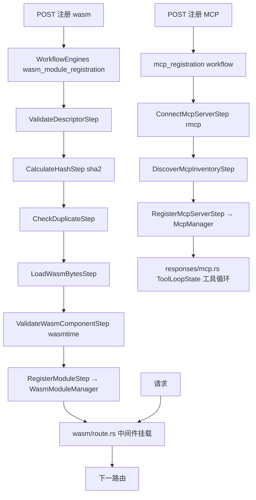

# 18.7 MCP/WASM

## 定位

网关在路由路径上提供两类可编程中间件：WASM（`src/wasm/`，wasmtime component-model）让用户用任意能编 wasm 组件的语言写请求处理逻辑；MCP（`routers/mcp_utils.rs` + `core/steps/mcp_registration.rs` + `smg-mcp` crate，rmcp 协议）把外部 Model Context Protocol server 接成工具循环。两者都经 `steps/` 多步工作流注册/移除。

## 职责

- `wasm/`：`mod.rs` + `route.rs`；wasmtime runtime，加载/校验/运行 component-model wasm 模块作中间件。`WasmModuleManager`（`app_context.rs`）持有实例。
- `mcp_utils.rs`：`McpLoopConfig` + `extract_server_label` + MCP 工具循环辅助；`smg-mcp::McpManager`（`app_context.rs`）管理 MCP server 连接。
- `core/steps/mcp_registration.rs`：`ConnectMcpServerStep`/`DiscoverMcpInventoryStep`/`RegisterMcpServerStep`/`ValidateRegistrationStep` + `create_mcp_registration_workflow`/`create_mcp_workflow_data`。
- `core/steps/wasm_module_registration.rs`：`ValidateDescriptorStep`/`CalculateHashStep`/`CheckDuplicateStep`/`LoadWasmBytesStep`/`ValidateWasmComponentStep`/`RegisterModuleStep` + `create_wasm_module_registration_workflow`。
- `core/steps/wasm_module_removal.rs`：`FindModuleToRemoveStep`/`RemoveModuleStep` + `create_wasm_module_removal_workflow`。
- `openai/responses/mcp.rs`：responses API 内的 MCP 工具循环状态（`ToolLoopState`/`FunctionCallInProgress`）。
- 依赖：`wasmtime 38`（`component-model`+`async`）、`smg-mcp`、`smg-wasm`、`rmcp 0.8.3`（client/server 多 transport）、`sha2`（wasm 哈希）。

## 关键类与函数

| 名称 | 定义位置 | 说明 |
|---|---|---|
| `WasmModuleManager` | `src/app_context.rs`（依赖 `smg-wasm`） | wasm 模块管理 |
| `route.rs` | `src/wasm/route.rs` | wasm 路由中间件接入 |
| `McpManager` | `src/app_context.rs`（`smg_mcp::McpManager`） | MCP server 管理 |
| `McpLoopConfig`/`extract_server_label` | `src/routers/mcp_utils.rs:31`/`:57` | MCP 循环配置 |
| `ConnectMcpServerStep` | `src/core/steps/mcp_registration.rs:35` | 连 MCP server 步骤 |
| `DiscoverMcpInventoryStep` | `src/core/steps/mcp_registration.rs:92` | 发现 MCP 工具 |
| `RegisterMcpServerStep` | `src/core/steps/mcp_registration.rs:146` | 注册 MCP server |
| `create_mcp_registration_workflow` | `src/core/steps/mcp_registration.rs:261` | MCP 注册工作流工厂 |
| `ValidateWasmComponentStep` | `src/core/steps/wasm_module_registration.rs:386` | wasm component 校验 |
| `RegisterModuleStep` | `src/core/steps/wasm_module_registration.rs:443` | 注册 wasm 模块 |
| `create_wasm_module_registration_workflow` | `src/core/steps/wasm_module_registration.rs:552` | wasm 注册工作流工厂 |
| `ToolLoopState`/`FunctionCallInProgress` | `src/routers/openai/responses/mcp.rs:47`/`:95` | responses MCP 工具循环 |

## 子模块树

- `src/wasm/` — `mod.rs`/`route.rs`
- `src/routers/mcp_utils.rs`
- `src/core/steps/mcp_registration.rs`/`wasm_module_registration.rs`/`wasm_module_removal.rs`
- `src/routers/openai/responses/mcp.rs`（responses MCP 循环）

## 数据流 / 控制流

wasm 注册经多步工作流：描述符校验→哈希→去重→载字节→wasmtime component 校验→注册进 `WasmModuleManager`，再由 `wasm/route.rs` 在路由路径挂载。MCP 注册经 connect→discover inventory→register→validate 四步，`McpManager` 维护连接；responses API 在 `responses/mcp.rs` 内跑工具循环（`ToolLoopState`）。rmcp 支持 stdio/SSE/streamable-http 多 transport。`benches/wasm_middleware_latency.rs` 测中间件延迟开销。

## 交叉引用

- 上游: [18.2 Worker 编排](18.2-worker-orchestration.md) — `WorkflowEngines`/`steps`
- 下游: [18.3 Routers](18.3-routers.md) — wasm/MCP 在路由路径注入
- 相关: [`02.3.5 responses`](../02-server-api/02.3.5-openai-responses-harmony-tool.md) — responses 工具循环协议
- 相关: [`11.7 function call`](../11-sampling-control/11.7.1-function-call-parser.md) — 函数调用解析

## 进一步阅读

- 源码: `sgl-model-gateway/src/wasm/`、`src/core/steps/mcp_registration.rs`、`src/routers/mcp_utils.rs`
- 依赖: `sgl-model-gateway/Cargo.toml`（`wasmtime`/`smg-mcp`/`smg-wasm`/`rmcp`）
- bench: `sgl-model-gateway/benches/wasm_middleware_latency.rs`
