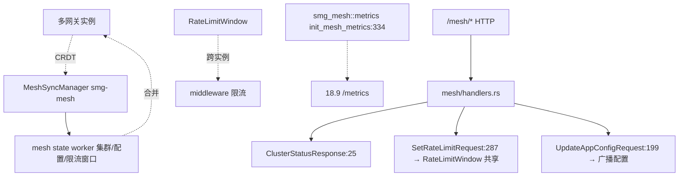

# 18.8 Mesh HA

## 定位

网关的 mesh 模式（`routers/mesh/` + `smg-mesh` crate）让多个网关实例组成 mesh，用 CRDT 同步 worker 集群状态与配置，实现 HA 与多实例一致性。`server.rs` 侧用 `smg_mesh::MeshServerHandler`/`MeshSyncManager`/`RateLimitWindow` 把 mesh 接入 axum server，`routers/mesh/handlers.rs` 暴露 mesh 管理 HTTP 端点。`smg-mesh` 二进制名 `smg-mesh`。

## 职责

- `routers/mesh/handlers.rs`：mesh 管理 HTTP 端点——`ClusterStatusResponse`/`NodeInfo`/`StoreStatus`/`MeshHealthResponse`/`UpdateAppConfigRequest`/`SetRateLimitRequest`。
- `smg-mesh` crate（依赖）：CRDT 状态同步、`MeshServerConfig`/`MeshServerHandler`/`MeshSyncManager`、`RateLimitWindow` 共享限流窗口、mesh metrics。
- `server.rs`：装配 mesh server handler 与 sync manager，暴露 mesh 端点。
- 依赖 `crdts 7.3` + `redis 0.27`（CRDT 与持久化/协调）。
- mesh state 经 CRDT 合并，保证多实例最终一致；限流窗口跨实例共享。

## 关键类与函数

| 名称 | 定义位置 | 说明 |
|---|---|---|
| mesh server 装配 | `src/server.rs:19` | `MeshServerConfig`/`MeshServerHandler`/`MeshSyncManager`/`RateLimitWindow` import |
| `ClusterStatusResponse` | `src/routers/mesh/handlers.rs:25` | 集群状态响应 |
| `NodeInfo` | `src/routers/mesh/handlers.rs:33` | mesh 节点信息 |
| `StoreStatus` | `src/routers/mesh/handlers.rs:41` | store 状态 |
| `MeshHealthResponse` | `src/routers/mesh/handlers.rs:50` | mesh 健康响应 |
| `UpdateAppConfigRequest` | `src/routers/mesh/handlers.rs:199` | 更新配置请求 |
| `SetRateLimitRequest` | `src/routers/mesh/handlers.rs:287` | 设置限流请求 |
| `init_mesh_metrics` | `src/observability/metrics.rs:334` | mesh metrics 初始化（`smg_mesh::metrics`） |

## 子模块树

- `src/routers/mesh/` — `mod.rs`/`handlers.rs`
- `src/server.rs`（mesh 装配段）
- 外部 crate `smg-mesh`（CRDT + Redis + sync manager）

## 数据流 / 控制流

多实例各自跑 `MeshSyncManager`，CRDT 状态（worker 集群、app 配置、限流窗口）持续合并达成最终一致。`mesh/handlers.rs` 暴露查询（cluster status/store status/health）与控制端点（set rate limit/update app config）。`RateLimitWindow` 让限流跨实例共享，`UpdateAppConfigRequest` 改配置广播全网。`init_mesh_metrics` 把 mesh 自有指标并入 `/metrics`。

## 交叉引用

- 上游: [18.1 网关总览](18.1-gateway-overview.md) — `server.rs` 装配
- 下游: [18.9 网关可观测](18.9-gateway-observability.md) — mesh metrics
- 相关: [18.2 Worker 编排](18.2-worker-orchestration.md) — mesh 同步 worker 集群
- 相关: [18.5 可靠性基元](18.5-reliability-primitives.md) — `RateLimitWindow` 与 `TokenBucket` 并存

## 进一步阅读

- 源码: `sgl-model-gateway/src/routers/mesh/`、`src/server.rs`
- 依赖: `sgl-model-gateway/Cargo.toml`（`smg-mesh`/`crdts`/`redis`）
- handlers: `sgl-model-gateway/src/routers/mesh/handlers.rs:25`
