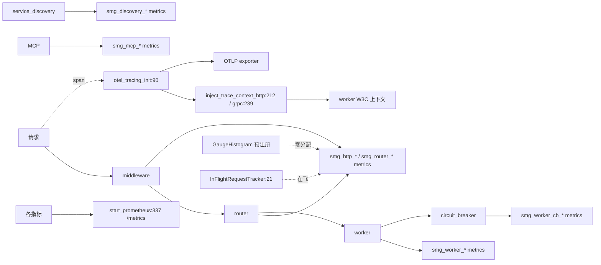

# 18.9 网关可观测

## 定位

`src/observability/` 是 Rust 侧观测面：40+ `smg_*` Prometheus 指标、OpenTelemetry trace（OTLP gRPC + W3C 上下文注入）、自研 `GaugeHistogram`（预注册零分配热路径）、inflight 请求跟踪、结构化日志、请求事件。`metrics.rs` 用 `metrics`/`metrics-exporter-prometheus` 注册全部指标，`otel_trace.rs` 用 `opentelemetry`/`tracing-opentelemetry` 导出 trace。

## 职责

- `metrics.rs`：`describe_*!` 注册 40+ `smg_*` 指标（HTTP/router/worker/cb/retry/discovery/mcp/db），`PrometheusConfig` + `start_prometheus`，`Metrics`/`StreamingMetricsParams`。
- `otel_trace.rs`：`otel_tracing_init`/`get_otel_layer`/`is_otel_enabled`/`shutdown_otel` + `inject_trace_context_http`/`inject_trace_context_grpc`（W3C）+ `OtelTraceInjector`。
- `gauge_histogram.rs`：`BucketBounds`/`GaugeHistogramHandle`/`GaugeHistogramVec`/`CachedGaugeHistogram`，预注册 handle 热路径零分配。
- `inflight_tracker.rs`：`InFlightRequestTracker`/`InFlightGuard` 跟踪在飞请求。
- `events.rs`：`RequestReceivedEvent`/`RequestSentEvent`/`RequestPDSentEvent`。
- `logging.rs`：`LoggingConfig`/`LogGuard`/`init_logging`（tracing-subscriber json/env-filter + otel layer）。

## 关键类与函数

| 名称 | 定义位置 | 说明 |
|---|---|---|
| `PrometheusConfig`/`start_prometheus` | `src/observability/metrics.rs:132`/`:337` | Prometheus 配置与启动 |
| `Metrics`/`StreamingMetricsParams` | `src/observability/metrics.rs:455`/`:458` | 指标集合 |
| `smg_http_requests_total` 等 | `src/observability/metrics.rs:151` 起 | 40+ 指标 describe/register |
| `smg_router_ttft_seconds`/`smg_router_tpot_seconds` | `src/observability/metrics.rs:199`/`:203` | TTFT/TPOT |
| `smg_worker_cb_state`/`smg_worker_retries_total` | `src/observability/metrics.rs:251`/`:273` | 熔断/重试指标 |
| `init_mesh_metrics` | `src/observability/metrics.rs:334` | mesh 指标初始化 |
| `otel_tracing_init` | `src/observability/otel_trace.rs:90` | OTLP 初始化 |
| `get_otel_layer`/`is_otel_enabled`/`shutdown_otel` | `src/observability/otel_trace.rs:154`/`:179`/`:200` | otel layer 接入 |
| `inject_trace_context_http`/`inject_trace_context_grpc` | `src/observability/otel_trace.rs:212`/`:239` | W3C 上下文注入 |
| `OtelTraceInjector` | `src/observability/otel_trace.rs:269` | 实现 `smg_grpc_client::TraceInjector` |
| `GaugeHistogramHandle`/`GaugeHistogramVec`/`CachedGaugeHistogram` | `src/observability/gauge_histogram.rs:171`/`:215`/`:316` | 预注册零分配直方图 |
| `BucketBounds` | `src/observability/gauge_histogram.rs:59` | bucket 边界 |
| `InFlightRequestTracker`/`InFlightGuard` | `src/observability/inflight_tracker.rs:21`/`:80` | 在飞跟踪 |
| `RequestReceivedEvent`/`RequestSentEvent`/`RequestPDSentEvent` | `src/observability/events.rs`/`:48`/`:21` | 请求事件 |
| `LoggingConfig`/`LogGuard`/`init_logging` | `src/observability/logging.rs:30`/`:55`/`:90` | 日志初始化 |

## 子模块树

- `observability/` — `mod.rs`/`metrics.rs`/`otel_trace.rs`/`gauge_histogram.rs`/`inflight_tracker.rs`/`events.rs`/`logging.rs`

## 数据流 / 控制流

请求路径上各层调 `counter!`/`gauge!`/`GaugeHistogram` 记 `smg_*` 指标；`start_prometheus` 暴露 `/metrics`。`otel_tracing_init` 建 OTLP exporter，`inject_trace_context_*` 在转发到 worker 时注入 W3C `traceparent`/`tracestate`，与 [17.2](17.2-opentelemetry-tracing.md) Python 侧上下文对接。`GaugeHistogram` 在启动期预注册所有 handle，热路径仅写预分配槽。`InFlightRequestTracker` 用 RAII `InFlightGuard` 跟踪在飞请求并算 age 直方图。日志经 `init_logging` 装 tracing-subscriber + otel layer。

## 交叉引用

- 上游: [18.1 网关总览](18.1-gateway-overview.md) — server 装配
- 相关: [18.5 可靠性基元](18.5-reliability-primitives.md) — cb/retry 指标来源
- 相关: [`17.2 OTel tracing`](../17-observability-ops/17.2-opentelemetry-tracing.md) — Python 侧 W3C 对端
- 相关: [`17.1 Prometheus metrics`](../17-observability-ops/17.1-prometheus-metrics.md) — Python 侧 `sglang:*` 对照

## 进一步阅读

- 源码: `sgl-model-gateway/src/observability/`
- 指标: `sgl-model-gateway/src/observability/metrics.rs:132`
- trace: `sgl-model-gateway/src/observability/otel_trace.rs:90`
