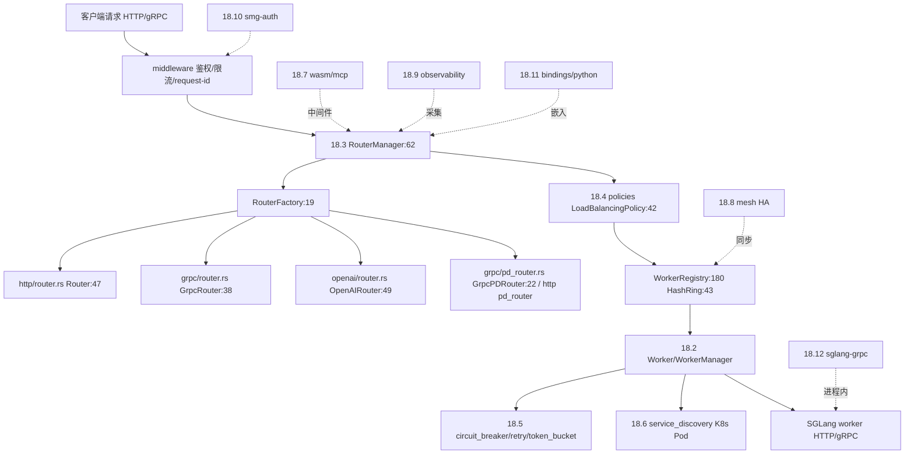

# 18 模型网关与代理

## 定位

`sgl-model-gateway/` 是 SGLang 的 Rust 控制面与数据面网关（crate `smg`，二进制 `sgl-model-gateway`/`smg`/`amg`）。它在 SGLang worker 之前承担请求路由、负载均衡、PD 分离路由、worker 编排、可靠性（熔断/重试/限流）、服务发现、MCP/WASM 中间件、mesh HA、OpenTelemetry/Prometheus 观测、JWT/OIDC 鉴权，并提供 Python（maturin）与 gRPC Rust 桥绑定。`rust/sglang-grpc/` 提供进程内 Rust gRPC server，让 Python 推理进程暴露 gRPC。

## 职责

- `core/`：`Worker` trait、`WorkerRegistry`/`HashRing`、`WorkerManager`/`LoadMonitor`、`WorkerService`、`JobQueue`、`circuit_breaker`/`retry`/`token_bucket`、`steps/` 多步工作流引擎。
- `routers/`：`RouterManager`/`RouterFactory` + HTTP/gRPC/OpenAI/Mesh 路由 + conversations/parse/tokenize/header_utils/streaming_utils/mcp_utils/persistence_utils。
- `policies/`：random/round_robin/cache_aware/power_of_two/bucket/prefix_hash/consistent_hashing/manual/tree + `LoadBalancingPolicy` trait + factory/registry。
- `service_discovery.rs`：Kubernetes Pod watch（kube/k8s-openapi）。
- `wasm/` + `mcp_utils.rs`：wasmtime component-model 中间件 + rmcp MCP。
- `routers/mesh/` + `smg-mesh`：CRDT mesh 状态、HA、限流窗口。
- `observability/`：40+ `smg_*` metrics、OTLP trace、gauge_histogram、inflight_tracker、logging、events。
- `smg-auth`（re-export `auth`）：jsonwebtoken JWT/OIDC。
- `bindings/python`：pyo3 + maturin → `sglang_router` 包；`rust/sglang-grpc`：进程内 gRPC。

## 子系统边界图

## 子系统内导航

| 编号 | 页面 | 一句话定位 |
|---|---|---|
| 18.1 | [网关总览](18.1-gateway-overview.md) | crate/binary/依赖/绑定全貌 |
| 18.2 | [Worker 编排](18.2-worker-orchestration.md) | Worker/Registry/Manager/JobQueue/steps |
| 18.3 | [Routers](18.3-routers.md) | HTTP/gRPC/OpenAI/Mesh 路由族 |
| 18.4 | [路由策略](18.4-routing-policies.md) | 9 种 LoadBalancingPolicy |
| 18.5 | [可靠性基元](18.5-reliability-primitives.md) | 熔断/重试/限流/健康检查 |
| 18.6 | [服务发现](18.6-service-discovery.md) | K8s Pod watch |
| 18.7 | [MCP/WASM](18.7-mcp-wasm.md) | wasmtime + rmcp 中间件 |
| 18.8 | [Mesh HA](18.8-mesh-ha.md) | CRDT mesh 状态与限流 |
| 18.9 | [网关可观测](18.9-gateway-observability.md) | smg_* metrics + OTLP |
| 18.10 | [Auth](18.10-auth.md) | smg-auth JWT/OIDC |
| 18.11 | [Python bindings](18.11-python-bindings.md) | maturin/pyo3 |
| 18.12 | [进程内 Rust gRPC](18.12-in-process-rust-grpc.md) | sglang-grpc 桥 |

## 交叉引用

- 上游: [`02 服务入口`](../02-server-api/index.md) — OpenAI 兼容协议、`02.5 grpc`
- 下游: [`03 编排`](../03-orchestration/index.md) — worker 即 SGLang Scheduler 进程
- 相关: [`09 分离`](../09-disaggregation/index.md) — PD 路由
- 相关: [`19 构建`](../19-build-ci-dev/index.md) — `pr-test-rust` CI

## 进一步阅读

- 源码: `sgl-model-gateway/`、`rust/sglang-grpc/`
- 说明: `sgl-model-gateway/README.md`
- 依赖清单: `sgl-model-gateway/Cargo.toml`
