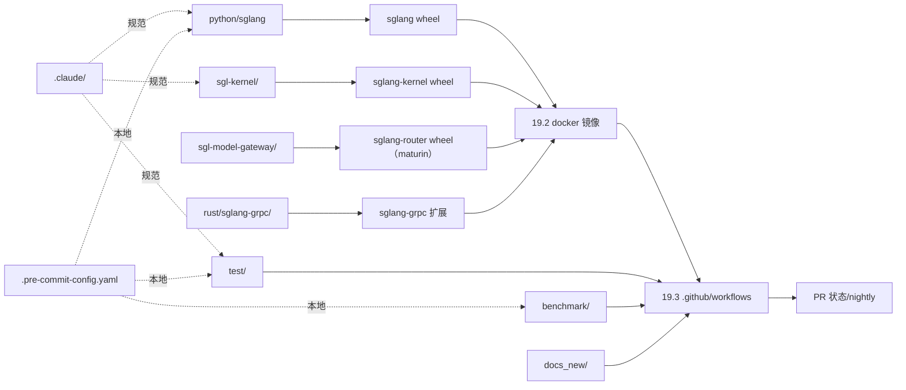

# 19.1 仓库布局

## 定位

本页从"构建与 CI"视角梳理 SGLang 仓库顶层布局，是 [`00.2 仓库地图`](../00-overview/00.2-repo-map.md) 的补充视角——侧重每个顶层目录在构建/测试/发布链路中的角色，而非运行时架构。

## 职责（按顶层目录）

- `python/`：主 Python 包 `sglang`（前端 + `srt` 后端 + `kernels`/`jit_kernel`/`eval`/`bench_*`/`profiler`/`multimodal_gen`），setup.py/pyproject 发 wheel。
- `sgl-kernel/`：AOT 内核库（[15.2](../15-kernels-hardware/15.2-sgl-kernel-aot.md)），独立 `pyproject_*.toml` 多平台 wheel。
- `sgl-model-gateway/`：Rust 网关（[18](../18-gateway/index.md)），workspace + `bindings/python`。
- `rust/sglang-grpc/`：进程内 gRPC 桥（[18.12](../18-gateway/18.12-in-process-rust-grpc.md)）。
- `test/`：CI 测试体系（[19.5](19.5-test-system.md)）。
- `benchmark/`：基准脚本集（[19.6](19.6-benchmarks.md)）。
- `docker/`：镜像（[19.2](19.2-docker.md)）。
- `develop/`：开发资产（当前仅 `wiki/`）。
- `scripts/`：运维/发布/CI 辅助（[19.4](19.4-dev-tools.md)）。
- `experimental/`：实验代码（[19.10](19.10-experimental.md)）。
- `docs_new/`：Mintlify 文档站。
- `examples/`：示例脚本。
- `proto/`：gRPC proto 定义。
- `3rdparty/`：第三方依赖。
- `assets/`：静态资源。
- `.github/`：CI（[19.3](19.3-ci-workflows.md)）+ actions。
- `.devcontainer/`：容器化开发（[19.4](19.4-dev-tools.md)）。
- `.claude/`：skills + rules（[19.8](19.8-contribution-conventions.md)）。
- `.pre-commit-config.yaml`：本地守卫（[19.8](19.8-contribution-conventions.md)）。

## 顶层条目

| 路径 | 角色 |
|---|---|
| `python/sglang/` | 主包（前端+srt+kernels） |
| `sgl-kernel/` | AOT 内核 wheel |
| `sgl-model-gateway/` | Rust 网关 crate |
| `rust/sglang-grpc/` | gRPC 桥 |
| `test/` / `benchmark/` | 测试与基准 |
| `docker/` / `.github/` / `scripts/` / `.devcontainer/` | 构建/CI/开发 |
| `experimental/` / `docs_new/` / `examples/` / `proto/` / `3rdparty/` | 实验/文档/示例/proto/三方 |
| `.claude/` / `.pre-commit-config.yaml` | 约定守卫 |

## 构建/CI 关系图

四个可发布单元（`sglang`/`sglang-kernel`/`sglang-router`/`sglang-grpc`）各自有构建配置，最终汇入 Docker 镜像供 CI 与部署使用。`.github/workflows` 按"哪个包变更"（`_pr-test-check-changes`）决定跑 kernel/rust/router/主 哪条 CI。`.claude/` 与 pre-commit 在本地与 CI 守卫代码风格。

## 交叉引用

- 互补: [`00.2 仓库地图`](../00-overview/00.2-repo-map.md)
- 详见: [19.2 Docker](19.2-docker.md) / [19.3 CI](19.3-ci-workflows.md) / [19.4 开发工具](19.4-dev-tools.md)
- 构建 unit: [`15.2 sgl-kernel`](../15-kernels-hardware/15.2-sgl-kernel-aot.md) / [`18.11 bindings`](../18-gateway/18.11-python-bindings.md) / [`18.12 sglang-grpc`](../18-gateway/18.12-in-process-rust-grpc.md)

## 进一步阅读

- 顶层: `ls /home/lychee/mycode/sglang`
- 构建: `python/sglang/setup.py`、`sgl-kernel/CMakeLists.txt`、`sgl-model-gateway/Cargo.toml`
