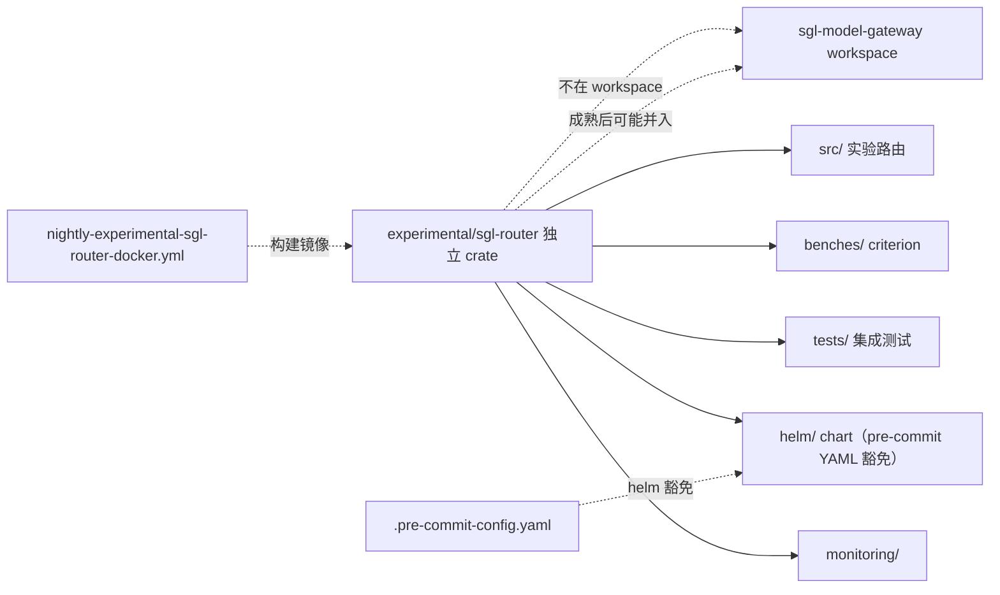

# 19.10 experimental

## 定位

`experimental/` 收纳尚在实验阶段、未并入主运行时路径的代码。当前含 `sgl-router/`——一个独立 Rust crate（不同于 [18](../18-gateway/index.md) 的 `sgl-model-gateway`），带自己的 `Cargo.toml`/`rust-toolchain.toml`/`deny.tomn`/`benches/`/`monitoring/`/`tests/`/`helm/`（pre-commit 对 helm 模板做 YAML 豁免）。它独立演进，CI 与主仓隔离。

## 职责

- `experimental/sgl-router/`：实验性 Rust 路由器 crate。
  - `Cargo.toml`/`rust-toolchain.toml`/`deny.tomn`：构建与依赖审计配置。
  - `src/`：路由器源码。
  - `benches/`：criterion 基准。
  - `tests/`：集成测试。
  - `monitoring/`：监控配置。
  - `helm/`：Helm chart（`templates/` 内 Go 模板，pre-commit 校验豁免）。
  - `BENCHMARKS.md`/`README.md`：基准与说明。
- 被 `Cargo.toml` workspace 排除（`sgl-model-gateway/Cargo.toml:3` `exclude = ["bindings/golang", "examples"]`，experimental 不在 workspace）。

## 关键文件

| 文件 | 说明 |
|---|---|
| `experimental/sgl-router/Cargo.toml` | 实验 crate 构建 |
| `experimental/sgl-router/rust-toolchain.toml` | 工具链锁定 |
| `experimental/sgl-router/deny.tomn` | 依赖审计 |
| `experimental/sgl-router/src/` | 源码 |
| `experimental/sgl-router/benches/` | criterion bench |
| `experimental/sgl-router/tests/` | 集成测试 |
| `experimental/sgl-router/monitoring/` | 监控 |
| `experimental/sgl-router/helm/` | Helm chart（template YAML 豁免） |
| `experimental/sgl-router/BENCHMARKS.md`/`README.md` | 基准/说明 |

## 子模块树

- `experimental/sgl-router/` — `Cargo.toml`/`rust-toolchain.toml`/`deny.tomn` + `src/`/`benches/`/`tests/`/`monitoring/`/`helm/` + docs

## 关系图

`experimental/sgl-router` 独立于主 `sgl-model-gateway` workspace，有自己的工具链与依赖审计。`nightly-experimental-sgl-router-docker.yml` 跑其镜像构建。pre-commit 对 `experimental/sgl-router/helm/.../templates/*.yaml` 做 check-yaml 豁免（Go 模板非合法 YAML，由 `helm template`/`helm lint` 校验）。实验 crate 成熟后可能并入主网关或保持独立。

## 交叉引用

- 对照: [`18.1 网关总览`](../18-gateway/18.1-gateway-overview.md) — 主 Rust 网关
- 相关: [19.3 CI](19.3-ci-workflows.md) — `nightly-experimental-sgl-router-docker`
- 相关: [19.8 贡献约定](19.8-contribution-conventions.md) — pre-commit helm 豁免

## 进一步阅读

- 源: `experimental/sgl-router/`
- 说明: `experimental/sgl-router/README.md`、`BENCHMARKS.md`
- nightly: `.github/workflows/nightly-experimental-sgl-router-docker.yml`
