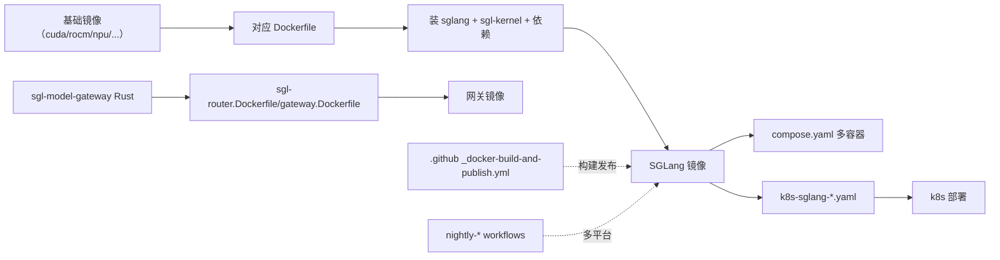

# 19.2 Docker

## 定位

`docker/` 提供覆盖多硬件平台的 SGLang 部署镜像、网关镜像、k8s 编排清单与 compose 配置。它是 CI runner 环境与生产部署的共同基础，把 Python wheel + sgl-kernel + 模型依赖打包成可直接 `docker run` 的镜像。

## 职责

- `Dockerfile`：主 CUDA 镜像。
- `arm64.Dockerfile`/`xeon.Dockerfile`：ARM64 / Intel Xeon CPU 镜像。
- `rocm.Dockerfile`：AMD ROCm 镜像。
- `npu.Dockerfile`：Ascend NPU 镜像。
- `xpu.Dockerfile`：Intel XPU 镜像。
- `sagemaker.Dockerfile`：AWS SageMaker 镜像。
- `sgl-deep-gemm.Dockerfile`：带 DeepGEMM 编译环境。
- `sgl-router.Dockerfile` / `gateway.Dockerfile`：Rust 网关镜像（[18](../18-gateway/index.md)）。
- `compose.yaml` + `configs/`：多容器编排。
- `k8s-sglang-service.yaml` / `k8s-sglang-distributed-sts.yaml`：k8s Service / StatefulSet 部署清单。
- `serve`：容器内启动脚本。

## 关键文件

| 文件 | 说明 |
|---|---|
| `docker/Dockerfile` | 主 CUDA 镜像 |
| `docker/rocm.Dockerfile` / `npu.Dockerfile` / `xpu.Dockerfile` / `xeon.Dockerfile` / `arm64.Dockerfile` | 厂商镜像 |
| `docker/sagemaker.Dockerfile` | SageMaker |
| `docker/sgl-deep-gemm.Dockerfile` | DeepGEMM 编译 |
| `docker/sgl-router.Dockerfile` / `gateway.Dockerfile` | 网关镜像 |
| `docker/compose.yaml` / `configs/` | 多容器编排 |
| `docker/k8s-sglang-service.yaml` / `k8s-sglang-distributed-sts.yaml` | k8s 清单 |
| `docker/serve` | 容器启动脚本 |

## 子模块树

- `docker/` — 各平台 Dockerfile + compose + configs + k8s + serve

## 构建流

CI 里 `_docker-build-and-publish.yml` 负责构建与发布镜像，`_docker-cleanup-nightly.yml` 清理。各 nightly 工作流（`nightly-test-amd`/`npu`/`intel`/`musa`）用对应厂商镜像跑全量测试。生产可经 `compose.yaml` 或 k8s 清单部署，PD 分离用 StatefulSet。

## 交叉引用

- 上游: [19.1 仓库布局](19.1-repo-layout.md) — 顶层定位
- 下游: [19.3 CI](19.3-ci-workflows.md) — runner 镜像来源
- 相关: [`15.5 platforms`](../15-kernels-hardware/15.5-platforms.md) — 厂商平台
- 相关: [`18.6 服务发现`](../18-gateway/18.6-service-discovery.md) — k8s Pod 发现
- 相关: [`09 分离`](../09-disaggregation/index.md) — distributed StatefulSet

## 进一步阅读

- 源: `docker/`
- k8s: `docker/k8s-sglang-service.yaml`、`docker/k8s-sglang-distributed-sts.yaml`
- 构建发布: `.github/workflows/_docker-build-and-publish.yml`
