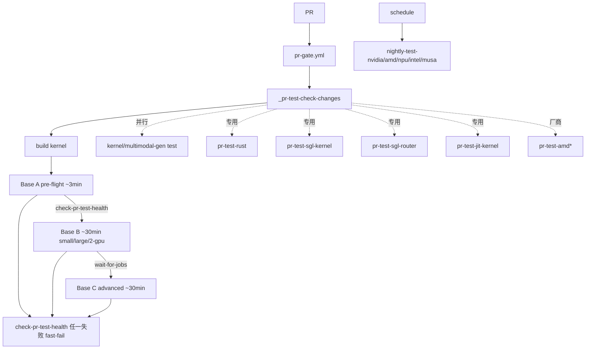

# 19.3 CI 工作流

## 定位

`.github/workflows/` 是 SGLang CI/CD 总控。主 PR 流水线 `pr-test.yml` 分 Base A/B/C 三阶段，按"哪个包变更"分流到 kernel/rust/router/jit/multimodal-gen 专用工作流；nightly 覆盖各厂商全量测试；bot 自动化版本 bump 与 cherry-pick。本页是 `.claude/skills/ci-workflow-guide` 的代码侧索引。

## 职责

- PR 主流水：`pr-test.yml`（A/B/C 阶段）+ `pr-test-extra.yml`（双标签门控）+ `pr-gate.yml`（draft/label/rate limit）。
- 复用件：`_pr-test-stage.yml`（阶段模板）、`_pr-test-check-changes.yml`（变更包检测）、`_pr-test-sgl-kernel-build.yml`。
- 专用 PR：`pr-test-rust.yml`/`pr-test-sgl-kernel.yml`/`pr-test-sgl-router.yml`/`pr-test-jit-kernel.yml`/`pr-test-multimodal-gen.yml`/`pr-benchmark-rust.yml`。
- 厂商 PR：`pr-test-amd.yml`/`-amd-rocm720.yml`/`-amd-extra.yml`/`pr-test-xpu.yml`/`pr-test-xeon.yml`/`pr-test-musa.yml`/`pr-test-npu.yml`/`pr-test-mlx.yml`/`pr-test-arm64.yml`。
- nightly：`nightly-test-nvidia.yml`/`-amd.yml`/`-npu.yml`/`-intel.yml`/`-musa.yml`/`nightly-72-gpu-gb200.yml`/`nightly-amd-mi355x-disagg.yml`/`nightly-test-npu-e2e-*`。
- 维护/监控：`ci-auto-bisect.yml`/`ci-coverage-overview.yml`/`ci-failure-monitor.yml`/`ci-model-inventory.yml`/`list-active-pr-runs.yml`/`cancel-unfinished-pr-tests.yml`/`cancel-pr-workflows-on-close.yml`。
- bot：`bot-bump-{kernel,sglang,flashinfer,docs}-version.yml`/`bot-cherry-pick.yml`。
- actions：`check-pr-test-health`（fast-fail）、`wait-for-jobs`（stage gating）、`check-maintenance`。
- 核心 runner：`test/run_suite.py` + `python/sglang/test/ci/ci_register.py`（AST 注册）+ `ci_utils.py`（执行/retry）+ `scripts/ci/utils/slash_command_handler.py`。

## 关键文件

| 文件 | 角色 |
|---|---|
| `.github/workflows/pr-test.yml` | 主流水 A/B/C |
| `.github/workflows/pr-test-extra.yml` | 双标签 extra |
| `.github/workflows/pr-gate.yml` | PR 门控 |
| `.github/workflows/_pr-test-stage.yml` | 阶段模板 |
| `.github/workflows/_pr-test-check-changes.yml` | 变更包检测 |
| `.github/workflows/pr-test-rust.yml` 等 | 专用/厂商 PR |
| `.github/actions/check-pr-test-health/action.yml` | 跨 job fast-fail |
| `.github/actions/wait-for-jobs/action.yml` | 阶段 gating |
| `test/run_suite.py` | 套件 runner |
| `python/sglang/test/ci/ci_register.py` | AST 注册 + LPT 分区 |
| `python/sglang/test/ci/ci_utils.py` | `run_unittest_files` |

## 阶段流

Base A 是 pre-flight（small GPU/CPU），B 是基础测试（small/large/2-gpu），C 是高级测试；`check-pr-test-health` 每阶段跨 job fast-fail，`wait-for-jobs` 阶段间 gating。`run_suite.py` 按 `--suite base-{a,b,c}-test-{n}-gpu-{hw}` 收集 `test/registered/` 下 `register_*_ci` 标记的测试，支持 `--auto-partition` LPT 并行。专用/厂商工作流由 `_pr-test-check-changes` 的变更包检测结果触发。slash 命令（`/rerun-stage` 等）经 `slash_command_handler.py` 处理。

## 交叉引用

- 上游: [19.1 仓库布局](19.1-repo-layout.md) / [19.2 Docker](19.2-docker.md)
- 下游: [19.5 测试体系](19.5-test-system.md) — `run_suite`/`ci_register`
- 相关: [`15.8 skills`](../15-kernels-hardware/15.8-adding-kernels-skills.md) — kernel CI 套件
- 相关: [`18.11 bindings`](../18-gateway/18.11-python-bindings.md) — `pr-test-rust`/`pr-test-sgl-router`
- 相关 skill: `.claude/skills/ci-workflow-guide`、`sglang-bisect-ci-regression`、`sglang-cherrypick`

## 进一步阅读

- 工作流: `.github/workflows/pr-test.yml`
- runner: `test/run_suite.py`
- skill: `.claude/skills/ci-workflow-guide/SKILL.md`
