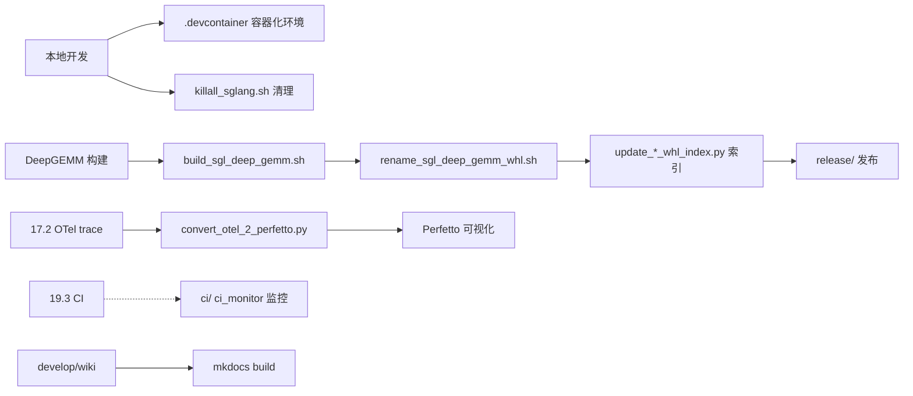

# 19.4 开发工具

## 定位

`develop/`、`scripts/`、`.devcontainer/` 提供开发与运维辅助：`develop/` 当前承载本 Wiki；`scripts/` 维护 CI 监控、wheel 索引、发布、playground、转换工具等；`.devcontainer/` 提供 VS Code/Codespaces 容器化开发环境。它们不在运行时路径上，仅服务于开发流程。

## 职责

- `develop/wiki/`：本架构 Wiki（mkdocs）。
- `scripts/`：
  - `build_sgl_deep_gemm.sh`/`rename_sgl_deep_gemm_whl.sh`：DeepGEMM wheel 构建/改名。
  - `update_*_whl_index.py`（kernel/pr/nightly/deepgemm）：维护 whl 索引。
  - `ci/` + `ci_monitor/`：CI 辅助与监控。
  - `code_sync/`：代码同步。
  - `convert_otel_2_perfetto.py`：OTel trace 转 Perfetto。
  - `export_deepseek_nextn.py`：DeepSeek NEXTN 导出。
  - `killall_sglang.sh`：清理本地 sglang 进程。
  - `playground/`：实验脚本。
  - `release/`：发布脚本。
  - `sort_testcases_alphabetically.py`：测试用例排序。
- `.devcontainer/`：`Dockerfile` + `devcontainer.json`，容器化开发环境。

## 关键文件

| 文件 | 说明 |
|---|---|
| `develop/wiki/` | 架构 Wiki（本目录） |
| `scripts/build_sgl_deep_gemm.sh` | DeepGEMM wheel 构建 |
| `scripts/rename_sgl_deep_gemm_whl.sh` | DeepGEMM whl 改名 |
| `scripts/update_kernel_whl_index.py`/`update_pr_whl_index.py`/`update_nightly_whl_index.py`/`update_deepgemm_whl_index.py` | whl 索引维护 |
| `scripts/ci/` + `scripts/ci_monitor/` | CI 辅助/监控 |
| `scripts/convert_otel_2_perfetto.py` | OTel→Perfetto trace 转换 |
| `scripts/export_deepseek_nextn.py` | DeepSeek NEXTN 导出 |
| `scripts/killall_sglang.sh` | 清理本地 sglang 进程 |
| `scripts/sort_testcases_alphabetically.py` | 用例排序 |
| `.devcontainer/Dockerfile` + `.devcontainer/devcontainer.json` | 容器化开发 |

## 子模块树

- `develop/wiki/` — mkdocs Wiki
- `scripts/` — `ci/`/`ci_monitor/`/`code_sync/`/`playground/`/`release/` + 顶层脚本
- `.devcontainer/` — `Dockerfile`/`devcontainer.json`

## 工具流

开发者用 `.devcontainer` 获统一环境；DeepGEMM wheel 经 `build_sgl_deep_gemm.sh`→`rename`→`update_*_whl_index.py` 入索引供 CI 拉取；OTel trace 转 Perfetto 供 chrome://tracing 可视化（与 [17.8](../17-observability-ops/17.8-profiling.md) 互补）；`scripts/ci`/`ci_monitor` 辅助 CI 监控；`killall_sglang.sh` 本地排障快速清进程。

## 交叉引用

- 上游: [19.1 仓库布局](19.1-repo-layout.md)
- 相关: [19.3 CI](19.3-ci-workflows.md) — `ci/`/`ci_monitor/`
- 相关: [`15.7 deep_gemm`](../15-kernels-hardware/15.7-deep-gemm-wrapper.md) — DeepGEMM whl
- 相关: [`17.8 profiling`](../17-observability-ops/17.8-profiling.md) / [`17.2 OTel`](../17-observability-ops/17.2-opentelemetry-tracing.md) — trace 转换
- 相关 skill: `.claude/skills/sglang-prod-incident-triage`

## 进一步阅读

- Wiki: `develop/wiki/`
- 脚本: `scripts/`
- 容器: `.devcontainer/devcontainer.json`
