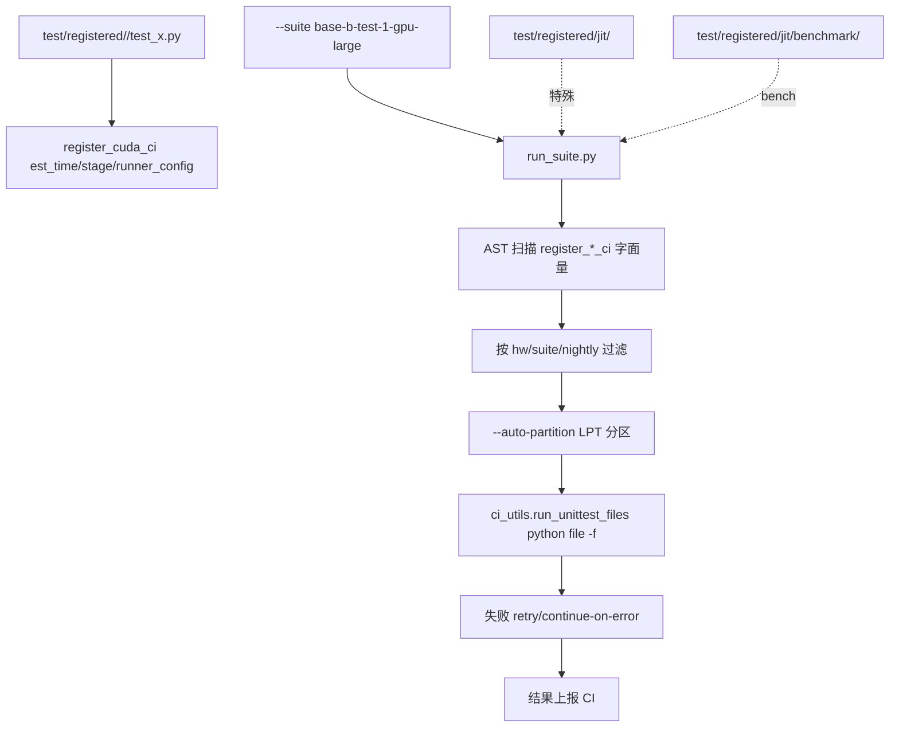

# 19.5 测试体系

## 定位

`test/` 是 SGLang CI 与本地测试的统一入口。`run_suite.py` 扫描 `registered/` 下用 `register_*_ci` 标记的测试文件（AST 静态解析），按 `base-{a,b,c}-test-{n}-gpu-{hw}` 套件组织，支持 LPT 自动分区与重试。本页是 `.claude/skills/write-sglang-test` 的代码侧落地。

## 职责

- `registered/`：CI 测试主目录，按子系统分子组（`core/`/`jit/`/`hicache/`/`srt/`...），`run_suite.py` 自动发现。
- `manual/`：非 CI、本地调试/特殊环境测试。
- `run_suite.py`：套件 runner — 收集/过滤/分区/执行，支持 `--hw`/`--suite`/`--nightly`/`--auto-partition`/`--continue-on-error`。
- `python/sglang/test/ci/ci_register.py`：`register_cuda_ci`/`register_cpu_ci` 等 AST 标记 + LPT 分区；要求字面量 `est_time`/`stage`/`runner_config`。
- `python/sglang/test/ci/ci_utils.py`：`run_unittest_files` 执行/retry/continue-on-error。
- `pytest.ini`：pytest 配置。
- `lm_eval_configs/`：lm-eval-harness 配置。
- 支持 unittest 与 pytest；文件须以 `unittest.main()` 或 `pytest.main([__file__])` 结尾（runner 追加 `-f` failfast）。

## 关键文件

| 文件 | 说明 |
|---|---|
| `test/README.md` | 测试与 CI 入门 |
| `test/run_suite.py` | 套件 runner，PER_COMMIT_SUITES/nightly 定义 |
| `test/pytest.ini` | pytest 配置 |
| `python/sglang/test/ci/ci_register.py` | `register_*_ci` AST 标记 + LPT |
| `python/sglang/test/ci/ci_utils.py` | `run_unittest_files` 执行器 |

## 子模块树

- `test/`
  - `README.md`/`run_suite.py`/`pytest.ini`
  - `registered/` — CI 测试（`core/`/`jit/`/`hicache/`/... + `jit/benchmark/`）
  - `manual/` — 非 CI 测试
  - `lm_eval_configs/` — lm-eval 配置

## 数据流 / 控制流

`run_suite.py` 静态解析每个 `test_*.py` 顶层的 `register_cuda_ci(...)` 调用，提取字面量 `stage`/`runner_config`/`est_time`（计算值会破坏 AST 收集），按 `{stage}-test-{runner_config}` 拼套件名。LPT 自动分区把长套件拆成多个并行 job。JIT 测试是"例外"——它们位于 `test/registered/jit/` 但由 `run_suite.py` 同一机制发现，bench 用 `marker` 框架（[15.8](../15-kernels-hardware/15.8-adding-kernels-skills.md)）。测试文件必须以标准 `unittest.main()`/`pytest.main()` 结尾，runner 追加 `-f` 开 failfast。

## 交叉引用

- 上游: [19.3 CI](19.3-ci-workflows.md) — `run_suite` 被 workflow 调用
- 上游: [`15.8 skills`](../15-kernels-hardware/15.8-adding-kernels-skills.md) — JIT 测试注册
- 相关 skill: `.claude/skills/write-sglang-test`、`ci-workflow-guide`
- 相关: [19.7 eval](19.7-eval-scripts.md) — `lm_eval_configs`

## 进一步阅读

- 入门: `test/README.md`
- runner: `test/run_suite.py`
- 注册: `python/sglang/test/ci/ci_register.py`
- skill: `.claude/skills/write-sglang-test/SKILL.md`
