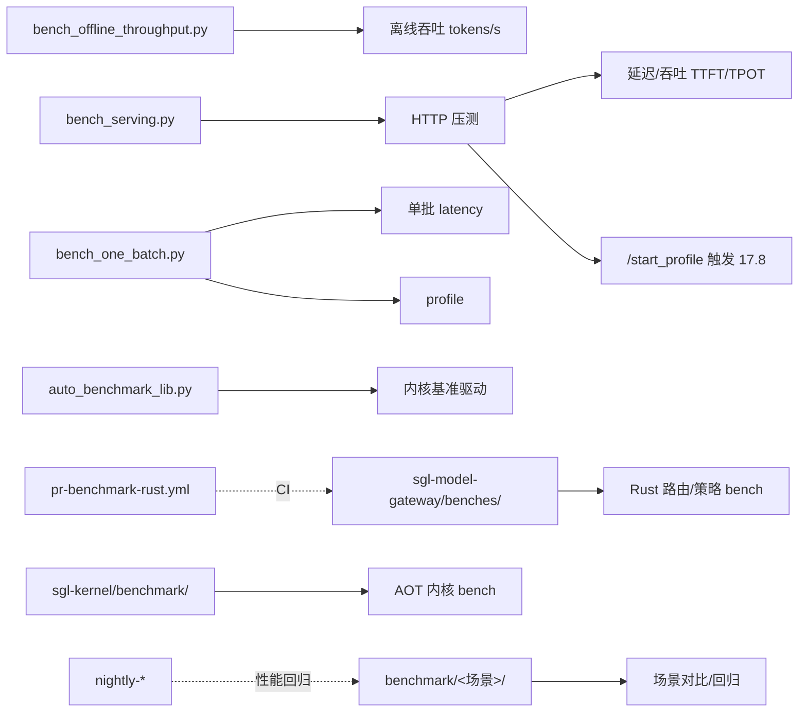

# 19.6 基准测试

## 定位

SGLang 基准脚本分两处：仓库根 `benchmark/` 是大量场景化/对比脚本集（覆盖 serving/attention/MoE/rope/io/json 等数十场景）；`python/sglang/bench_*.py` + `auto_benchmark_lib.py` 是包内携带的通用基准（离线吞吐、服务化延迟、单批、自动内核基准）。两者经 `pr-benchmark-rust.yml` 等在 CI 跑性能回归。

## 职责

- `python/sglang/bench_offline_throughput.py`：离线吞吐基准。
- `python/sglang/bench_serving.py`：服务化（HTTP）延迟/吞吐，含 `/start_profile`/`/stop_profile` 触发（[17.8](../17-observability-ops/17.8-profiling.md)）。
- `python/sglang/bench_one_batch.py`：单批 latency（含 `start_profile`/`stop_profile`）。
- `python/sglang/bench_one_batch_server.py`：服务化单批。
- `python/sglang/auto_benchmark_lib.py`：自动内核库基准驱动。
- `benchmark/`：场景集——`benchmark_batch/`/`benchmark_vllm_060/`/`blog_v0_2/`/`kernels/`/`deepseek_v3/`/`gpt_oss/`/`hicache/`/`llava_bench/`/`fla/`/`bench_attention_sink/`/`bench_linear_attention/`/`bench_rope/`/`bench_in_batch_prefix/`/`bench_pynccl_allocator/`/`json_schema/`/`json_decode_regex/`/`json_jump_forward/`/`long_json_decode/`/`line_retrieval/`/`gsm8k`/`cevil`/`hellaswag`/`boolq`/`dspy`/`generative_agents`/`io/`/`hf3fs`/`asr` 等。

## 关键文件

| 文件 | 说明 |
|---|---|
| `python/sglang/bench_offline_throughput.py` | 离线吞吐 |
| `python/sglang/bench_serving.py` | 服务化延迟/吞吐 + profile 触发 |
| `python/sglang/bench_one_batch.py` | 单批 latency + profile |
| `python/sglang/bench_one_batch_server.py` | 服务化单批 |
| `python/sglang/auto_benchmark_lib.py` | 自动内核基准驱动 |
| `benchmark/` | 场景化基准集 |
| `sgl-kernel/benchmark/bench_*.py` | sgl-kernel 专用 bench（`triton.testing`） |
| `python/sglang/benchmark/marker.py` | 旧 marker 框架（`bench_serving.py` 用） |

`bench_serving.py` 在 `:839`/`:916` 处理 `/start_profile`/`/stop_profile`，`:1446`/`:1533` 触发 profile，与 [17.8](../17-observability-ops/17.8-profiling.md) 端点对接。`benchmark/marker.py` 与 `sgl-model-gateway/benches/` 的 Rust bench 互补。

## 子模块树

- `python/sglang/bench_*.py` + `auto_benchmark_lib.py` + `benchmark/`
- `sgl-kernel/benchmark/`（见 [15.2](../15-kernels-hardware/15.2-sgl-kernel-aot.md)）
- `sgl-model-gateway/benches/`（见 [18.4](../18-gateway/18.4-routing-policies.md)）

## 基准流

`bench_serving.py` 是最常用：起服务、压 HTTP、采 TTFT/TPOT/吞吐，可触发 profile。`bench_offline_throughput.py` 直接离线跑吞吐。`benchmark/` 下场景脚本用于专项回归（如 `json_schema` 走 [11.5 受限解码](../11-sampling-control/11.5.1-constrained-base-registry.md)）。`auto_benchmark_lib.py` 驱动内核库自动基准。`sgl-kernel/benchmark/` 用 `triton.testing.perf_report`；JIT 用 `marker` 框架（[15.4](../15-kernels-hardware/15.4-jit-kernel.md)）；网关用 criterion（[18](../18-gateway/index.md) benches）。

## 交叉引用

- 上游: [19.3 CI](19.3-ci-workflows.md) — `pr-benchmark-rust`
- 相关: [`17.8 profiling`](../17-observability-ops/17.8-profiling.md) — `bench_serving` 触发 profile
- 相关: [`15.2 sgl-kernel`](../15-kernels-hardware/15.2-sgl-kernel-aot.md) / [`15.4 jit_kernel`](../15-kernels-hardware/15.4-jit-kernel.md) — 内核 bench
- 相关: [`18.4 policies`](../18-gateway/18.4-routing-policies.md) — 网关 bench

## 进一步阅读

- 服务化: `python/sglang/bench_serving.py`
- 单批: `python/sglang/bench_one_batch.py`
- 场景集: `benchmark/`
