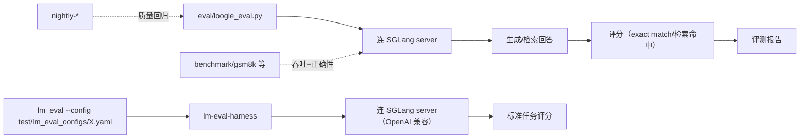

# 19.7 评测脚本

## 定位

`python/sglang/eval/` 提供离线任务评测脚本，用标准基准集衡量模型质量（而非吞吐延迟）。当前含 `loogle_eval.py`（长上下文检索）与 `llama3_eval.py`（LLama3 系列任务）。CI/本地可用 `test/lm_eval_configs/` 下的 lm-eval-harness 配置做更广覆盖。

## 职责

- `loogle_eval.py`：Loogle 长上下文检索基准，评估模型在长 input 中的needle检索能力。
- `llama3_eval.py`：LLama3 系列评测。
- 与 `benchmark/` 下任务集（`gsm8k`/`cevil`/`hellaswag`/`boolq`/`llava_bench` 等）互补——后者偏吞吐场景，本目录偏质量。
- `test/lm_eval_configs/`：lm-eval-harness YAML 配置，供 `lm_eval` 跑标准任务。

## 关键文件

| 文件 | 说明 |
|---|---|
| `python/sglang/eval/loogle_eval.py` | Loogle 长上下文检索评测 |
| `python/sglang/eval/llama3_eval.py` | LLama3 评测 |
| `test/lm_eval_configs/` | lm-eval-harness 配置 |

## 子模块树

- `python/sglang/eval/` — `loogle_eval.py`/`llama3_eval.py`
- `test/lm_eval_configs/` — lm-eval 配置

## 评测流

`loogle_eval.py`/`llama3_eval.py` 连 SGLang server 跑任务并评分；`lm_eval` 经 `test/lm_eval_configs/` 配置连 OpenAI 兼容端点跑标准任务集。质量评测与 `benchmark/` 吞吐基准互补，nightly 工作流按需触发质量回归。

## 交叉引用

- 上游: [`02.2.2 OpenAI 兼容`](../02-server-api/02.2.2-openai-compat.md) — 评测端点
- 相关: [19.6 基准测试](19.6-benchmarks.md) — `benchmark/` 任务集
- 相关: [19.5 测试体系](19.5-test-system.md) — `lm_eval_configs`
- 相关: [`12 多模态`](../12-multimodal/index.md) — `llava_bench`

## 进一步阅读

- 源: `python/sglang/eval/`
- 配置: `test/lm_eval_configs/`
