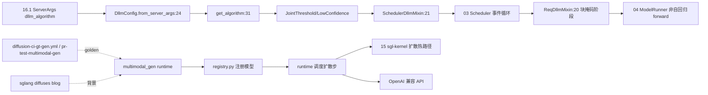

# 19.9 扩散/多模态生成

## 定位

SGLang 除 LLM 外还支持两类生成式负载：扩散 LLM（Diffusion LLM，`python/sglang/srt/dllm/`，用非自回归块掩码解码）与多模态图像/视频生成（`python/sglang/multimodal_gen/`，端到端扩散推理框架）。两者复用 SGLang 的 scheduler/runtime/内核基础设施，但有专属 config、algorithm、mixin 与 runtime。

## 职责

- `srt/dllm/`：
  - `config.py::DllmConfig`：algorithm/algorithm_config/block_size/mask_id/max_running_requests/first_done_first_out_mode；`from_server_args` 按 `architectures` 查 `DLLM_PARAMS`（LLaDA2Moe/SDAR/SDARMoe）。
  - `algorithm/`：`base.DllmAlgorithm`、`joint_threshold.JointThreshold`、`low_confidence.LowConfidence`；`get_algorithm(config)` 工厂。
  - `mixin/`：`req.ReqDllmMixin`/`ReqDllmPhase`、`scheduler.SchedulerDllmMixin`/`DllmManager`，把扩散 LLM 阶段接入 Scheduler。
- `python/sglang/multimodal_gen/`：
  - 端到端图像/视频扩散推理框架，支持 Wan/FastWan/FLUX/Qwen-Image/Z-Image/Ideogram4/Krea-2/Cosmos3/LTX-2/LingBot World/SANA-WM/JoyEcho/MOVA/GLM-Image/ERNIE-Image/Hunyuan3D 等。
  - `README.md`/`registry.py`/`runtime/`/`apps/`/`configs/`/`csrc/`/`envs.py`/`tools/`/`third_party/`/`benchmarks/`/`test/`。
  - 多平台：NVIDIA/AMD/Intel XPU/Ascend NPU/Apple MPS/Moore Threads MUSA。
  - OpenAI 兼容 API + CLI + Python SDK；用 `sgl-kernel` 优化内核、缓存加速、native 扩散热路径。

## 关键类与函数

| 名称 | 定义位置 | 说明 |
|---|---|---|
| `DllmConfig` | `python/sglang/srt/dllm/config.py:7` | 扩散 LLM 配置 |
| `DllmConfig.from_server_args` | `python/sglang/srt/dllm/config.py:24` | 由 ServerArgs 构造（查 `DLLM_PARAMS`） |
| `DllmAlgorithm` | `python/sglang/srt/dllm/algorithm/base.py:23` | 算法基类 |
| `get_algorithm` | `python/sglang/srt/dllm/algorithm/__init__.py:31` | 算法工厂 |
| `JointThreshold`/`LowConfidence` | `python/sglang/srt/dllm/algorithm/joint_threshold.py:12`/`low_confidence.py:10` | 算法实现 |
| `SchedulerDllmMixin`/`DllmManager` | `python/sglang/srt/dllm/mixin/scheduler.py:21`/`:362` | Scheduler 扩散 mixin |
| `ReqDllmMixin`/`ReqDllmPhase` | `python/sglang/srt/dllm/mixin/req.py:20`/`:13` | 请求扩散 mixin/阶段 |
| `multimodal_gen/registry.py` | `python/sglang/multimodal_gen/registry.py` | 视频/图像生成模型注册 |
| `multimodal_gen/runtime/` | `python/sglang/multimodal_gen/runtime/` | 扩散 runtime |

## 子模块树

- `python/sglang/srt/dllm/` — `config.py`/`algorithm/`/`mixin/`
- `python/sglang/multimodal_gen/` — `README.md`/`registry.py`/`runtime/`/`apps/`/`configs/`/`csrc/`/`envs.py`/`tools/`/`third_party/`/`benchmarks/`/`test/`/`utils.py`

## 数据流 / 控制流

扩散 LLM：`ServerArgs.dllm_algorithm` 经 `DllmConfig.from_server_args` 构造 config，`get_algorithm` 选算法，`SchedulerDllmMixin`/`ReqDllmMixin` 把块掩码阶段接入 Scheduler/请求生命周期，ModelRunner 执行非自回归 forward。多模态生成：`registry.py` 注册模型，`runtime/` 调度扩散步，用 `sgl-kernel` 热路径与缓存加速，暴露 OpenAI 兼容 API。CI 由 `diffusion-ci-gt-gen.yml`/`diffusion-ci-gt-gen-npu.yml`/`pr-test-multimodal-gen.yml` 跑 golden 测试。

## 交叉引用

- 上游: [`16.1 ServerArgs`](../16-config-runtime/16.1-server-args-port-args.md) — `dllm_algorithm` 字段
- 上游: [`03.4 Scheduler`](../03-orchestration/03.4.1-scheduler-structure.md) — `SchedulerDllmMixin`
- 下游: [`15.2 sgl-kernel`](../15-kernels-hardware/15.2-sgl-kernel-aot.md) — 扩散热路径内核
- 相关: [19.3 CI](19.3-ci-workflows.md) — `diffusion-ci-gt-gen`/`pr-test-multimodal-gen`
- 相关: [`12 多模态`](../12-multimodal/index.md) — 多模态输入对照（本页是输出侧生成）

## 进一步阅读

- 扩散 LLM: `python/sglang/srt/dllm/`
- 多模态生成: `python/sglang/multimodal_gen/README.md`
- config: `python/sglang/srt/dllm/config.py:7`
