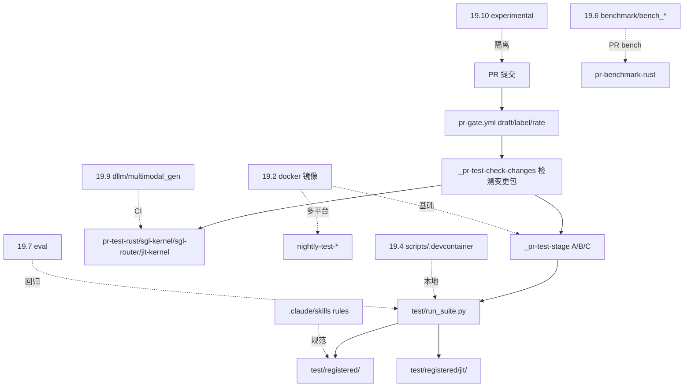

# 19 构建 CI 与开发

## 定位

子系统 19 覆盖 SGLang 仓库的构建、CI、测试、基准、评测、贡献约定与实验性代码。它把"如何把代码从 PR 跑到生产"的工程基础设施集中记录：Docker 镜像、GitHub Actions 工作流、开发脚本与 devcontainer、test 体系、benchmark/eval 脚本、`.claude/skills`+`.claude/rules`+pre-commit 约定、diffusion/多模态生成、experimental。本子系统与 [`00.2 仓库地图`](../00-overview/00.2-repo-map.md) 互补，侧重构建/CI 视角。

## 职责

- `docker/`：多平台镜像（CUDA/ROCm/NPU/XPU/MUSA/Xeon/ARM64/SageMaker/gateway/router/deep-gemm）+ compose + k8s。
- `.github/workflows/`：pr-test 三阶段 + kernel/rust/router/jit/multimodal-gen 专用 + nightly + bot。
- `develop/`、`scripts/`、`.devcontainer/`：开发辅助与容器化开发环境。
- `test/`：`registered/`/`manual/`/`run_suite.py`，`CustomTestCase`、server fixtures、模型选择、mock。
- `benchmark/` + `python/sglang/bench_*.py`/`auto_benchmark_lib.py`：吞吐/延迟/单批/服务化基准。
- `python/sglang/eval/`：loogle/llama3 评测。
- `.claude/skills`+`.claude/rules`+`.pre-commit-config.yaml`：贡献约定与守卫。
- `python/sglang/srt/dllm/` + `python/sglang/multimodal_gen/`：扩散 LLM 与图像/视频生成。
- `experimental/`：实验性 sgl-router 等。

## 子系统边界图

## 子系统内导航

| 编号 | 页面 | 一句话定位 |
|---|---|---|
| 19.1 | [仓库布局](19.1-repo-layout.md) | 构建/CI 视角的仓库结构 |
| 19.2 | [Docker](19.2-docker.md) | 多平台镜像与 k8s |
| 19.3 | [CI 工作流](19.3-ci-workflows.md) | pr-test 三阶段 + 专用 + nightly |
| 19.4 | [开发工具](19.4-dev-tools.md) | scripts/ + .devcontainer |
| 19.5 | [测试体系](19.5-test-system.md) | registered/manual + run_suite + CustomTestCase |
| 19.6 | [基准测试](19.6-benchmarks.md) | benchmark/ + bench_* |
| 19.7 | [评测脚本](19.7-eval-scripts.md) | loogle/llama3 eval |
| 19.8 | [贡献约定](19.8-contribution-conventions.md) | skills/rules/pre-commit |
| 19.9 | [扩散/多模态生成](19.9-diffusion-mm-gen.md) | dllm + multimodal_gen |
| 19.10 | [experimental](19.10-experimental.md) | 实验性 sgl-router 等 |

## 交叉引用

- 互补: [`00.2 仓库地图`](../00-overview/00.2-repo-map.md)
- 上游: [`15 内核`](../15-kernels-hardware/index.md) — sgl-kernel/jit CI；[`18 网关`](../18-gateway/index.md) — rust/router CI
- 相关 skill: `.claude/skills/ci-workflow-guide`、`write-sglang-test`、`sglang-bisect-ci-regression`、`sglang-cherrypick`

## 进一步阅读

- 测试说明: `test/README.md`
- CI skill: `.claude/skills/ci-workflow-guide/SKILL.md`
- 镜像: `docker/`
