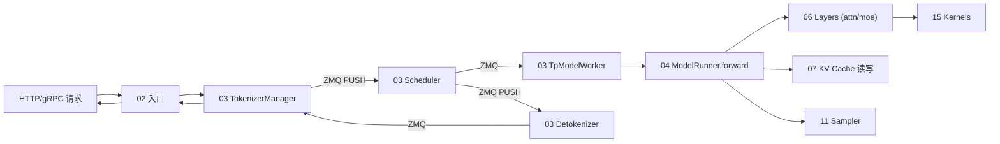
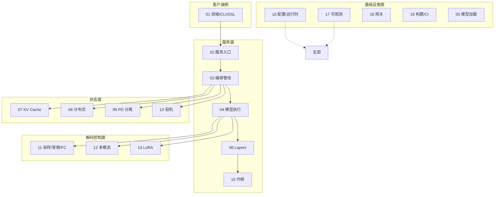

# 交叉引用矩阵

> 本页汇总 SGLang 各子系统之间的主要依赖关系，是叶子页"交叉引用"小节的宏观对照表。行=依赖方（源），列=被依赖方（目标）。`●`=强依赖（频繁调用/共享核心数据结构），`○`=弱依赖（边缘交互/可选）。

## 子系统依赖矩阵

| 源 \ 目 | 01 前端 | 02 入口 | 03 编排 | 04 执行 | 05 加载 | 06 Layers | 07 KV | 08 分布式 | 09 分离 | 10 投机 | 11 采样 | 12 MM | 13 LoRA | 15 内核 | 16 配置 | 17 观测 | 18 网关 |
|---|---|---|---|---|---|---|---|---|---|---|---|---|---|---|---|---|---|
| 01 前端 | — | ● | ○ | | | | | | | | | | | | ● | | |
| 02 入口 | | — | ● | | | | | | ● | | ○ | | | | | ● | ○ |
| 03 编排 | | ● | — | ● | | | ● | ● | ● | ● | ● | ○ | ● | | ● | ● | |
| 04 执行 | | | ● | — | ● | ● | ● | ● | ○ | ● | ● | ○ | ● | ● | ● | ● | |
| 05 加载 | | | ○ | ● | — | ● | ○ | ● | ● | | | | | ● | ● | | |
| 06 Layers | | | ○ | ● | | — | ● | ● | | ○ | ● | | ● | ● | ● | | |
| 07 KV | | | ● | ○ | | ● | — | ● | ● | ● | | | | | ● | ○ | |
| 08 分布式 | | | ○ | ○ | ○ | ○ | ○ | — | ● | | | | | ● | ● | ○ | |
| 09 分离 | | ○ | ● | ○ | ○ | | ● | ● | — | | | | | ● | ● | ○ | |
| 10 投机 | | | ● | ● | | ○ | ● | | | — | ● | | | | ● | | |
| 11 采样 | | ○ | ● | ● | | ● | | ○ | | ● | — | | | ● | ● | | |
| 12 MM | | | ● | ○ | | ○ | | | ○ | | | — | | | ● | | |
| 13 LoRA | | | ● | ● | | ● | | | | | | | — | ● | ● | | |
| 15 内核 | | | | ● | | ● | ○ | ● | ● | ○ | ○ | | | — | ● | | |
| 16 配置 | ● | ● | ● | ● | ● | ● | ● | ● | ● | ● | ● | ● | ● | ● | — | ● | |
| 17 观测 | | ○ | ● | ○ | | ○ | ○ | ○ | ○ | ○ | | | ○ | | ● | — | ○ |
| 18 网关 | | ● | ○ | | | | | | ● | | ○ | | | | | ○ | — |

## 核心数据流路径

### 请求推理主路径（写请求 → 返回 token）

### 跨子系统关键耦合点

| 耦合点 | 涉及子系统 | 说明 |
|---|---|---|
| `ScheduleBatch` / `Req` | 03 ↔ 04 ↔ 11 | 调度批与请求状态是整条管线的共享词汇 |
| `ForwardBatch` / `ForwardContext` | 03 ↔ 04 ↔ 06 | 每次 forward 的 GPU 张量与控制上下文 |
| KV 内存池 `TokenToKVPool` | 03 ↔ 04 ↔ 06 ↔ 07 | 注意力后端与调度器共同持有 |
| `parallel_state` GroupCoordinator | 04 ↔ 06 ↔ 07 ↔ 08 | 所有并行组访问的唯一入口 |
| `io_struct` 消息族 | 02 ↔ 03 | 跨进程 IPC 契约 |
| `ServerArgs` / `RuntimeContext` | 全部 ↔ 16 | 配置与运行时状态的总源 |
| RadixCache 树 | 03 ↔ 07 ↔ 10 | 调度器准入、缓存淘汰、投机分配共同操作 |
| Grammar / Sampler mask | 03 ↔ 11 ↔ 06 | 受限解码与采样在 logits 上交汇 |

## 子系统边界图

