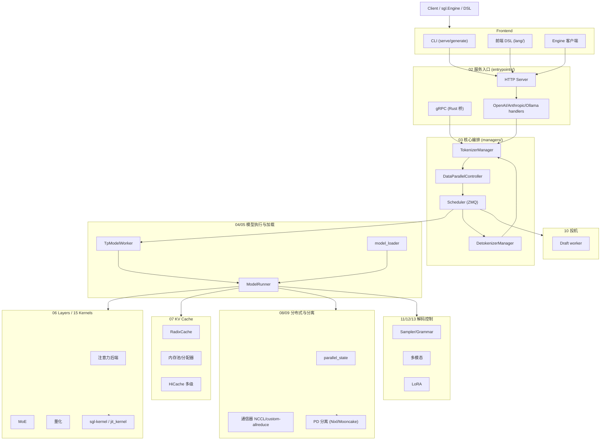

# SGLang 架构 Wiki

> 本 Wiki 按**树形拓扑**梳理 SGLang 系统架构：顶层划分为 20 个子系统（00–19），每个子系统下含子模块与叶子页，页与页之间通过交叉引用链接，形成可导航的知识网络。

SGLang 是一个面向大语言模型与多模态模型的高性能推理服务框架，从单卡到大规模分布式集群均可提供低延迟、高吞吐的推理能力。其核心特性包括 RadixAttention 前缀缓存、零开销 CPU 调度器、Prefill-Decode 分离、投机解码、连续批处理、Paged Attention、张量/流水/专家/数据并行、结构化输出、分块 prefill、量化（FP4/FP8/INT4/AWQ/GPTQ）以及多 LoRA 批处理。

## 如何阅读本 Wiki

- 想快速建立全局认识：先读 [00 总览](00-overview/index.md)，尤其是 [架构一图流](00-overview/00.3-architecture-overview.md) 与 [进程与线程模型](00-overview/00.4-process-model.md)。
- 想理解一个请求如何流经系统：从 [02 服务入口](02-server-api/index.md) → [03 核心调度与编排](03-orchestration/index.md) → [04 模型执行](04-model-execution/index.md)。
- 想理解一次 forward 在 GPU 上发生什么：[04 模型执行](04-model-execution/index.md) → [06 Layers](06-layers/index.md) → [15 内核与硬件](15-kernels-hardware/index.md)。
- 想查跨子系统依赖：直接看 [交叉引用矩阵](cross-references.md)。

## 子系统导览

| # | 子系统 | 一句话定位 |
|---|---|---|
| 00 | [总览](00-overview/index.md) | 系统全貌、仓库地图、术语表 |
| 01 | [前端与客户端层](01-frontend/index.md) | SGLang DSL、CLI、Engine 客户端 API |
| 02 | [服务入口与 API](02-server-api/index.md) | HTTP/gRPC/OpenAI 等协议入口与请求生命周期 |
| 03 | [核心调度与编排](03-orchestration/index.md) | TokenizerManager↔Scheduler↔TpWorker↔Detokenizer 管线 |
| 04 | [模型执行](04-model-execution/index.md) | ModelRunner、forward、cuda graph |
| 05 | [模型加载与注册](05-model-loading/index.md) | 权重下载/加载、模型注册 |
| 06 | [Layers](06-layers/index.md) | 注意力/MoE/量化/线性等 nn.Module 构件 |
| 07 | [KV Cache 与内存管理](07-kv-cache/index.md) | RadixAttention 缓存、内存池、HiCache 多级存储 |
| 08 | [分布式与并行](08-distributed/index.md) | TP/PP/DP/EP/CP 及通信器 |
| 09 | [分离式推理](09-disaggregation/index.md) | PD 分离与 KV 跨进程传输 |
| 10 | [投机解码](10-speculative/index.md) | EAGLE/DFlash/Spec V2/N-gram/MTP |
| 11 | [采样与解码控制](11-sampling-control/index.md) | 采样、受限解码、parser、function call |
| 12 | [多模态](12-multimodal/index.md) | 图像/视频/音频输入处理 |
| 13 | [LoRA 与适配器](13-lora/index.md) | 多 LoRA 服务 |
| 14 | [会话状态检查点](14-session-state/index.md) | session、状态捕获、在线权重更新 |
| 15 | [内核与硬件后端](15-kernels-hardware/index.md) | sgl-kernel/jit_kernel/platforms |
| 16 | [配置与运行时上下文](16-config-runtime/index.md) | ServerArgs、RuntimeContext、env、plugins |
| 17 | [可观测性与运维](17-observability-ops/index.md) | metrics/tracing/debug/profiling |
| 18 | [模型网关与代理](18-gateway/index.md) | Rust 模型网关与进程内 gRPC |
| 19 | [构建 CI 与开发](19-build-ci-dev/index.md) | Docker/CI/测试/基准/贡献约定 |

## 架构总览

详细路径与跨子系统依赖见 [交叉引用矩阵](cross-references.md)。

## 本 Wiki 的组织原则

- 每叶子页统一含：定位 / 职责 / 关键类与函数（`file:line`）/ 子模块树 / 数据流或控制流（Mermaid）/ 交叉引用 / 进一步阅读。
- 编号采用 `NN.M`（子系统.模块）格式，便于定位与引用。
- 所有跨页引用使用相对路径链接，可在本地用 `mkdocs serve` 渲染，也可在 GitHub 直接浏览。
